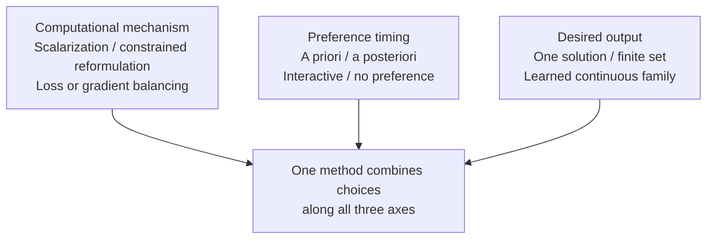

# Introduction to Multi-objective Optimization: Pareto Optimality and Stationarity

In single-objective optimization, we compare two feasible solutions by their values of one function. With several objectives, one solution may improve one criterion and worsen another. Multi-objective optimization (MOO) therefore needs a notion of improvement that does not collapse all objectives into one number at the outset.

Let $X\subseteq\mathbb R^d$ be a nonempty feasible set, and let $f_s:X\to\mathbb R$ be the objective indexed by $s\in[S]=\{1,\ldots,S\}$. We consider minimization of the vector-valued function
$$
\min_{\mathbf{x}\in X}\mathbf{F}(\mathbf{x}),
\qquad
\mathbf{F}(\mathbf{x})=\bigl(f_1(\mathbf{x}),\ldots,f_S(\mathbf{x})\bigr)^\top.
\tag{1}
$$
^eq-moo-model

**Notation.** $S$ is the number of objectives and $d$ the number of model parameters. Bold lowercase symbols denote vectors, such as $\mathbf{x}\in\mathbb{R}^d$ and $\mathbf{w}\in\Delta_S$; $w_s$ is a scalar component. The vector-valued objective is $\mathbf{F}$, the gradient matrix is $G(\mathbf{x})\in\mathbb{R}^{d\times S}$, and the model step size is $\eta_t>0$. In one-dimensional examples, $x\in\mathbb{R}$ denotes the scalar coordinate of $\mathbf{x}$; for two objectives, $w\in[0,1]$ represents the weight vector $(w,1-w)^\top$.

The notation $\min \mathbf{F}(\mathbf{x})$ does not assert that the vectors $\mathbf{F}(\mathbf{x})$ have a total order. It asks which feasible decisions cannot be improved in one objective without a loss in another. Treatments of this viewpoint include [Ehrgott (2005)](https://doi.org/10.1007/3-540-27659-9) [\[1\]](#^ref-ehrgott-2005) and [Miettinen (1999)](https://doi.org/10.1007/978-1-4615-5563-6) [\[2\]](#^ref-miettinen-1999).

:::danger

*Q: If no feasible point minimizes every objective, what does it mean for a solution to be optimal?*

:::

## Dominance and Pareto optimality

For two feasible decisions $\mathbf{x},\mathbf{y}\in X$, we say that **$\mathbf{y}$ dominates $\mathbf{x}$** if
$$
f_s(\mathbf{y})\leq f_s(\mathbf{x})\quad\text{for every }s\in[S],
\qquad
f_j(\mathbf{y})<f_j(\mathbf{x})\quad\text{for at least one }j\in[S].
\tag{2}
$$
^eq-dominance

The first condition says that $\mathbf{y}$ is no worse in any objective; the second says that it is better in at least one. A feasible point $\mathbf{x}^\star$ is **Pareto optimal**, also called **efficient**, if no feasible point dominates it. Pareto optimality is a global property: checking it requires comparison with *all* of $X$.

A weaker notion excludes only a simultaneous *strict* improvement. A point $\mathbf{x}^\star$ is **weakly Pareto optimal** if there is no $\mathbf{y}\in X$ such that $f_s(\mathbf{y})<f_s(\mathbf{x}^\star)$ for every $s\in[S]$. Every Pareto-optimal point is weakly Pareto optimal, but the converse need not hold. For instance, if $X=\{a,b\}$ with $\mathbf{F}(a)=(0,1)^\top$ and $\mathbf{F}(b)=(0,0)^\top$, then $a$ is weakly Pareto optimal: $b$ does not strictly improve the first objective. Yet $b$ dominates $a$, so $a$ is not Pareto optimal.

The **Pareto set** contains the efficient decisions, whereas the **Pareto front** contains their objective vectors:
$$
\mathcal P=\{\mathbf{x}\in X:\mathbf{x}\text{ is Pareto optimal}\},
\qquad
\mathbf{F}(\mathcal P)=\{\mathbf{F}(\mathbf{x}):\mathbf{x}\in\mathcal P\}.
\tag{3}
$$
^eq-pareto-set-front

This distinction matters when two different decisions have the same objective vector. They are different points in decision space but correspond to one point on the front. If dominance comparisons are restricted to a neighborhood of $\mathbf{x}^\star$, we obtain *local* Pareto optimality. Local and global claims should not be interchanged.

### A two-objective example

Consider $d=1$, $X=\mathbb R$, and $f_1(x)=(x+1)^2$, $f_2(x)=(x-1)^2$. The first objective is minimized at $x=-1$; the second at $x=1$. Every $x\in[-1,1]$ is Pareto optimal. Moving right within that interval worsens $f_1$ but improves $f_2$, and moving left does the reverse. A point $x<-1$ is dominated by $-1$, while a point $x>1$ is dominated by $1$. Hence
$$
\mathcal P=[-1,1],
\qquad
\mathbf{F}(\mathcal P)=\bigl\{((x+1)^2,(x-1)^2)^\top:x\in[-1,1]\bigr\}.
$$
This example has many optimal *trade-offs*, although neither objective has more than one individual minimizer. MOO can describe the entire set of trade-offs; choosing one of them may require a preference supplied by the decision maker.

## Scalarization: choosing a trade-off

A **scalarization** replaces the vector problem with a parameterized single-objective problem. The simplest choice is the weighted sum. Let $\Delta_S=\{\mathbf{w}\in\mathbb R^S:w_s\geq0\text{ for all }s\in[S],\ \sum_{s\in[S]}w_s=1\}$. For a chosen $\mathbf{w}\in\Delta_S$, solve
$$
\min_{\mathbf{x}\in X}\ \sum_{s\in[S]}w_s f_s(\mathbf{x}).
\tag{4}
$$
^eq-weighted-sum

The weights encode a preference or a choice of units; they are fixed *before* solving this problem. This differs from MGDA weights, which are recomputed from current gradients at each iteration. The basic guarantee is useful, but the distinction between positive and zero weights matters.

:::success

**Proposition 1 (What a weighted sum guarantees).**

Suppose $\mathbf{x}^\star$ is a global minimizer of [[#^eq-weighted-sum|(4)]] for some $\mathbf{w}\in\Delta_S$. Then $\mathbf{x}^\star$ is weakly Pareto optimal. If every weight is strictly positive, $w_s>0$ for all $s\in[S]$, then $\mathbf{x}^\star$ is Pareto optimal.

:::

**Proof of Proposition 1.** If a feasible $\mathbf{y}$ strictly improved every objective, then at least one weight is positive and $\sum_{s\in[S]}w_s f_s(\mathbf{y})<\sum_{s\in[S]}w_s f_s(\mathbf{x}^\star)$, contradicting global optimality. Thus $\mathbf{x}^\star$ is weakly Pareto optimal. If all weights are positive and $\mathbf{y}$ dominates $\mathbf{x}^\star$, every weighted objective difference is nonpositive and at least one is negative. The same contradiction shows that $\mathbf{x}^\star$ is Pareto optimal. &#9633;

In the quadratic example above, assigning weight $w$ to $f_1$ and $1-w$ to $f_2$ gives the unique minimizer $x_w=1-2w$. As $w$ runs from $0$ to $1$, weighted sums recover the entire Pareto set $[-1,1]$. This completeness does not hold for every problem.

For a simple counterexample, take a finite feasible set with three objective vectors
$$
\mathbf{F}(a)=(0,2)^\top,\qquad \mathbf{F}(b)=(3/2,3/2)^\top,\qquad \mathbf{F}(c)=(2,0)^\top.
$$
All three are Pareto optimal: each improves one coordinate relative to at least one of the others. Yet $b$ never minimizes a weighted sum. With weights $(w,1-w)$, its scalarized value is $3/2$, while the smaller value of $a$ and $c$ is $\min\{2(1-w),2w\}\leq1$ for every $w\in[0,1]$. The point $b$ is an **unsupported** efficient solution. Weighted sums recover supported points; on a nonconvex front they can miss trade-offs altogether. Under suitable convexity and closedness conditions on the upper objective image $\mathbf{F}(X)+\mathbb R_+^S$, supporting-hyperplane arguments give converse results for weakly efficient objective vectors [Ehrgott (2005)](https://doi.org/10.1007/3-540-27659-9) [\[1\]](#^ref-ehrgott-2005).

## Pareto stationarity: a first-order target

Global dominance is difficult to test during a gradient-based algorithm. For differentiable objectives and the unconstrained case $X=\mathbb R^d$, a more accessible target is *Pareto stationarity*. At a point $\mathbf{x}$, write $\mathbf{g}_s=\nabla f_s(\mathbf{x})$. A direction $\mathbf{v}\in\mathbb R^d$ is a **common first-order descent direction** if $\mathbf{g}_s^\top \mathbf{v}<0$ for every $s\in[S]$. We call $\mathbf{x}$ **Pareto stationary** if no such direction exists.

:::success

**Proposition 2 (The minimum-norm stationarity certificate).**

For differentiable $f_s:\mathbb R^d\to\mathbb R$, the following are equivalent at $\mathbf{x}$:

**(i)** There is no common first-order descent direction at $\mathbf{x}$.

**(ii)** $0$ belongs to the convex hull of the gradients $\{\mathbf{g}_s:s\in[S]\}$.

**(iii)** The minimum-norm convex combination of the gradients has norm zero:
$$
\min_{\mathbf{w}\in\Delta_S}\left\|\sum_{s\in[S]}w_s \mathbf{g}_s\right\|=0.
\tag{5}
$$
^eq-stationarity-certificate

:::

**Proof of Proposition 2.** Conditions (ii) and (iii) are equivalent because the gradient convex hull is the compact set $\{\sum_{s\in[S]}w_s \mathbf{g}_s:\mathbf{w}\in\Delta_S\}$. If $0=\sum_s w_s \mathbf{g}_s$, a direction with $\mathbf{g}_s^\top \mathbf{v}<0$ for every $s$ would give $0=\sum_s w_s \mathbf{g}_s^\top \mathbf{v}<0$, a contradiction. Conversely, suppose $0$ is outside the gradient convex hull $C$. Let $\mathbf{u}$ be the nonzero projection of $0$ onto $C$. Projection optimality gives $\mathbf{u}^\top(\mathbf{g}_s-\mathbf{u})\geq0$ for every $s$, so $\mathbf{v}=-\mathbf{u}$ satisfies $\mathbf{g}_s^\top \mathbf{v}\leq-\|\mathbf{u}\|^2<0$ for every $s$. Thus (i) implies (ii). &#9633;

This is the gradient version of Gordan's theorem of alternatives; see [Bertsekas (2009, Section 5.6)](https://faculty.engineering.asu.edu/bertsekas/wp-content/uploads/sites/129/2019/10/Convex_Theory_Entire_Book.pdf) [\[3\]](#^ref-bertsekas-2009). It motivates the squared Pareto-stationarity measure
$$
R(\mathbf{x}):=\min_{\mathbf{w}\in\Delta_S}\left\|\sum_{s\in[S]}w_s\nabla f_s(\mathbf{x})\right\|^2,
\qquad
R(\mathbf{x})=0\ \Longleftrightarrow\ \mathbf{x}\text{ is Pareto stationary}.
\tag{6}
$$
^eq-ps-measure

A local Pareto optimum must be Pareto stationary in the unconstrained differentiable setting: a common strict descent direction would decrease every objective for a sufficiently small step. The converse is false. For the scalar objectives $f_1(x)=-x^2$ and $f_2(x)=-2x^2$, the point $x=0$ is Pareto stationary because both gradients vanish there, but every nearby nonzero point improves both objectives. For constrained problems, first-order statements must use *feasible* directions or an appropriate tangent cone; [[#^eq-stationarity-certificate|(5)]] is the unconstrained characterization.

## Categories of multi-objective methods

MOO methods can be classified by **how they compute solutions**, **when preferences enter**, and **what they return**. These are different axes, so scalarization, constrained reformulations, gradient manipulation, and preference guidance do not form disjoint categories. The following overview combines the classical treatments of [Ehrgott (2005, Chapters 3–4)](https://doi.org/10.1007/3-540-27659-9) [\[1\]](#^ref-ehrgott-2005) and [Miettinen (1999, Part II)](https://users.jyu.fi/~miettine/book/index.html) [\[2\]](#^ref-miettinen-1999) with the deep-learning taxonomy of [Chen et al. (2025, Sections 3–5)](https://arxiv.org/html/2501.10945v3) [\[6\]](#^ref-chen-2025-survey).

### Scalarization and constrained reformulations

**Scalarization** reduces the vector problem to a parameterized scalar optimization problem. Besides the weighted sum in [[#^eq-weighted-sum|(4)]], a common choice is weighted Tchebycheff scalarization,
$$
\min_{\mathbf{x}\in X}\ \max_{s\in[S]}w_s\bigl(f_s(\mathbf{x})-z_s^{\mathrm{ref}}\bigr),
$$
where $\mathbf{z}^{\mathrm{ref}}$ is a reference objective vector. Such reference-point constructions can reach unsupported trade-offs that weighted sums miss, under appropriate choices of the reference point and weights. Reference points, weights, and objective scaling determine which trade-off is sought [Ehrgott (2005, Chapter 4)](https://doi.org/10.1007/3-540-27659-9_4) [\[1\]](#^ref-ehrgott-2005).

**Constrained reformulations** encode objective bounds or objective-space geometry through additional constraints. The **$\varepsilon$-constraint method** selects an objective $k$ and solves
$$
\min_{\mathbf{x}\in X}\ f_k(\mathbf{x})
\qquad\text{subject to}\qquad
f_s(\mathbf{x})\leq\varepsilon_s,\quad s\neq k.
$$
The thresholds may express acceptable performance levels or be swept to generate trade-offs. Every Pareto-optimal $\mathbf{x}^\star$ solves such a problem with $\varepsilon_s=f_s(\mathbf{x}^\star)$: a feasible point with a smaller $f_k$ would dominate it. A global minimizer is weakly Pareto optimal; excluding dominated ties requires additional care [Miettinen (1999, Part II, Section 3.2)](https://users.jyu.fi/~miettine/book/index.html) [\[2\]](#^ref-miettinen-1999).

**Normal-boundary intersection (NBI)** instead constructs a reference simplex from individual-objective minimizers and solves constrained subproblems that extend from points on this simplex toward the objective-space boundary along a normal direction. Varying the simplex coordinates aims to spread the resulting trade-offs across the front [Das and Dennis (1998)](https://doi.org/10.1137/S1052623496307510) [\[7\]](#^ref-das-dennis-1998). NBI is a front-generation construction, rather than an objective-threshold rule. In the broad sense of reduction to a scalar optimization problem, both NBI and $\varepsilon$-constraint are also scalarizations; “constrained” describes their formulation, not a separate class of feasible sets $X$.

### Gradient weighting and manipulation in multi-task learning

In multi-task learning, each task loss is an objective, and the gradients with respect to shared parameters can conflict. The overview below follows Part IV of the [AAAI 2024 tutorial, slides 138–164 and references on slides 195–198](https://lisha-chen.github.io/www/files/tutorial/aaai2024_tut.pdf#page=138) [\[26\]](#^ref-chen-2024-tutorial), with formulas and distinctions checked against the original papers. The survey separates **loss balancing** from **gradient balancing**, and subdivides gradient balancing into **gradient weighting** and **gradient manipulation** [Chen et al. (2025, Sections 3.1–3.2)](https://arxiv.org/html/2501.10945v3) [\[6\]](#^ref-chen-2025-survey). These mechanisms overlap: an algorithm motivated as gradient manipulation may ultimately produce a weighted combination of the original gradients.

We use the notation already introduced above. At a fixed $\mathbf{x}\in\mathbb R^d$, let
$$
\mathbf{g}_s=\nabla f_s(\mathbf{x}),\qquad
G=G(\mathbf{x})=[\mathbf{g}_1,\ldots,\mathbf{g}_S]\in\mathbb R^{d\times S},\qquad
\mathbf{g}_0=\frac1S\sum_{s\in[S]}\mathbf{g}_s,\qquad
f_0(\mathbf{x})=\frac1S\sum_{s\in[S]}f_s(\mathbf{x}).
$$
Here $\mathbf{g}_0=\nabla f_0(\mathbf{x})$ is the **average gradient**, not a zeroth task. Every method below uses the update convention
$$
\mathbf{x}_{t+1}=\mathbf{x}_t+\eta_t \mathbf{d}_t,\qquad \eta_t>0.
$$
Thus $\mathbf{d}$ is the direction actually added to $\mathbf{x}$, and $-\mathbf{d}$ is the gradient-like vector shown in the figure. Pairwise conflict means $\mathbf{g}_i^\top \mathbf{g}_j<0$; common first-order descent requires the stronger condition $\mathbf{g}_s^\top \mathbf{d}<0$ for **every** $s\in[S]$. The formulas describe unconstrained updates of the shared parameters using exact gradients; stochastic estimates require separate analysis.

**MGDA: choose a minimum-norm combination.** MGDA computes
$$
\mathbf{w}^{\mathrm{MGDA}}\in\operatorname*{argmin}_{\mathbf{w}\in\Delta_S}\|G\mathbf{w}\|^2,
\qquad
\mathbf{d}_{\mathrm{MGDA}}=-G\mathbf{w}^{\mathrm{MGDA}}.
$$
When $\mathbf{d}_{\mathrm{MGDA}}\neq0$, projection optimality gives $\mathbf{g}_s^\top \mathbf{d}_{\mathrm{MGDA}}\leq-\|\mathbf{d}_{\mathrm{MGDA}}\|^2<0$ for every $s$. This links the update directly to the stationarity certificate in [[#^eq-stationarity-certificate|(5)]] [Désidéri (2012)](https://doi.org/10.1016/j.crma.2012.03.014) [\[5\]](#^ref-desideri-2012). [Sener and Koltun (2018)](https://proceedings.neurips.cc/paper/2018/hash/432aca3a1e345e339f35a30c8f65edce-Abstract.html) [\[27\]](#^ref-sener-2018) brought this viewpoint to deep multi-task learning and proposed an efficient shared-representation approximation. Complexity results for exact multiobjective gradient descent are given by [Fliege et al. (2019)](https://doi.org/10.1080/10556788.2018.1510928) [\[42\]](#^ref-fliege-2019-complexity).

**CAGrad: control departure from the average gradient.** Conflict-Averse Gradient Descent chooses the direction with the best worst-task first-order improvement inside a ball around $-\mathbf{g}_0$ [Liu et al. (2021)](https://proceedings.neurips.cc/paper_files/paper/2021/hash/9d27fdf2477ffbff837d73ef7ae23db9-Abstract.html) [\[28\]](#^ref-liu-2021-cagrad):
$$
\mathbf{d}_{\mathrm{CA}}\in\operatorname*{argmax}_{\mathbf{v}\in\mathbb R^d}
\min_{s\in[S]}\bigl(-\mathbf{g}_s^\top \mathbf{v}\bigr)
\qquad\text{subject to}\qquad
\|\mathbf{v}+\mathbf{g}_0\|\leq c\|\mathbf{g}_0\|.
$$
For $c>0$, write $\mathbf{g}_{\mathbf{w}}=G\mathbf{w}$. The corresponding weight problem and direction are
$$
\mathbf{w}^{\mathrm{CA}}\in\operatorname*{argmin}_{\mathbf{w}\in\Delta_S}
\left\{\mathbf{g}_0^\top \mathbf{g}_{\mathbf{w}}+c\|\mathbf{g}_0\|\,\|\mathbf{g}_{\mathbf{w}}\|\right\},
\qquad
\mathbf{d}_{\mathrm{CA}}=-\mathbf{g}_0-c\|\mathbf{g}_0\|\frac{\mathbf{g}_{\mathbf{w}^{\mathrm{CA}}}}{\|\mathbf{g}_{\mathbf{w}^{\mathrm{CA}}}\|},
$$
where the direction formula applies when $\mathbf{g}_{\mathbf{w}^{\mathrm{CA}}}\neq0$; degenerate cases can be handled through the primal problem. For $c=0$, $\mathbf{d}_{\mathrm{CA}}=-\mathbf{g}_0$. The normalization factor in the second term is needed to satisfy the ball constraint. When $0\leq c<1$ and $\mathbf{g}_0\neq0$, every feasible $\mathbf{v}$ satisfies $\mathbf{g}_0^\top \mathbf{v}\leq-(1-c)\|\mathbf{g}_0\|^2<0$. CAGrad therefore preserves descent of the **average** objective, while improving the worst-task linear prediction within that neighborhood; it need not decrease every individual objective. Its nonconvex convergence guarantee concerns stationarity of the average loss under the paper's smoothness, lower-bound, and step-size assumptions.

Black arrows are $\mathbf{g}_1=\nabla f_1(\mathbf{x})$ and $\mathbf{g}_2=\nabla f_2(\mathbf{x})$; the dashed segment is their convex hull. The blue arrow ends at $\mathbf{g}_0=(\mathbf{g}_1+\mathbf{g}_2)/2$, and the dashed circle bounds $\{\mathbf{u}:\|\mathbf{u}-\mathbf{g}_0\|\leq c\|\mathbf{g}_0\|\}$. The red arrow is $-\mathbf{d}_{\mathrm{CA}}$, so the actual parameter update points in the opposite direction. Redrawn from the tutorial's CAGrad illustration (slide 145) [\[26\]](#^ref-chen-2024-tutorial), using this note's notation. [Vector version](assets/cagrad-manipulation.svg).

**PCGrad: remove conflicting components before aggregation.** Projecting Conflicting Gradients starts with $\widetilde{\mathbf{g}}_s\leftarrow \mathbf{g}_s$. For each task $s$, it visits the other tasks $j\neq s$ in a random order and, only if $\widetilde{\mathbf{g}}_s^\top \mathbf{g}_j<0$, performs
$$
\widetilde{\mathbf{g}}_s\leftarrow
\widetilde{\mathbf{g}}_s-
\frac{\widetilde{\mathbf{g}}_s^\top \mathbf{g}_j}{\|\mathbf{g}_j\|^2}\,\mathbf{g}_j.
$$
The comparison uses the current modified gradient $\widetilde{\mathbf{g}}_s$ and the other task's original gradient $\mathbf{g}_j$; zero $\mathbf{g}_j$ can be skipped. The update is $\mathbf{d}_{\mathrm{PC}}=-\sum_{s\in[S]}\widetilde{\mathbf{g}}_s$ [Yu et al. (2020)](https://arxiv.org/abs/2001.06782) [\[8\]](#^ref-yu-2020-pcgrad). Averaging instead of summing changes only the overall scale, which can be absorbed into $\eta_t$. For a conflicting pair, this projection removes the component opposed to $\mathbf{g}_j$. With more than two tasks, later projections can reintroduce earlier conflicts, so pairwise surgery does not give MGDA's general common-descent certificate.

**Nash-MTL: choose weights through bargaining.** Nash-MTL treats each task's predicted improvement as a utility in a bargaining problem [Navon et al. (2022)](https://proceedings.mlr.press/v162/navon22a.html) [\[29\]](#^ref-navon-2022-nash). Under its nonstationary, linearly independent-gradient setting, a representative direction satisfies
$$
G^\top G\,\boldsymbol{\alpha}=1/\boldsymbol{\alpha},\qquad \boldsymbol{\alpha}\in\mathbb R_{++}^S,
\qquad \mathbf{d}_{\mathrm{Nash}}=-G\boldsymbol{\alpha},
$$
where $1/\boldsymbol{\alpha}$ is the elementwise reciprocal. These positive coefficients are **not** constrained to $\Delta_S$. In particular, $\mathbf{g}_s^\top \mathbf{d}_{\mathrm{Nash}}=-1/\alpha_s<0$. The bargaining construction is invariant to positive rescaling of individual objectives; its assumptions and treatment of stationarity should accompany this property.

  <strong>Figure 2:</strong> Comparison of GD, MGDA, PCGrad, and CAGrad for two conflicting task gradients.

Adapted from [Liu et al. (2021, Figure 2)](https://proceedings.neurips.cc/paper_files/paper/2021/file/9d27fdf2477ffbff837d73ef7ae23db9-Paper.pdf) [\[28\]](#^ref-liu-2021-cagrad). Black arrows are the task gradients $\mathbf{g}_1$ and $\mathbf{g}_2$; red arrows show $-\mathbf{d}$, consistently with the update $\mathbf{x}_{t+1}=\mathbf{x}_t+\eta_t\mathbf{d}_t$. Gray dashed arrows in the PCGrad panel are the projected gradients. In the CAGrad panel, the blue arrow is $\mathbf{g}_0$ and the dashed circle has radius $c\|\mathbf{g}_0\|$. The PCGrad panel uses the average of its two projected gradients; using their sum, as in the text, changes only the step-size scale. The sketches illustrate gradient geometry, with method-specific magnitudes.

**Other balancing rules in Part IV.** The methods below address different aspects of training and should not all be interpreted as common-descent algorithms.

| Method | Mechanism and distinction | Original reference |
| --- | --- | --- |
| GradNorm | Adjust task weights using gradient magnitudes and relative training rates. | [Chen et al. (2018)](https://proceedings.mlr.press/v80/chen18a.html) [\[30\]](#^ref-chen-2018-gradnorm) |
| GradDrop | Stochastically mask gradient signals at a shared activation layer according to sign consistency. | [Chen et al. (2020)](https://proceedings.neurips.cc/paper/2020/hash/16002f7a455a94aa4e91cc34ebdb9f2d-Abstract.html) [\[31\]](#^ref-chen-2020-graddrop) |
| IMTL | Balance the aggregate gradient's projections onto normalized task-gradient directions; combine gradient and loss balancing. | [Liu et al. (2021)](https://openreview.net/pdf/1641df474b8e0e2f7dd6c0dda99081b06fed400c.pdf) [\[32\]](#^ref-liu-2021-imtl) |
| Uncertainty weighting (UW) | Learn loss weights through task-dependent homoscedastic uncertainty. This is loss balancing. | [Kendall et al. (2018)](https://openaccess.thecvf.com/content_cvpr_2018/html/Kendall_Multi-Task_Learning_Using_CVPR_2018_paper.html) [\[33\]](#^ref-kendall-2018-uw) |
| Random loss / gradient weighting (RLW / RGW) | Sample task weights rather than compute them from a conflict-avoidance subproblem. | [Lin et al. (2022)](https://openreview.net/forum?id=jjtFD8A1Wx) [\[34\]](#^ref-lin-2022-rw) |
| Dynamic task prioritization (DTP) | Adapt loss weights to prioritize tasks according to learning difficulty. | [Guo et al. (2018)](https://openaccess.thecvf.com/content_ECCV_2018/html/Michelle_Guo_Focus_on_the_ECCV_2018_paper.html) [\[35\]](#^ref-guo-2018-dtp) |

The companion [stochastic MGDA note](Intro%20Stochastic%20MGDA.md) discusses stochastic-gradient bias and distinguishes exact inner solves from the original iterative-weight algorithms. Beyond centralized training, [Yang et al. (2023)](https://arxiv.org/abs/2310.09866) [\[47\]](#^ref-yang-2023-federated) extend multi-gradient methods to federated learning; [LibMTL](https://www.jmlr.org/papers/v24/22-0347.html) [\[46\]](#^ref-lin-2023-libmtl) provides a common implementation framework for comparing multi-task architectures and optimization strategies.

Finally, reducing gradient conflict is an optimization criterion, not a guarantee of better test performance. [Kurin et al. (2022)](https://proceedings.neurips.cc/paper_files/paper/2022/file/4f301ae934f396086bfefd1139039dbd-Paper-Conference.pdf) [\[44\]](#^ref-kurin-2022) and [Xin et al. (2022)](https://proceedings.neurips.cc/paper_files/paper/2022/hash/580c4ec4738ff61d5862a122cdf139b6-Abstract-Conference.html) [\[45\]](#^ref-xin-2022) emphasize strong scalarization baselines, regularization, and fair tuning. Conversely, [Hu et al. (2023)](https://proceedings.neurips.cc/paper_files/paper/2023/hash/97c8a8eb0e5231d107d0da51b79e09cb-Abstract-Conference.html) [\[43\]](#^ref-hu-2023-scalarization) show limitations of linear scalarization for Pareto-front coverage in linear multi-task models. Empirical performance, first-order convergence, and front coverage are separate claims.

### Preference timing and the desired output

Miettinen's classification concerns the decision maker's involvement [Miettinen (1999, Part II)](https://users.jyu.fi/~miettine/book/index.html) [\[2\]](#^ref-miettinen-1999):

- **A priori:** specify preferences before optimization, for example weights, objective priorities, or acceptable objective bounds.
- **A posteriori:** generate a representative set of trade-offs first, then choose a preferred solution.
- **Interactive:** alternate optimization with preference feedback, refining the search as the decision maker learns about attainable trade-offs.
- **No preference:** compute a compromise using an algorithmic criterion without eliciting preferences from the decision maker. The criterion still embodies a choice of what constitutes a compromise.

The survey uses a separate primary classification by **output**: a single solution, a finite set of solutions, or a learned continuous family approximating the Pareto set. Such a learned family does not itself certify recovery of the entire true Pareto set [Chen et al. (2025)](https://arxiv.org/html/2501.10945v3) [\[6\]](#^ref-chen-2025-survey).

*The diagram summarizes classification axes rather than disjoint sets.* For example, a weighted sum with user-selected weights is a priori, while sweeping weights and choosing afterward is a posteriori. Sweeping $\varepsilon$ thresholds or NBI subproblems can likewise support a posteriori selection. A preference-guided gradient method may combine gradient balancing with objective-space constraints. Thus “uses a preference vector” does not by itself determine when the decision maker expresses preferences.

### Preference-guided methods: related work

Preference guidance specifies which trade-offs are desirable, through scalarization weights, objective bounds, target ratios, priorities, or an ordering of improvement directions. The discussion below draws on the preference-guided methods and Pareto-front approximation literature reviewed in [FERERO, Section 4 and Appendix B](https://arxiv.org/html/2412.01773) [\[9\]](#^ref-chen-2024-ferero) and more recent work on front sampling, with references to the original works.

**Methods for a specified preference.** The same preference can lead to different formulations and algorithms; conversely, a single framework may support several preference models.

| Method | How preferences are represented | Main idea and distinction |
| --- | --- | --- |
| Weighted sum and Tchebycheff scalarization | Weights and, for Tchebycheff, a reference point | Solve a scalar problem. Weighted sums can miss unsupported trade-offs; smooth Tchebycheff scalarization replaces the nonsmooth maximum with a smooth approximation suitable for gradient methods [Lin et al. (2024)](https://proceedings.mlr.press/v235/lin24y.html) [\[10\]](#^ref-lin-2024-stch). |
| $\varepsilon$-constraint | Upper or lower bounds on objective values | Optimize a selected objective subject to acceptable levels of the others. [Curtis et al. (2024)](https://doi.org/10.1007/s11590-023-02024-6) [\[11\]](#^ref-curtis-2024-fair) use constrained stochastic optimization to explore loss–unfairness trade-offs. |
| Pareto Multi-Task Learning (PMTL) | Reference vectors defining objective-space regions | Decompose the problem into constrained subproblems and use gradient-based updates within the corresponding regions. A region preference does not require exact alignment with its reference ray [Lin et al. (2019)](https://papers.nips.cc/paper_files/paper/2019/hash/685bfde03eb646c27ed565881917c71c-Abstract.html) [\[12\]](#^ref-lin-2019-pmtl). |
| Exact Pareto Optimal (EPO) search | Desired ratios between task losses | Seek a Pareto solution whose weighted losses are balanced, corresponding to a ray in objective space. Controlled ascent can worsen some losses to move toward the desired trade-off [Mahapatra and Rajan (2020)](https://proceedings.mlr.press/v119/mahapatra20a.html) [\[13\]](#^ref-mahapatra-2020-epo). |
| WC-MGDA and XWC-MGDA | Weighted Chebyshev preferences and their extension relative to a reference model | Combine preference alignment with Pareto-stationarity conditions. The extended formulation accommodates shifted reference geometry rather than requiring a ray from the origin [Momma et al. (2022)](https://proceedings.mlr.press/v162/momma22a.html) [\[14\]](#^ref-momma-2022-wc-mgda). |
| Dynamic barrier gradient descent | Objective constraints or lexicographic priorities | Optimize a secondary loss while respecting a primary-loss requirement; lexicographic optimization treats improvement of the primary objective as having priority [Gong et al. (2021)](https://papers.nips.cc/paper_files/paper/2021/hash/f7b027d45fd7484f6d0833823b98907e-Abstract.html) [\[15\]](#^ref-gong-2021-dynamic-barrier). |
| FERERO | An ordering cone together with affine constraints on objective values | Combine preferences over improvement directions with bounds, ratios, or shifted objective-space constraints in a constrained vector optimization framework [Chen et al. (2024)](https://arxiv.org/abs/2412.01773) [\[9\]](#^ref-chen-2024-ferero). |

For EPO, a positive preference vector $\mathbf{r}$ encodes the target relation $r_1f_1(\mathbf{x})=\cdots=r_Sf_S(\mathbf{x})$, so the target ray is proportional to $(1/r_1,\ldots,1/r_S)$. This illustrates why scalarization weights and desired loss ratios should not be treated as interchangeable. Exact ray alignment also requires the ray to intersect attainable objective values; an algorithm cannot satisfy an infeasible preference [Mahapatra and Rajan (2020)](https://proceedings.mlr.press/v119/mahapatra20a.html) [\[13\]](#^ref-mahapatra-2020-epo).

**FERERO: preferences over values and improvement directions.** FERERO distinguishes *absolute preferences*, which restrict preferred objective values, from *relative preferences*, which define an ordering cone. Absolute preferences take the form
$$
B_{\mathrm{g}}\mathbf{F}(\mathbf{x})+\mathbf{b}_{\mathrm{g}}\leq0,
\qquad
B_{\mathrm{h}}\mathbf{F}(\mathbf{x})+\mathbf{b}_{\mathrm{h}}=0,
$$
where the matrices and offsets specify the desired region. Relative preferences use a polyhedral cone $C_A=\{\mathbf{y}:A\mathbf{y}\geq0\}$ to define improvement through $A\mathbf{F}(\mathbf{x})$. The identity $A=I_S$ recovers the usual componentwise ordering. The framework combines these ingredients with gradient-based updates and includes single-loop deterministic and stochastic variants with convergence guarantees under their stated assumptions [Chen et al. (2024)](https://arxiv.org/abs/2412.01773) [\[9\]](#^ref-chen-2024-ferero). These two kinds of preference describe *what* is specified; a priori, a posteriori, and interactive describe *when* it is specified.

**Learning or generating many trade-offs.** Rather than solving a new problem independently for every preference, **Pareto HyperNetworks** learn a preference-to-model map [Navon et al. (2021)](https://openreview.net/forum?id=NjF772F4ZZR) [\[16\]](#^ref-navon-2021-phn). **Pareto set learning for expensive MOO** learns a continuous approximation of the Pareto set within a Bayesian optimization framework, allowing exploration of different trade-off regions under a limited evaluation budget [Lin et al. (2022)](https://papers.nips.cc/paper_files/paper/2022/hash/7a583691ccfcf8945ab714b677ccbf0b-Abstract-Conference.html) [\[17\]](#^ref-lin-2022-psl). In reinforcement learning, **Pareto Policy Adaptation** adapts policies to distributions over preferences [Kyriakis et al. (2022)](https://openreview.net/pdf?id=wfZGut6e09) [\[18\]](#^ref-kyriakis-2022-ppa), while **Pareto Policy Pool** constructs policies in different reference-vector regions to trade off model return and uncertainty in model-based offline learning [Yang et al. (2022)](https://openreview.net/pdf/811177d23b2117fa0be0cc22952e7c1e3325bf59.pdf) [\[19\]](#^ref-yang-2022-policy-pool). These approaches can support selection after training even though preference vectors are used during training.

**SURF: geometry-aware sampling of trade-offs.** SURF (Sampling Uniformly along the Pareto Front) adjusts scalarization weights to obtain approximately uniform objective-space coverage [Jiang et al. (2026, v2)](https://arxiv.org/abs/2605.20619v2) [\[48\]](#^ref-jiang-2026-surf). For two objectives, let $\mathbf{x}_w^\star$ minimize $wf_1(\mathbf{x})+(1-w)f_2(\mathbf{x})$ over $X$, and suppose $\mathbf{z}(w)=\mathbf{F}(\mathbf{x}_w^\star)$ smoothly traces the front with positive speed. Define the normalized cumulative arc length
$$
\Phi(w)=\frac{\int_0^w\|\mathbf{z}'(\tau)\|\,\mathrm{d}\tau}{\int_0^1\|\mathbf{z}'(\tau)\|\,\mathrm{d}\tau}.
$$
Equal arc-length positions correspond to weights $w_j=\Phi^{-1}(j/K)$ for $j=0,\ldots,K$, where $K$ is the number of intervals. SURF alternates scalarized solves with reconstruction of $\Phi$. This supports a posteriori selection from an evenly spaced menu; a prescribed normalized arc-length position $q$ can also be targeted using $w=\Phi^{-1}(q)$. Its bi-objective linear-scalarization analysis gives linear convergence of the CDF reconstruction error to an $O(K^{-2})$ discretization floor under the stated assumptions. Coverage depends on the chosen scalarization's reachable front, and Euclidean arc length depends on objective scaling.

**Front approximation without an explicit target preference.** The related probabilistic approaches include multi-objective Stein variational gradient descent, which combines gradient-based improvement with particle repulsion to encourage diverse solutions [Liu et al. (2021)](https://papers.nips.cc/paper_files/paper/2021/hash/7bb16972da003e87724f048d76b7e0e1-Abstract.html) [\[20\]](#^ref-liu-2021-moo-svgd), and multiple-target sampling gradient descent, which evolves distributions toward multiple targets and connects asymptotically to MGDA [Phan et al. (2022)](https://papers.nips.cc/paper_files/paper/2022/hash/8e63972d4d9d81b31459d787466ce271-Abstract-Conference.html) [\[21\]](#^ref-phan-2022-mt-sgd). These methods are relevant to preference-based decision making through the alternatives they generate, even when their updates do not target a user-specified ray.

**Connections to vector and constrained optimization.** Cone-based preferences build on classical vector optimization [Jahn (2011)](https://doi.org/10.1007/978-3-642-17005-8) [\[22\]](#^ref-jahn-2011) and steepest descent for general cone-induced orders [Graña Drummond and Svaiter (2005)](https://doi.org/10.1016/j.cam.2004.06.018) [\[23\]](#^ref-drummond-svaiter-2005). Related constrained MOO algorithms include SQP-based methods [Fliege and Vaz (2016)](https://doi.org/10.1137/15M1016424) [\[24\]](#^ref-fliege-vaz-2016) and descent methods using active sets for equality and inequality constraints [Gebken et al. (2019)](https://doi.org/10.1007/978-3-319-96104-0_2) [\[25\]](#^ref-gebken-2019). These provide optimization machinery that can be used with preference constraints; the preference model and the numerical solver remain separate choices. Convergence to a stationary or KKT point under specified assumptions should be distinguished from global Pareto optimality, exact preference satisfaction, and coverage of the full front.

## From concepts to algorithms

The goal determines the method. A weighted sum selects a solution for a specified preference and can be solved with standard single-objective tools. A front-approximation method seeks multiple nondominated outcomes so a preference can be applied afterward. A gradient-based method such as MGDA instead targets Pareto stationarity without fixing scalarization weights in advance. Its minimum-norm gradient combination is exactly the certificate in Proposition 2; when nonzero, its negative is a common first-order descent direction [Fliege and Svaiter (2000)](https://doi.org/10.1007/s001860000043) [\[4\]](#^ref-fliege-svaiter-2000); [Désidéri (2012)](https://doi.org/10.1016/j.crma.2012.03.014) [\[5\]](#^ref-desideri-2012). The geometry and update rule are developed in [Introduction to MGDA](Intro%20Deterministic%20MGDA.md), with stochastic gradients treated in [Stochastic MGDA with Exact Direction Updates](Intro%20Stochastic%20MGDA.md).

Two distinctions are useful when reading convergence results. First, convergence to $R(\mathbf{x})=0$ concerns **first-order stationarity**, not global Pareto optimality or a complete approximation of the front. Second, dominance is unchanged by a strictly increasing transformation of an individual objective, but weighted sums and gradient-based directions generally change under rescaling. Objective units therefore matter when choosing weights or interpreting an algorithm's trajectory.

## References

[1] Matthias Ehrgott (2005). [Multicriteria Optimization, 2nd ed.](https://doi.org/10.1007/3-540-27659-9). Springer. ^ref-ehrgott-2005

[2] Kaisa Miettinen (1999). [Nonlinear Multiobjective Optimization](https://doi.org/10.1007/978-1-4615-5563-6). Kluwer Academic Publishers. ^ref-miettinen-1999

[3] Dimitri P. Bertsekas (2009). [Convex Optimization Theory](https://faculty.engineering.asu.edu/bertsekas/wp-content/uploads/sites/129/2019/10/Convex_Theory_Entire_Book.pdf). Athena Scientific, Section 5.6. ^ref-bertsekas-2009

[4] Jörg Fliege and Benar Fux Svaiter (2000). [Steepest descent methods for multicriteria optimization](https://doi.org/10.1007/s001860000043). *Mathematical Methods of Operations Research*, **51**(3), 479–494. ^ref-fliege-svaiter-2000

[5] Jean-Antoine Désidéri (2012). [Multiple-gradient descent algorithm (MGDA) for multiobjective optimization](https://doi.org/10.1016/j.crma.2012.03.014). *Comptes Rendus Mathématique*, **350**(5–6), 313–318. ^ref-desideri-2012

[6] Weiyu Chen, Baijiong Lin, Xiaoyuan Zhang, Xi Lin, Han Zhao, Qingfu Zhang, and James T. Kwok (2025). [Gradient-Based Multi-Objective Deep Learning: Algorithms, Theories, Applications, and Beyond](https://arxiv.org/abs/2501.10945v3). arXiv:2501.10945v3. ^ref-chen-2025-survey

[7] Indraneel Das and J. E. Dennis (1998). [Normal-Boundary Intersection: A New Method for Generating the Pareto Surface in Nonlinear Multicriteria Optimization Problems](https://doi.org/10.1137/S1052623496307510). *SIAM Journal on Optimization*, **8**(3), 631–657. ^ref-das-dennis-1998

[8] Tianhe Yu, Saurabh Kumar, Abhishek Gupta, Sergey Levine, Karol Hausman, and Chelsea Finn (2020). [Gradient Surgery for Multi-Task Learning](https://arxiv.org/abs/2001.06782). *Advances in Neural Information Processing Systems*, **33**, 5824–5836. ^ref-yu-2020-pcgrad

[9] Lisha Chen, AFM Saif, Yanning Shen, and Tianyi Chen (2024). [FERERO: A Flexible Framework for Preference-Guided Multi-Objective Learning](https://papers.nips.cc/paper_files/paper/2024/hash/21a33eba893ca3890e395651b38810df-Abstract-Conference.html). *Advances in Neural Information Processing Systems*, **37**. [arXiv:2412.01773](https://arxiv.org/abs/2412.01773). ^ref-chen-2024-ferero

[10] Xi Lin, Xiaoyuan Zhang, Zhiyuan Yang, Fei Liu, Zhenkun Wang, and Qingfu Zhang (2024). [Smooth Tchebycheff Scalarization for Multi-Objective Optimization](https://proceedings.mlr.press/v235/lin24y.html). *Proceedings of the 41st International Conference on Machine Learning*, PMLR **235**, 30479–30509. ^ref-lin-2024-stch

[11] Frank E. Curtis, Suyun Liu, and Daniel P. Robinson (2024). [Fair machine learning through constrained stochastic optimization and an $\varepsilon$-constraint method](https://doi.org/10.1007/s11590-023-02024-6). *Optimization Letters*, **18**, 1975–1991. First published online in 2023. ^ref-curtis-2024-fair

[12] Xi Lin, Hui-Ling Zhen, Zhenhua Li, Qing-Fu Zhang, and Sam Kwong (2019). [Pareto Multi-Task Learning](https://papers.nips.cc/paper_files/paper/2019/hash/685bfde03eb646c27ed565881917c71c-Abstract.html). *Advances in Neural Information Processing Systems*, **32**. ^ref-lin-2019-pmtl

[13] Debabrata Mahapatra and Vaibhav Rajan (2020). [Multi-Task Learning with User Preferences: Gradient Descent with Controlled Ascent in Pareto Optimization](https://proceedings.mlr.press/v119/mahapatra20a.html). *Proceedings of the 37th International Conference on Machine Learning*, PMLR **119**, 6597–6607. ^ref-mahapatra-2020-epo

[14] Michinari Momma, Chaosheng Dong, and Jia Liu (2022). [A Multi-objective / Multi-task Learning Framework Induced by Pareto Stationarity](https://proceedings.mlr.press/v162/momma22a.html). *Proceedings of the 39th International Conference on Machine Learning*, PMLR **162**, 15895–15907. ^ref-momma-2022-wc-mgda

[15] Chengyue Gong, Xingchao Liu, and Qiang Liu (2021). [Automatic and Harmless Regularization with Constrained and Lexicographic Optimization: A Dynamic Barrier Approach](https://papers.nips.cc/paper_files/paper/2021/hash/f7b027d45fd7484f6d0833823b98907e-Abstract.html). *Advances in Neural Information Processing Systems*, **34**, 29630–29642. ^ref-gong-2021-dynamic-barrier

[16] Aviv Navon, Aviv Shamsian, Ethan Fetaya, and Gal Chechik (2021). [Learning the Pareto Front with Hypernetworks](https://openreview.net/forum?id=NjF772F4ZZR). *International Conference on Learning Representations*. ^ref-navon-2021-phn

[17] Xi Lin, Zhiyuan Yang, Xiaoyuan Zhang, and Qingfu Zhang (2022). [Pareto Set Learning for Expensive Multi-Objective Optimization](https://papers.nips.cc/paper_files/paper/2022/hash/7a583691ccfcf8945ab714b677ccbf0b-Abstract-Conference.html). *Advances in Neural Information Processing Systems*, **35**. ^ref-lin-2022-psl

[18] Panagiotis Kyriakis, Jyotirmoy V. Deshmukh, and Paul Bogdan (2022). [Pareto Policy Adaptation](https://openreview.net/pdf?id=wfZGut6e09). *International Conference on Learning Representations*. ^ref-kyriakis-2022-ppa

[19] Yijun Yang, Jing Jiang, Tianyi Zhou, Jie Ma, and Yuhui Shi (2022). [Pareto Policy Pool for Model-based Offline Reinforcement Learning](https://openreview.net/pdf/811177d23b2117fa0be0cc22952e7c1e3325bf59.pdf). *International Conference on Learning Representations*. ^ref-yang-2022-policy-pool

[20] Xingchao Liu, Xin Tong, and Qiang Liu (2021). [Profiling Pareto Front With Multi-Objective Stein Variational Gradient Descent](https://papers.nips.cc/paper_files/paper/2021/hash/7bb16972da003e87724f048d76b7e0e1-Abstract.html). *Advances in Neural Information Processing Systems*, **34**. ^ref-liu-2021-moo-svgd

[21] Hoang Phan, Ngoc Tran, Trung Le, Toan Tran, Nhat Ho, and Dinh Phung (2022). [Stochastic Multiple Target Sampling Gradient Descent](https://papers.nips.cc/paper_files/paper/2022/hash/8e63972d4d9d81b31459d787466ce271-Abstract-Conference.html). *Advances in Neural Information Processing Systems*, **35**. ^ref-phan-2022-mt-sgd

[22] Johannes Jahn (2011). [Vector Optimization: Theory, Applications, and Extensions, 2nd ed.](https://doi.org/10.1007/978-3-642-17005-8). Springer. ^ref-jahn-2011

[23] L. M. Graña Drummond and Benar Fux Svaiter (2005). [A steepest descent method for vector optimization](https://doi.org/10.1016/j.cam.2004.06.018). *Journal of Computational and Applied Mathematics*, **175**(2), 395–414. ^ref-drummond-svaiter-2005

[24] Jörg Fliege and A. Ismael F. Vaz (2016). [A Method for Constrained Multiobjective Optimization Based on SQP Techniques](https://doi.org/10.1137/15M1016424). *SIAM Journal on Optimization*, **26**(4), 2091–2119. ^ref-fliege-vaz-2016

[25] Bennet Gebken, Sebastian Peitz, and Michael Dellnitz (2019). [A Descent Method for Equality and Inequality Constrained Multiobjective Optimization Problems](https://doi.org/10.1007/978-3-319-96104-0_2). In *Numerical and Evolutionary Optimization – NEO 2017*, Studies in Computational Intelligence **785**, 29–61. Springer. ^ref-gebken-2019

[26] Tianyi Chen, Zhuoran Yang, and Lisha Chen (2024). [Learning with Multiple Objectives: Foundations and Applications](https://lisha-chen.github.io/www/files/tutorial/aaai2024_tut.pdf). AAAI 2024 tutorial, February 20, 2024. Part IV: *Multi-objective Learning Beyond Bilevel*, presented by Lisha Chen. ^ref-chen-2024-tutorial

[27] Ozan Sener and Vladlen Koltun (2018). [Multi-Task Learning as Multi-Objective Optimization](https://proceedings.neurips.cc/paper/2018/hash/432aca3a1e345e339f35a30c8f65edce-Abstract.html). *Advances in Neural Information Processing Systems*, **31**. ^ref-sener-2018

[28] Bo Liu, Xingchao Liu, Xiaojie Jin, Peter Stone, and Qiang Liu (2021). [Conflict-Averse Gradient Descent for Multi-task Learning](https://proceedings.neurips.cc/paper_files/paper/2021/hash/9d27fdf2477ffbff837d73ef7ae23db9-Abstract.html). *Advances in Neural Information Processing Systems*, **34**. ^ref-liu-2021-cagrad

[29] Aviv Navon, Aviv Shamsian, Idan Achituve, Haggai Maron, Kenji Kawaguchi, Gal Chechik, and Ethan Fetaya (2022). [Multi-Task Learning as a Bargaining Game](https://proceedings.mlr.press/v162/navon22a.html). *Proceedings of the 39th International Conference on Machine Learning*, PMLR **162**, 16428–16446. ^ref-navon-2022-nash

[30] Zhao Chen, Vijay Badrinarayanan, Chen-Yu Lee, and Andrew Rabinovich (2018). [GradNorm: Gradient Normalization for Adaptive Loss Balancing in Deep Multitask Networks](https://proceedings.mlr.press/v80/chen18a.html). *Proceedings of the 35th International Conference on Machine Learning*, PMLR **80**, 794–803. ^ref-chen-2018-gradnorm

[31] Zhao Chen, Jiquan Ngiam, Yanping Huang, Thang Luong, Henrik Kretzschmar, Yuning Chai, and Dragomir Anguelov (2020). [Just Pick a Sign: Optimizing Deep Multitask Models with Gradient Sign Dropout](https://proceedings.neurips.cc/paper/2020/hash/16002f7a455a94aa4e91cc34ebdb9f2d-Abstract.html). *Advances in Neural Information Processing Systems*, **33**. ^ref-chen-2020-graddrop

[32] Liyang Liu, Yi Li, Zhanghui Kuang, Jing-Hao Xue, Yimin Chen, Wenming Yang, Qingmin Liao, and Wayne Zhang (2021). [Towards Impartial Multi-task Learning](https://openreview.net/pdf/1641df474b8e0e2f7dd6c0dda99081b06fed400c.pdf). *International Conference on Learning Representations*. ^ref-liu-2021-imtl

[33] Alex Kendall, Yarin Gal, and Roberto Cipolla (2018). [Multi-Task Learning Using Uncertainty to Weigh Losses for Scene Geometry and Semantics](https://openaccess.thecvf.com/content_cvpr_2018/html/Kendall_Multi-Task_Learning_Using_CVPR_2018_paper.html). *Proceedings of the IEEE Conference on Computer Vision and Pattern Recognition*, 7482–7491. ^ref-kendall-2018-uw

[34] Baijiong Lin, Feiyang Ye, Yu Zhang, and Ivor W. Tsang (2022). [Reasonable Effectiveness of Random Weighting: A Litmus Test for Multi-Task Learning](https://openreview.net/forum?id=jjtFD8A1Wx). *Transactions on Machine Learning Research*. ^ref-lin-2022-rw

[35] Michelle Guo, Albert Haque, De-An Huang, Serena Yeung, and Li Fei-Fei (2018). [Dynamic Task Prioritization for Multitask Learning](https://openaccess.thecvf.com/content_ECCV_2018/html/Michelle_Guo_Focus_on_the_ECCV_2018_paper.html). *Proceedings of the European Conference on Computer Vision*, 282–299. ^ref-guo-2018-dtp

[36] Shiji Zhou, Wenpeng Zhang, Jiyan Jiang, Wenliang Zhong, Jinjie Gu, and Wenwu Zhu (2022). [On the Convergence of Stochastic Multi-Objective Gradient Manipulation and Beyond](https://papers.nips.cc/paper_files/paper/2022/hash/f91bd64a3620aad8e70a27ad9cb3ca57-Abstract-Conference.html). *Advances in Neural Information Processing Systems*, **35**. ^ref-zhou-2022-crmogm

[37] Peiyao Xiao, Hao Ban, and Kaiyi Ji (2023). [Direction-oriented Multi-objective Learning: Simple and Provable Stochastic Algorithms](https://papers.neurips.cc/paper_files/paper/2023/hash/0e5b96f97c1813bb75f6c28532c2ecc7-Abstract-Conference.html). *Advances in Neural Information Processing Systems*, **36**. ^ref-xiao-2023-sdmgrad

[38] Suyun Liu and Luís Nunes Vicente (2024). [The stochastic multi-gradient algorithm for multi-objective optimization and its application to supervised machine learning](https://doi.org/10.1007/s10479-021-04033-z). *Annals of Operations Research*, **339**(3), 1119–1148. First published online in 2021, the year used in the tutorial. ^ref-liu-vicente-2024-smg

[39] Heshan Fernando, Han Shen, Miao Liu, Subhajit Chaudhury, Keerthiram Murugesan, and Tianyi Chen (2023). [Mitigating Gradient Bias in Multi-objective Learning: A Provably Convergent Approach](https://openreview.net/forum?id=dLAYGdKTi2). *International Conference on Learning Representations*. ^ref-fernando-2023-moco

[40] Lisha Chen, Heshan Fernando, Yiming Ying, and Tianyi Chen (2023; extended 2024). [Three-Way Trade-Off in Multi-Objective Learning: Optimization, Generalization and Conflict-Avoidance](https://proceedings.neurips.cc/paper_files/paper/2023/file/ddcf34623ca2d63823b6d40e4d980580-Paper-Conference.pdf). *Advances in Neural Information Processing Systems*, **36**. Extended version: [*Journal of Machine Learning Research*, **25**(193), 1–53 (2024)](https://www.jmlr.org/papers/v25/23-1287.html). ^ref-chen-2024-modo

[41] Heshan Fernando, Lisha Chen, Songtao Lu, Pin-Yu Chen, Miao Liu, Subhajit Chaudhury, Keerthiram Murugesan, Gaowen Liu, Meng Wang, and Tianyi Chen (2024). [Variance Reduction Can Improve Trade-Off in Multi-Objective Learning](https://doi.org/10.1109/ICASSP48485.2024.10446038). *IEEE International Conference on Acoustics, Speech and Signal Processing*, 6975–6979. ^ref-fernando-2024-mocoplus

[42] Jörg Fliege, A. Ismael F. Vaz, and Luís Nunes Vicente (2019). [Complexity of gradient descent for multiobjective optimization](https://doi.org/10.1080/10556788.2018.1510928). *Optimization Methods and Software*, **34**(5), 949–959. ^ref-fliege-2019-complexity

[43] Yuzheng Hu, Ruicheng Xian, Qilong Wu, Qiuling Fan, Lang Yin, and Han Zhao (2023). [Revisiting Scalarization in Multi-Task Learning: A Theoretical Perspective](https://proceedings.neurips.cc/paper_files/paper/2023/hash/97c8a8eb0e5231d107d0da51b79e09cb-Abstract-Conference.html). *Advances in Neural Information Processing Systems*, **36**. ^ref-hu-2023-scalarization

[44] Vitaly Kurin, Alessandro De Palma, Shimon Whiteson, M. Pawan Kumar, and Ilya Kostrikov (2022). [In Defense of the Unitary Scalarization for Deep Multi-Task Learning](https://proceedings.neurips.cc/paper_files/paper/2022/file/4f301ae934f396086bfefd1139039dbd-Paper-Conference.pdf). *Advances in Neural Information Processing Systems*, **35**. ^ref-kurin-2022

[45] Derrick Xin, Behrooz Ghorbani, Justin Gilmer, Ankush Garg, and Orhan Firat (2022). [Do Current Multi-Task Optimization Methods in Deep Learning Even Help?](https://proceedings.neurips.cc/paper_files/paper/2022/hash/580c4ec4738ff61d5862a122cdf139b6-Abstract-Conference.html). *Advances in Neural Information Processing Systems*, **35**. ^ref-xin-2022

[46] Baijiong Lin and Yu Zhang (2023). [LibMTL: A Python Library for Deep Multi-Task Learning](https://www.jmlr.org/papers/v24/22-0347.html). *Journal of Machine Learning Research*, **24**(209), 1–7. ^ref-lin-2023-libmtl

[47] Haibo Yang, Zhuqing Liu, Jia Liu, Chaosheng Dong, and Michinari Momma (2023). [Federated Multi-Objective Learning](https://arxiv.org/abs/2310.09866). *Advances in Neural Information Processing Systems*, **36**. ^ref-yang-2023-federated

[48] Liuyuan Jiang, Chentong Huang, and Lisha Chen (2026). [SURF: Steering the Scalarization Weight to Uniformly Traverse the Pareto Front](https://arxiv.org/abs/2605.20619v2). *Advances in Neural Information Processing Systems*. ^ref-jiang-2026-surf
