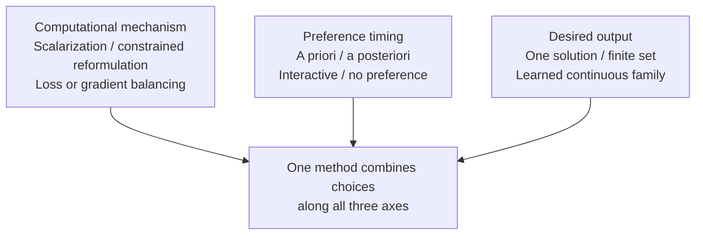

# Introduction to Multi-objective Optimization: Pareto Optimality and Stationarity

In single-objective optimization, we compare two feasible solutions by their values of one function. With several objectives, one solution may improve one criterion and worsen another. Multi-objective optimization (MOO) therefore needs a notion of improvement that does not collapse all objectives into one number at the outset.

Let $X\subseteq\mathbb R^d$ be a nonempty feasible set, and let $f_s:X\to\mathbb R$ be the objective indexed by $s\in[S]=\{1,\ldots,S\}$. We consider minimization of the vector-valued function
$$
\min_{\mathbf{x}\in X}\mathbf{F}(\mathbf{x}),
\qquad
\mathbf{F}(\mathbf{x})=\bigl(f_1(\mathbf{x}),\ldots,f_S(\mathbf{x})\bigr)^\top.
\tag{1}
$$
^eq-moo-model

**Notation.** $S$ is the number of objectives and $d$ the number of model parameters. Bold lowercase symbols denote vectors, such as $\mathbf{x}\in\mathbb{R}^d$ and $\mathbf{w}\in\Delta_S$; $w_s$ is a scalar component. The vector-valued objective is $\mathbf{F}$, the gradient matrix is $G(\mathbf{x})\in\mathbb{R}^{d\times S}$, and the model step size is $\eta_t>0$. In one-dimensional examples, $x\in\mathbb{R}$ denotes the scalar coordinate of $\mathbf{x}$; for two objectives, $w\in[0,1]$ represents the weight vector $(w,1-w)^\top$.

The notation $\min \mathbf{F}(\mathbf{x})$ does not assert that the vectors $\mathbf{F}(\mathbf{x})$ have a total order. It asks which feasible decisions cannot be improved in one objective without a loss in another. Treatments of this viewpoint include [Ehrgott (2005)](https://doi.org/10.1007/3-540-27659-9) [\[1\]](#^ref-ehrgott-2005) and [Miettinen (1999)](https://doi.org/10.1007/978-1-4615-5563-6) [\[2\]](#^ref-miettinen-1999).

:::danger

*Q: If no feasible point minimizes every objective, what does it mean for a solution to be optimal?*

:::

## Dominance and Pareto optimality

For two feasible decisions $\mathbf{x},\mathbf{y}\in X$, we say that **$\mathbf{y}$ dominates $\mathbf{x}$** if
$$
f_s(\mathbf{y})\leq f_s(\mathbf{x})\quad\text{for every }s\in[S],
\qquad
f_j(\mathbf{y})<f_j(\mathbf{x})\quad\text{for at least one }j\in[S].
\tag{2}
$$
^eq-dominance

The first condition says that $\mathbf{y}$ is no worse in any objective; the second says that it is better in at least one. A feasible point $\mathbf{x}^\star$ is **Pareto optimal**, also called **efficient**, if no feasible point dominates it. Pareto optimality is a global property: checking it requires comparison with *all* of $X$.

A weaker notion excludes only a simultaneous *strict* improvement. A point $\mathbf{x}^\star$ is **weakly Pareto optimal** if there is no $\mathbf{y}\in X$ such that $f_s(\mathbf{y})<f_s(\mathbf{x}^\star)$ for every $s\in[S]$. Every Pareto-optimal point is weakly Pareto optimal, but the converse need not hold. For instance, if $X=\{a,b\}$ with $\mathbf{F}(a)=(0,1)^\top$ and $\mathbf{F}(b)=(0,0)^\top$, then $a$ is weakly Pareto optimal: $b$ does not strictly improve the first objective. Yet $b$ dominates $a$, so $a$ is not Pareto optimal.

The **Pareto set** contains the efficient decisions, whereas the **Pareto front** contains their objective vectors:
$$
\mathcal P=\{\mathbf{x}\in X:\mathbf{x}\text{ is Pareto optimal}\},
\qquad
\mathbf{F}(\mathcal P)=\{\mathbf{F}(\mathbf{x}):\mathbf{x}\in\mathcal P\}.
\tag{3}
$$
^eq-pareto-set-front

This distinction matters when two different decisions have the same objective vector. They are different points in decision space but correspond to one point on the front. If dominance comparisons are restricted to a neighborhood of $\mathbf{x}^\star$, we obtain *local* Pareto optimality. Local and global claims should not be interchanged.

### A two-objective example

Consider $d=1$, $X=\mathbb R$, and $f_1(x)=(x+1)^2$, $f_2(x)=(x-1)^2$. The first objective is minimized at $x=-1$; the second at $x=1$. Every $x\in[-1,1]$ is Pareto optimal. Moving right within that interval worsens $f_1$ but improves $f_2$, and moving left does the reverse. A point $x<-1$ is dominated by $-1$, while a point $x>1$ is dominated by $1$. Hence
$$
\mathcal P=[-1,1],
\qquad
\mathbf{F}(\mathcal P)=\bigl\{((x+1)^2,(x-1)^2)^\top:x\in[-1,1]\bigr\}.
$$
This example has many optimal *trade-offs*, although neither objective has more than one individual minimizer. MOO can describe the entire set of trade-offs; choosing one of them may require a preference supplied by the decision maker.

## Scalarization: choosing a trade-off

A **scalarization** replaces the vector problem with a parameterized single-objective problem. The simplest choice is the weighted sum. Let $\Delta_S=\{\mathbf{w}\in\mathbb R^S:w_s\geq0\text{ for all }s\in[S],\ \sum_{s\in[S]}w_s=1\}$. For a chosen $\mathbf{w}\in\Delta_S$, solve
$$
\min_{\mathbf{x}\in X}\ \sum_{s\in[S]}w_s f_s(\mathbf{x}).
\tag{4}
$$
^eq-weighted-sum

The weights encode a preference or a choice of units; they are fixed *before* solving this problem. This differs from MGDA weights, which are recomputed from current gradients at each iteration. The basic guarantee is useful, but the distinction between positive and zero weights matters.

:::success

**Proposition 1 (What a weighted sum guarantees).**

Suppose $\mathbf{x}^\star$ is a global minimizer of [[#^eq-weighted-sum|(4)]] for some $\mathbf{w}\in\Delta_S$. Then $\mathbf{x}^\star$ is weakly Pareto optimal. If every weight is strictly positive, $w_s>0$ for all $s\in[S]$, then $\mathbf{x}^\star$ is Pareto optimal.

:::

**Proof of Proposition 1.** If a feasible $\mathbf{y}$ strictly improved every objective, then at least one weight is positive and $\sum_{s\in[S]}w_s f_s(\mathbf{y})<\sum_{s\in[S]}w_s f_s(\mathbf{x}^\star)$, contradicting global optimality. Thus $\mathbf{x}^\star$ is weakly Pareto optimal. If all weights are positive and $\mathbf{y}$ dominates $\mathbf{x}^\star$, every weighted objective difference is nonpositive and at least one is negative. The same contradiction shows that $\mathbf{x}^\star$ is Pareto optimal. &#9633;

In the quadratic example above, assigning weight $w$ to $f_1$ and $1-w$ to $f_2$ gives the unique minimizer $x_w=1-2w$. As $w$ runs from $0$ to $1$, weighted sums recover the entire Pareto set $[-1,1]$. This completeness does not hold for every problem.

For a simple counterexample, take a finite feasible set with three objective vectors
$$
\mathbf{F}(a)=(0,2)^\top,\qquad \mathbf{F}(b)=(3/2,3/2)^\top,\qquad \mathbf{F}(c)=(2,0)^\top.
$$
All three are Pareto optimal: each improves one coordinate relative to at least one of the others. Yet $b$ never minimizes a weighted sum. With weights $(w,1-w)$, its scalarized value is $3/2$, while the smaller value of $a$ and $c$ is $\min\{2(1-w),2w\}\leq1$ for every $w\in[0,1]$. The point $b$ is an **unsupported** efficient solution. Weighted sums recover supported points; on a nonconvex front they can miss trade-offs altogether. Under suitable convexity and closedness conditions on the upper objective image $\mathbf{F}(X)+\mathbb R_+^S$, supporting-hyperplane arguments give converse results for weakly efficient objective vectors [Ehrgott (2005)](https://doi.org/10.1007/3-540-27659-9) [\[1\]](#^ref-ehrgott-2005).

## Pareto stationarity: a first-order target

Global dominance is difficult to test during a gradient-based algorithm. For differentiable objectives and the unconstrained case $X=\mathbb R^d$, a more accessible target is *Pareto stationarity*. At a point $\mathbf{x}$, write $\mathbf{g}_s=\nabla f_s(\mathbf{x})$. A direction $\mathbf{v}\in\mathbb R^d$ is a **common first-order descent direction** if $\mathbf{g}_s^\top \mathbf{v}<0$ for every $s\in[S]$. We call $\mathbf{x}$ **Pareto stationary** if no such direction exists.

:::success

**Proposition 2 (The minimum-norm stationarity certificate).**

For differentiable $f_s:\mathbb R^d\to\mathbb R$, the following are equivalent at $\mathbf{x}$:

**(i)** There is no common first-order descent direction at $\mathbf{x}$.

**(ii)** $0$ belongs to the convex hull of the gradients $\{\mathbf{g}_s:s\in[S]\}$.

**(iii)** The minimum-norm convex combination of the gradients has norm zero:
$$
\min_{\mathbf{w}\in\Delta_S}\left\|\sum_{s\in[S]}w_s \mathbf{g}_s\right\|=0.
\tag{5}
$$
^eq-stationarity-certificate

:::

**Proof of Proposition 2.** Conditions (ii) and (iii) are equivalent because the gradient convex hull is the compact set $\{\sum_{s\in[S]}w_s \mathbf{g}_s:\mathbf{w}\in\Delta_S\}$. If $0=\sum_s w_s \mathbf{g}_s$, a direction with $\mathbf{g}_s^\top \mathbf{v}<0$ for every $s$ would give $0=\sum_s w_s \mathbf{g}_s^\top \mathbf{v}<0$, a contradiction. Conversely, suppose $0$ is outside the gradient convex hull $C$. Let $\mathbf{u}$ be the nonzero projection of $0$ onto $C$. Projection optimality gives $\mathbf{u}^\top(\mathbf{g}_s-\mathbf{u})\geq0$ for every $s$, so $\mathbf{v}=-\mathbf{u}$ satisfies $\mathbf{g}_s^\top \mathbf{v}\leq-\|\mathbf{u}\|^2<0$ for every $s$. Thus (i) implies (ii). &#9633;

This is the gradient version of Gordan's theorem of alternatives; see [Bertsekas (2009, Section 5.6)](https://faculty.engineering.asu.edu/bertsekas/wp-content/uploads/sites/129/2019/10/Convex_Theory_Entire_Book.pdf) [\[3\]](#^ref-bertsekas-2009). It motivates the squared Pareto-stationarity measure
$$
R(\mathbf{x}):=\min_{\mathbf{w}\in\Delta_S}\left\|\sum_{s\in[S]}w_s\nabla f_s(\mathbf{x})\right\|^2,
\qquad
R(\mathbf{x})=0\ \Longleftrightarrow\ \mathbf{x}\text{ is Pareto stationary}.
\tag{6}
$$
^eq-ps-measure

A local Pareto optimum must be Pareto stationary in the unconstrained differentiable setting: a common strict descent direction would decrease every objective for a sufficiently small step. The converse is false. For the scalar objectives $f_1(x)=-x^2$ and $f_2(x)=-2x^2$, the point $x=0$ is Pareto stationary because both gradients vanish there, but every nearby nonzero point improves both objectives. For constrained problems, first-order statements must use *feasible* directions or an appropriate tangent cone; [[#^eq-stationarity-certificate|(5)]] is the unconstrained characterization.

## Categories of multi-objective methods

MOO methods can be classified by **how they compute solutions**, **when preferences enter**, and **what they return**. These are different axes, so scalarization, constrained reformulations, gradient manipulation, and preference guidance do not form disjoint categories. The following overview combines the classical treatments of [Ehrgott (2005, Chapters 3–4)](https://doi.org/10.1007/3-540-27659-9) [\[1\]](#^ref-ehrgott-2005) and [Miettinen (1999, Part II)](https://users.jyu.fi/~miettine/book/index.html) [\[2\]](#^ref-miettinen-1999) with the deep-learning taxonomy of [Chen et al. (2025, Sections 3–5)](https://arxiv.org/abs/2501.10945v3) [\[6\]](#^ref-chen-2026-survey).

### Scalarization and constrained reformulations

**Scalarization** reduces the vector problem to a parameterized scalar optimization problem. Besides the weighted sum in [[#^eq-weighted-sum|(4)]], a common choice is weighted Tchebycheff scalarization,
$$
\min_{\mathbf{x}\in X}\ \max_{s\in[S]}w_s\bigl(f_s(\mathbf{x})-z_s^{\mathrm{ref}}\bigr),
$$
where $\mathbf{z}^{\mathrm{ref}}$ is a reference objective vector. Such reference-point constructions can reach unsupported trade-offs that weighted sums miss, under appropriate choices of the reference point and weights. Reference points, weights, and objective scaling determine which trade-off is sought [Ehrgott (2005, Chapter 4)](https://doi.org/10.1007/3-540-27659-9_4) [\[1\]](#^ref-ehrgott-2005).

**Constrained reformulations** encode objective bounds or objective-space geometry through additional constraints. The **$\varepsilon$-constraint method** selects an objective $k$ and solves
$$
\min_{\mathbf{x}\in X}\ f_k(\mathbf{x})
\qquad\text{subject to}\qquad
f_s(\mathbf{x})\leq\varepsilon_s,\quad s\neq k.
$$
The thresholds may express acceptable performance levels or be swept to generate trade-offs. Every Pareto-optimal $\mathbf{x}^\star$ solves such a problem with $\varepsilon_s=f_s(\mathbf{x}^\star)$: a feasible point with a smaller $f_k$ would dominate it. A global minimizer is weakly Pareto optimal; excluding dominated ties requires additional care [Miettinen (1999, Part II, Section 3.2)](https://users.jyu.fi/~miettine/book/index.html) [\[2\]](#^ref-miettinen-1999).

**Normal-boundary intersection (NBI)** instead constructs a reference simplex from individual-objective minimizers and solves constrained subproblems that extend from points on this simplex toward the objective-space boundary along a normal direction. Varying the simplex coordinates aims to spread the resulting trade-offs across the front [Das and Dennis (1998)](https://doi.org/10.1137/S1052623496307510) [\[7\]](#^ref-das-dennis-1998). NBI is a front-generation construction, rather than an objective-threshold rule. In the broad sense of reduction to a scalar optimization problem, both NBI and $\varepsilon$-constraint are also scalarizations; “constrained” describes their formulation, not a separate class of feasible sets $X$.

### Gradient weighting and manipulation in multi-task learning

See [Gradient Weighting and Manipulation for Multi-Objective Optimization](Intro%20MOO%20--%20Gradient%20Manipulation.md) for the loss-balancing, gradient-weighting, and gradient-manipulation taxonomy, including MGDA, CAGrad, Nash-MTL, PCGrad, GradVac, GradDrop, and their gradient geometry.

### Preference timing and the desired output

Miettinen's classification concerns the decision maker's involvement [Miettinen (1999, Part II)](https://users.jyu.fi/~miettine/book/index.html) [\[2\]](#^ref-miettinen-1999):

- **A priori:** specify preferences before optimization, for example weights, objective priorities, or acceptable objective bounds.
- **A posteriori:** generate a representative set of trade-offs first, then choose a preferred solution.
- **Interactive:** alternate optimization with preference feedback, refining the search as the decision maker learns about attainable trade-offs.
- **No preference:** compute a compromise using an algorithmic criterion without eliciting preferences from the decision maker. The criterion still embodies a choice of what constitutes a compromise.

The survey uses a separate primary classification by **output**: a single solution, a finite set of solutions, or a learned continuous family approximating the Pareto set. Such a learned family does not itself certify recovery of the entire true Pareto set [Chen et al. (2025)](https://arxiv.org/abs/2501.10945v3) [\[6\]](#^ref-chen-2026-survey).

*The diagram summarizes classification axes rather than disjoint sets.* For example, a weighted sum with user-selected weights is a priori, while sweeping weights and choosing afterward is a posteriori. Sweeping $\varepsilon$ thresholds or NBI subproblems can likewise support a posteriori selection. A preference-guided gradient method may combine gradient balancing with objective-space constraints. Thus “uses a preference vector” does not by itself determine when the decision maker expresses preferences.

### Preference-guided methods: related work

See [Preference-Guided Multi-Objective Optimization](Intro%20MOO%20--%20Preference%20Guided%20MOO.md) for methods based on weights, bounds, target ratios, ordering cones, and Pareto-front approximation.

## From concepts to algorithms

The goal determines the method. A weighted sum selects a solution for a specified preference and can be solved with standard single-objective tools. A front-approximation method seeks multiple nondominated outcomes so a preference can be applied afterward. A gradient-based method such as MGDA instead targets Pareto stationarity without fixing scalarization weights in advance. Its minimum-norm gradient combination is exactly the certificate in Proposition 2; when nonzero, its negative is a common first-order descent direction [Fliege and Svaiter (2000)](https://doi.org/10.1007/s001860000043) [\[4\]](#^ref-fliege-svaiter-2000); [Désidéri (2012)](https://doi.org/10.1016/j.crma.2012.03.014) [\[5\]](#^ref-desideri-2012). The geometry and update rule are developed in [Introduction to MGDA](Intro%20MOO%20--%20Deterministic%20MGDA.md).

Two distinctions are useful when reading convergence results. First, convergence to $R(\mathbf{x})=0$ concerns **first-order stationarity**, not global Pareto optimality or a complete approximation of the front. Second, dominance is unchanged by a strictly increasing transformation of an individual objective, but weighted sums and gradient-based directions generally change under rescaling. Objective units therefore matter when choosing weights or interpreting an algorithm's trajectory.

For software frameworks, representative benchmark families, and evaluation protocols, see [Benchmarks and Libraries for Multi-Objective Optimization](Intro%20MOO%20--%20Benchmarks%20and%20Libraries.md).

## Surveys and further reading

For a survey of continuous nonlinear MOO methods, including scalarization and the role of preferences, see [Marler and Arora (2004)](https://doi.org/10.1007/s00158-003-0368-6 "Survey of multi-objective optimization methods for engineering") [\[8\]](#^ref-marler-arora-2004). For deep learning, [Chen et al. (2025)](https://arxiv.org/abs/2501.10945v3 "Gradient-based multi-objective deep learning survey") [\[6\]](#^ref-chen-2026-survey) reviews gradient-based algorithms, theory, and applications, organizing methods by whether they seek one solution, a finite set, or a learned family. [Peitz and Hotegni (2025)](https://doi.org/10.1016/j.mlwa.2025.100700 "Multi-objective deep learning: taxonomy and survey") [\[9\]](#^ref-peitz-hotegni-2025) provides a complementary taxonomy based on training algorithms and decision-maker needs, spanning supervised, unsupervised, reinforcement, and generative learning.

For the broader multi-task learning context, [Zhang and Yang (2022)](https://doi.org/10.1109/TKDE.2021.3070203 "A Survey on Multi-Task Learning") [\[10\]](#^ref-zhang-yang-2022-survey) surveys task-sharing models, applications, and theoretical analyses. This complements the MOO viewpoint by explaining how tasks share features and parameters, alongside the question of how their objectives are balanced.

## References

[1] Matthias Ehrgott (2005). [Multicriteria Optimization, 2nd ed.](https://doi.org/10.1007/3-540-27659-9). Springer. ^ref-ehrgott-2005

[2] Kaisa Miettinen (1999). [Nonlinear Multiobjective Optimization](https://doi.org/10.1007/978-1-4615-5563-6). Kluwer Academic Publishers. ^ref-miettinen-1999

[3] Dimitri P. Bertsekas (2009). [Convex Optimization Theory](https://faculty.engineering.asu.edu/bertsekas/wp-content/uploads/sites/129/2019/10/Convex_Theory_Entire_Book.pdf). Athena Scientific, Section 5.6. ^ref-bertsekas-2009

[4] Jörg Fliege and Benar Fux Svaiter (2000). [Steepest descent methods for multicriteria optimization](https://doi.org/10.1007/s001860000043). *Mathematical Methods of Operations Research*, **51**(3), 479–494. ^ref-fliege-svaiter-2000

[5] Jean-Antoine Désidéri (2012). [Multiple-gradient descent algorithm (MGDA) for multiobjective optimization](https://doi.org/10.1016/j.crma.2012.03.014). *Comptes Rendus Mathématique*, **350**(5–6), 313–318. ^ref-desideri-2012

[6] Weiyu Chen, Baijiong Lin, Xiaoyuan Zhang, Xi Lin, Han Zhao, Qingfu Zhang, and James T. Kwok (2025). [Gradient-Based Multi-Objective Deep Learning: Algorithms, Theories, Applications, and Beyond](https://arxiv.org/abs/2501.10945v3 "Chen et al. — gradient-based MOO survey, arXiv:2501.10945v3"). *arXiv preprint arXiv:2501.10945*. Section and figure numbering follows v3. [Later journal version](https://openreview.net/forum?id=eCUcXXH3PS). ^ref-chen-2026-survey

[7] Indraneel Das and J. E. Dennis (1998). [Normal-Boundary Intersection: A New Method for Generating the Pareto Surface in Nonlinear Multicriteria Optimization Problems](https://doi.org/10.1137/S1052623496307510). *SIAM Journal on Optimization*, **8**(3), 631–657. ^ref-das-dennis-1998

[8] R. Timothy Marler and Jasbir S. Arora (2004). [Survey of multi-objective optimization methods for engineering](https://doi.org/10.1007/s00158-003-0368-6 "Marler and Arora — Structural and Multidisciplinary Optimization 26, 369–395"). *Structural and Multidisciplinary Optimization*, **26**, 369–395. ^ref-marler-arora-2004

[9] Sebastian Peitz and Sedjro Salomon Hotegni (2025). [Multi-objective deep learning: Taxonomy and survey of the state of the art](https://doi.org/10.1016/j.mlwa.2025.100700 "Peitz and Hotegni — Machine Learning with Applications 21, 100700"). *Machine Learning with Applications*, **21**, 100700. [Preprint, arXiv:2412.01566](https://arxiv.org/abs/2412.01566). ^ref-peitz-hotegni-2025

[10] Yu Zhang and Qiang Yang (2022). [A Survey on Multi-Task Learning](https://doi.org/10.1109/TKDE.2021.3070203 "Zhang and Yang — IEEE TKDE 34(12), 5586–5609"). *IEEE Transactions on Knowledge and Data Engineering*, **34**(12), 5586–5609. [Preprint, arXiv:1707.08114](https://arxiv.org/abs/1707.08114). ^ref-zhang-yang-2022-survey
