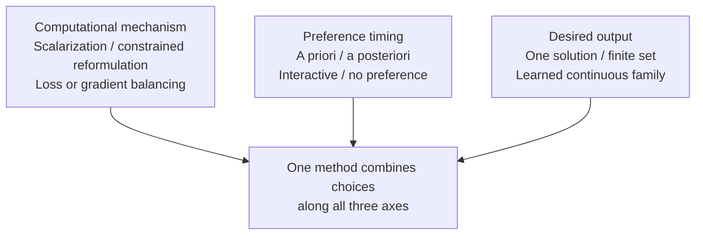
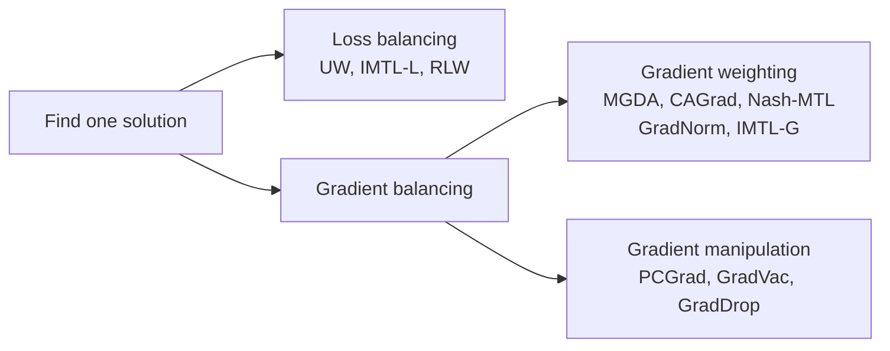

# Section 1: Foundations and Methods of Multi-Objective Optimization

[TOC]

This section develops the optimization foundations, scalarization and preference models, deterministic and stochastic multiple-gradient methods, alternative gradient aggregation rules, and evaluation tools. All objectives are written as minimization problems unless stated otherwise.

## 1.1 Foundations: Pareto Optimality and Stationarity

In single-objective optimization, we compare two feasible solutions by their values of one function. With several objectives, one solution may improve one criterion and worsen another. Multi-objective optimization (MOO) therefore needs a notion of improvement that does not collapse all objectives into one number at the outset.

Let $X\subseteq\mathbb R^d$ be a nonempty feasible set, and let $f_s:X\to\mathbb R$ be the objective indexed by $s\in[S]=\{1,\ldots,S\}$. We consider minimization of the vector-valued function

$$
\min_{\mathbf{x}\in X}\mathbf{F}(\mathbf{x}),
\qquad
\mathbf{F}(\mathbf{x})=\bigl(f_1(\mathbf{x}),\ldots,f_S(\mathbf{x})\bigr)^\top.
\tag{1.1.1}
$$

**Notation.** $S$ is the number of objectives and $d$ the number of model parameters. Bold lowercase symbols denote vectors, such as $\mathbf{x}\in\mathbb{R}^d$ and $\mathbf{w}\in\Delta_S$; $w_s$ is a scalar component. The vector-valued objective is $\mathbf{F}$, the gradient matrix is $G(\mathbf{x})\in\mathbb{R}^{d\times S}$, and the model step size is $\eta_t>0$. In one-dimensional examples, $x\in\mathbb{R}$ denotes the scalar coordinate of $\mathbf{x}$; for two objectives, $w\in[0,1]$ represents the weight vector $(w,1-w)^\top$.

The notation $\min \mathbf{F}(\mathbf{x})$ does not assert that the vectors $\mathbf{F}(\mathbf{x})$ have a total order. It asks which feasible decisions cannot be improved in one objective without a loss in another. Treatments of this viewpoint include Ehrgott (2005) [1](#ref-ehrgott-2005) and Miettinen (1999) [2](#ref-miettinen-1999).

:::danger

*Q: If no feasible point minimizes every objective, what does it mean for a solution to be optimal?*

:::

### 1.1.1 Dominance and Pareto optimality

For two feasible decisions $\mathbf{x},\mathbf{y}\in X$, we say that **$\mathbf{y}$ dominates $\mathbf{x}$** if

$$
f_s(\mathbf{y})\leq f_s(\mathbf{x})\quad\text{for every }s\in[S],
\qquad
f_j(\mathbf{y})<f_j(\mathbf{x})\quad\text{for at least one }j\in[S].
\tag{1.1.2}
$$

The first condition says that $\mathbf{y}$ is no worse in any objective; the second says that it is better in at least one. A feasible point $\mathbf{x}^\star$ is **Pareto optimal**, also called **efficient**, if no feasible point dominates it. Pareto optimality is a global property: checking it requires comparison with *all* of $X$.

A weaker notion excludes only a simultaneous *strict* improvement. A point $\mathbf{x}^\star$ is **weakly Pareto optimal** if there is no $\mathbf{y}\in X$ such that $f_s(\mathbf{y})<f_s(\mathbf{x}^\star)$ for every $s\in[S]$. Every Pareto-optimal point is weakly Pareto optimal, but the converse need not hold. For instance, if $X=\{a,b\}$ with $\mathbf{F}(a)=(0,1)^\top$ and $\mathbf{F}(b)=(0,0)^\top$, then $a$ is weakly Pareto optimal: $b$ does not strictly improve the first objective. Yet $b$ dominates $a$, so $a$ is not Pareto optimal.

The **Pareto set** contains the efficient decisions, whereas the **Pareto front** contains their objective vectors:

$$
\mathcal P=\{\mathbf{x}\in X:\mathbf{x}\text{ is Pareto optimal}\},
\qquad
\mathbf{F}(\mathcal P)=\{\mathbf{F}(\mathbf{x}):\mathbf{x}\in\mathcal P\}.
\tag{1.1.3}
$$

This distinction matters when two different decisions have the same objective vector. They are different points in decision space but correspond to one point on the front. If dominance comparisons are restricted to a neighborhood of $\mathbf{x}^\star$, we obtain *local* Pareto optimality. Local and global claims should not be interchanged.

#### A two-objective example

Consider $d=1$, $X=\mathbb R$, and $f_1(x)=(x+1)^2$, $f_2(x)=(x-1)^2$. The first objective is minimized at $x=-1$; the second at $x=1$. Every $x\in[-1,1]$ is Pareto optimal. Moving right within that interval worsens $f_1$ but improves $f_2$, and moving left does the reverse. A point $x<-1$ is dominated by $-1$, while a point $x>1$ is dominated by $1$. Hence
$$
\mathcal P=[-1,1],
\qquad
\mathbf{F}(\mathcal P)=\bigl\{((x+1)^2,(x-1)^2)^\top:x\in[-1,1]\bigr\}.
$$
This example has many optimal *trade-offs*, although neither objective has more than one individual minimizer. MOO can describe the entire set of trade-offs; choosing one of them may require a preference supplied by the decision maker.

### 1.1.2 Scalarization: choosing a trade-off

A **scalarization** replaces the vector problem with a parameterized single-objective problem. The simplest choice is the weighted sum. Let $\Delta_S=\{\mathbf{w}\in\mathbb R^S:w_s\geq0\text{ for all }s\in[S],\ \sum_{s\in[S]}w_s=1\}$. For a chosen $\mathbf{w}\in\Delta_S$, solve

$$
\min_{\mathbf{x}\in X}\ \sum_{s\in[S]}w_s f_s(\mathbf{x}).
\tag{1.1.4}
$$

The weights encode a preference or a choice of units; they are fixed *before* solving this problem. This differs from MGDA weights, which are recomputed from current gradients at each iteration. The basic guarantee is useful, but the distinction between positive and zero weights matters.

:::success

**Proposition 1 (What a weighted sum guarantees).**

Suppose $\mathbf{x}^\star$ is a global minimizer of [Eq. (1.1.4)](#eq-weighted-sum) for some $\mathbf{w}\in\Delta_S$. Then $\mathbf{x}^\star$ is weakly Pareto optimal. If every weight is strictly positive, $w_s>0$ for all $s\in[S]$, then $\mathbf{x}^\star$ is Pareto optimal.

:::

**Proof of Proposition 1.** If a feasible $\mathbf{y}$ strictly improved every objective, then at least one weight is positive and $\sum_{s\in[S]}w_s f_s(\mathbf{y})<\sum_{s\in[S]}w_s f_s(\mathbf{x}^\star)$, contradicting global optimality. Thus $\mathbf{x}^\star$ is weakly Pareto optimal. If all weights are positive and $\mathbf{y}$ dominates $\mathbf{x}^\star$, every weighted objective difference is nonpositive and at least one is negative. The same contradiction shows that $\mathbf{x}^\star$ is Pareto optimal. &#9633;

In the quadratic example above, assigning weight $w$ to $f_1$ and $1-w$ to $f_2$ gives the unique minimizer $x_w=1-2w$. As $w$ runs from $0$ to $1$, weighted sums recover the entire Pareto set $[-1,1]$. This completeness does not hold for every problem.

For a simple counterexample, take a finite feasible set with three objective vectors
$$
\mathbf{F}(a)=(0,2)^\top,\qquad \mathbf{F}(b)=(3/2,3/2)^\top,\qquad \mathbf{F}(c)=(2,0)^\top.
$$
All three are Pareto optimal: each improves one coordinate relative to at least one of the others. Yet $b$ never minimizes a weighted sum. With weights $(w,1-w)$, its scalarized value is $3/2$, while the smaller value of $a$ and $c$ is $\min\{2(1-w),2w\}\leq1$ for every $w\in[0,1]$. The point $b$ is an **unsupported** efficient solution. Weighted sums recover supported points; on a nonconvex front they can miss trade-offs altogether. Under suitable convexity and closedness conditions on the upper objective image $\mathbf{F}(X)+\mathbb R_+^S$, supporting-hyperplane arguments give converse results for weakly efficient objective vectors Ehrgott (2005) [1](#ref-ehrgott-2005).

### 1.1.3 Pareto stationarity: a first-order target

Global dominance is difficult to test during a gradient-based algorithm. For differentiable objectives and the unconstrained case $X=\mathbb R^d$, a more accessible target is *Pareto stationarity*. At a point $\mathbf{x}$, write $\mathbf{g}_s=\nabla f_s(\mathbf{x})$. A direction $\mathbf{v}\in\mathbb R^d$ is a **common first-order descent direction** if $\mathbf{g}_s^\top \mathbf{v}<0$ for every $s\in[S]$. We call $\mathbf{x}$ **Pareto stationary** if no such direction exists.

:::success

**Proposition 2 (The minimum-norm stationarity certificate).**

For differentiable $f_s:\mathbb R^d\to\mathbb R$, the following are equivalent at $\mathbf{x}$:

**(i)** There is no common first-order descent direction at $\mathbf{x}$.

**(ii)** $0$ belongs to the convex hull of the gradients $\{\mathbf{g}_s:s\in[S]\}$.

**(iii)** The minimum-norm convex combination of the gradients has norm zero:

$$
\min_{\mathbf{w}\in\Delta_S}\left\|\sum_{s\in[S]}w_s \mathbf{g}_s\right\|=0.
\tag{1.1.5}
$$

:::

**Proof of Proposition 2.** Conditions (ii) and (iii) are equivalent because the gradient convex hull is the compact set $\{\sum_{s\in[S]}w_s \mathbf{g}_s:\mathbf{w}\in\Delta_S\}$. If $0=\sum_s w_s \mathbf{g}_s$, a direction with $\mathbf{g}_s^\top \mathbf{v}<0$ for every $s$ would give $0=\sum_s w_s \mathbf{g}_s^\top \mathbf{v}<0$, a contradiction. Conversely, suppose $0$ is outside the gradient convex hull $C$. Let $\mathbf{u}$ be the nonzero projection of $0$ onto $C$. Projection optimality gives $\mathbf{u}^\top(\mathbf{g}_s-\mathbf{u})\geq0$ for every $s$, so $\mathbf{v}=-\mathbf{u}$ satisfies $\mathbf{g}_s^\top \mathbf{v}\leq-\|\mathbf{u}\|^2<0$ for every $s$. Thus (i) implies (ii). &#9633;

This is the gradient version of Gordan's theorem of alternatives; see Bertsekas (2009, Section 5.6) [3](#ref-bertsekas-2009). It motivates the squared Pareto-stationarity measure

$$
R(\mathbf{x}):=\min_{\mathbf{w}\in\Delta_S}\left\|\sum_{s\in[S]}w_s\nabla f_s(\mathbf{x})\right\|^2,
\qquad
R(\mathbf{x})=0\ \Longleftrightarrow\ \mathbf{x}\text{ is Pareto stationary}.
\tag{1.1.6}
$$

A local Pareto optimum must be Pareto stationary in the unconstrained differentiable setting: a common strict descent direction would decrease every objective for a sufficiently small step. The converse is false. For the scalar objectives $f_1(x)=-x^2$ and $f_2(x)=-2x^2$, the point $x=0$ is Pareto stationary because both gradients vanish there, but every nearby nonzero point improves both objectives. For constrained problems, first-order statements must use *feasible* directions or an appropriate tangent cone; [Eq. (1.1.5)](#eq-stationarity-certificate) is the unconstrained characterization.

### 1.1.4 Categories of multi-objective methods

MOO methods can be classified by **how they compute solutions**, **when preferences enter**, and **what they return**. These are different axes, so scalarization, constrained reformulations, gradient manipulation, and preference guidance do not form disjoint categories. The following overview combines the classical treatments of Ehrgott (2005, Chapters 3–4) [1](#ref-ehrgott-2005) and Miettinen (1999, Part II) [2](#ref-miettinen-1999) with the deep-learning taxonomy of Chen et al. (2025, Sections 3–5) [4](#ref-chen-2026-survey).

#### Scalarization and constrained reformulations

**Scalarization** reduces the vector problem to a parameterized scalar optimization problem. Besides the weighted sum in [Eq. (1.1.4)](#eq-weighted-sum), a common choice is weighted Tchebycheff scalarization,
$$
\min_{\mathbf{x}\in X}\ \max_{s\in[S]}w_s\bigl(f_s(\mathbf{x})-z_s^{\mathrm{ref}}\bigr),
$$
where $\mathbf{z}^{\mathrm{ref}}$ is a reference objective vector. Such reference-point constructions can reach unsupported trade-offs that weighted sums miss, under appropriate choices of the reference point and weights. Reference points, weights, and objective scaling determine which trade-off is sought Ehrgott (2005, Chapter 4) [1](#ref-ehrgott-2005).

**Constrained reformulations** encode objective bounds or objective-space geometry through additional constraints. The **$\varepsilon$-constraint method** selects an objective $k$ and solves
$$
\min_{\mathbf{x}\in X}\ f_k(\mathbf{x})
\qquad\text{subject to}\qquad
f_s(\mathbf{x})\leq\varepsilon_s,\quad s\neq k.
$$
The thresholds may express acceptable performance levels or be swept to generate trade-offs. Every Pareto-optimal $\mathbf{x}^\star$ solves such a problem with $\varepsilon_s=f_s(\mathbf{x}^\star)$: a feasible point with a smaller $f_k$ would dominate it. A global minimizer is weakly Pareto optimal; excluding dominated ties requires additional care Miettinen (1999, Part II, Section 3.2) [2](#ref-miettinen-1999).

**Normal-boundary intersection (NBI)** instead constructs a reference simplex from individual-objective minimizers and solves constrained subproblems that extend from points on this simplex toward the objective-space boundary along a normal direction. Varying the simplex coordinates aims to spread the resulting trade-offs across the front Das and Dennis (1998) [5](#ref-das-dennis-1998). NBI is a front-generation construction, rather than an objective-threshold rule. In the broad sense of reduction to a scalar optimization problem, both NBI and $\varepsilon$-constraint are also scalarizations; “constrained” describes their formulation, not a separate class of feasible sets $X$.

#### Gradient weighting and manipulation in multi-task learning

The loss-balancing, gradient-weighting, and gradient-manipulation taxonomy is developed in [Section 1.4](#sec-1-4).

#### Preference timing and the desired output

Miettinen's classification concerns the decision maker's involvement Miettinen (1999, Part II) [2](#ref-miettinen-1999):

- **A priori:** specify preferences before optimization, for example weights, objective priorities, or acceptable objective bounds.
- **A posteriori:** generate a representative set of trade-offs first, then choose a preferred solution.
- **Interactive:** alternate optimization with preference feedback, refining the search as the decision maker learns about attainable trade-offs.
- **No preference:** compute a compromise using an algorithmic criterion without eliciting preferences from the decision maker. The criterion still embodies a choice of what constitutes a compromise.

The survey uses a separate primary classification by **output**: a single solution, a finite set of solutions, or a learned continuous family approximating the Pareto set. Such a learned family does not itself certify recovery of the entire true Pareto set Chen et al. (2025) [4](#ref-chen-2026-survey).

*The diagram summarizes classification axes rather than disjoint sets.* For example, a weighted sum with user-selected weights is a priori, while sweeping weights and choosing afterward is a posteriori. Sweeping $\varepsilon$ thresholds or NBI subproblems can likewise support a posteriori selection. A preference-guided gradient method may combine gradient balancing with objective-space constraints. Thus “uses a preference vector” does not by itself determine when the decision maker expresses preferences.

#### Preference-guided methods: related work

Methods based on weights, bounds, target ratios, ordering cones, and Pareto-front approximation are developed in [Section 1.5](#sec-1-5).

### 1.1.5 From concepts to algorithms

The goal determines the method. A weighted sum selects a solution for a specified preference and can be solved with standard single-objective tools. A front-approximation method seeks multiple nondominated outcomes so a preference can be applied afterward. A gradient-based method such as MGDA instead targets Pareto stationarity without fixing scalarization weights in advance. Its minimum-norm gradient combination is exactly the certificate in Proposition 2; when nonzero, its negative is a common first-order descent direction Fliege and Svaiter (2000) [6](#ref-fliege-svaiter-2000); Désidéri (2012) [7](#ref-desideri-2012). The geometry and update rule are developed in [Introduction to MGDA](#sec-1-3).

Two distinctions are useful when reading convergence results. First, convergence to $R(\mathbf{x})=0$ concerns **first-order stationarity**, not global Pareto optimality or a complete approximation of the front. Second, dominance is unchanged by a strictly increasing transformation of an individual objective, but weighted sums and gradient-based directions generally change under rescaling. Objective units therefore matter when choosing weights or interpreting an algorithm's trajectory.

For software frameworks, representative benchmark families, and evaluation protocols, see [Benchmarks and Libraries for Multi-Objective Optimization](#sec-1-6).

### 1.1.6 Surveys and further reading

For a survey of continuous nonlinear MOO methods, including scalarization and the role of preferences, see Marler and Arora (2004) [8](#ref-marler-arora-2004). For deep learning, Chen et al. (2025) [4](#ref-chen-2026-survey) reviews gradient-based algorithms, theory, and applications, organizing methods by whether they seek one solution, a finite set, or a learned family. Peitz and Hotegni (2025) [9](#ref-peitz-hotegni-2025) provides a complementary taxonomy based on training algorithms and decision-maker needs, spanning supervised, unsupervised, reinforcement, and generative learning.

For the broader multi-task learning context, Zhang and Yang (2022) [10](#ref-zhang-yang-2022-survey) surveys task-sharing models, applications, and theoretical analyses. This complements the MOO viewpoint by explaining how tasks share features and parameters, alongside the question of how their objectives are balanced.

## 1.2 Scalarization and Classical Preference Formulations

This subsection first establishes what scalarization guarantees, then compares classical ways to encode trade-offs and preferences.

### 1.2.1 Pareto guarantees of scalarization methods

**Notation.** In this discussion, $M$ denotes the number of objectives and $n$ the decision dimension, so $M=S$ and $n=d$ relative to Section 1.1.

Scalarization fixes a parameter $\theta$ and solves $\min_{x\in X}\phi(x;\theta)$. Three questions must be separated: the Pareto status of a minimizer for a fixed $\theta$, whether varying $\theta$ can recover a specified Pareto point, and what first-order stationarity of the scalar problem implies. The squared residual is
$$
R(x):=\min_{\lambda\in\Delta_M}\left\|\sum_{m\in[M]}\lambda_m\nabla f_m(x)\right\|^2,
\qquad R(x)=0\iff x\text{ is Pareto stationary}.
$$
This is the same certificate as [Eq. (1.1.6)](#eq-ps-measure), written in the notation of the scalarization source.

#### Monotonicity and forward guarantees

Let $\phi(x;\theta)=h(F(x);\theta)$ for fixed $\theta$. If $h(u;\theta)<h(v;\theta)$ whenever every component of $u$ is strictly below the corresponding component of $v$, every global minimizer of $\phi$ is weakly Pareto optimal. If $h(u;\theta)<h(v;\theta)$ whenever $u\leq v$ componentwise with at least one strict inequality, every global minimizer is Pareto optimal. The local versions follow by applying the same argument in a neighborhood of the candidate. Indeed, a point that dominated a scalar minimizer would have a strictly smaller scalar value, contradicting minimality. These statements concern scalarizations over the original feasible set; the $\varepsilon$-constraint method changes that set and is treated separately below [1](#ref-ehrgott-2005), [2](#ref-miettinen-1999), [11](#ref-helfrich-2024).

For $X=\mathbb R^n$ and differentiable $f_m$ and $h$, a related first-order certificate follows from the chain rule. If every $\partial h/\partial u_m$ is nonnegative and their sum is positive, then $\nabla_x\phi(x;\theta)=0$ gives
$$
0=\sum_{m\in[M]}\frac{\partial h}{\partial u_m}(F(x);\theta)\nabla f_m(x).
$$
Normalizing the coefficients yields a simplex vector and hence $R(x)=0$. For a nonsmooth weighted maximum, the corresponding statement uses Clarke stationarity and convex combinations of active weighted gradients. With constraints, the certificate must account for feasible directions or normal-cone/KKT conditions.

The following maps keep fixed-parameter guarantees and varying-parameter recovery separate. Positive weights mean $\lambda_m>0$ for every $m$.

| Scalarization | Global minimizer | Local minimizer | Scalar stationarity, $X=\mathbb R^n$ |
|---|---|---|---|
| Weighted sum, $\lambda\in\Delta_M$ | **Weak Pareto**; **Pareto** if all weights are positive | Locally weak Pareto; locally Pareto if positive | $\nabla\phi=0\Rightarrow R(x)=0$ |
| Weighted Tchebycheff, positive weights | **Weak Pareto**; **Pareto** if the minimizer is unique | Locally weak Pareto | $0\in\partial_C\phi(x)\Rightarrow R(x)=0$ |
| Augmented Tchebycheff, positive weights and $\rho>0$ | **Pareto** | Locally Pareto | $0\in\partial_C\phi(x)\Rightarrow R(x)=0$ |
| $\varepsilon$-constraint | **Weak Pareto**; **Pareto** after lexicographic tie-breaking | Locally weak Pareto | A local minimizer satisfies $R(x)=0$ for differentiable objectives; KKT gives a certificate under constraint qualification |
| Augmented achievement/reference-point, positive weights and $\rho>0$ | **Pareto** | Locally Pareto | $0\in\partial_C\phi(x)\Rightarrow R(x)=0$ |
| Smooth Tchebycheff, positive weights and $\tau>0$ | **Pareto** | Locally Pareto | $\nabla\phi_\tau=0\Rightarrow R(x)=0$ |

| Scalarization family | Pareto-point coverage | Conditions and qualification |
|---|---|---|
| Weighted sum | **Supported points** | Under convexity and suitable closedness of $F(X)+\mathbb R_+^M$, every **weakly Pareto-optimal** point is obtainable with some nonnegative weight vector. Positive weights yield Pareto solutions but need not recover every Pareto point, even for convex problems. |
| Weighted Tchebycheff | **All weakly Pareto points**, hence all Pareto points | Given a utopian $z$ with $z_m<f_m(x^\star)$ for each $m$, choose $\lambda_m\propto[f_m(x^\star)-z_m]^{-1}$. Global scalarized optimality follows from weak Pareto optimality, with no convexity requirement. |
| Augmented Tchebycheff | **Pareto points with bounded trade-offs** | Positive $\rho$ ensures all global minimizers are Pareto optimal. For a target $x^\star$, inverse-gap weights plus the explicit bound in [the Tchebycheff discussion](#sec-1-2-tchebycheff) recover it when $0<\rho\leq 1/B$; this includes suitable properly efficient solutions. |
| $\varepsilon$-constraint | **Every Pareto point** | For any Pareto-optimal $x^\star$, fix $\varepsilon_m=f_m(x^\star)$ for $m\ne j$. Then $x^\star$ globally minimizes objective $j$ over the restricted feasible set. |
| Augmented achievement/reference point | **Controlled-trade-off/properly efficient points** under suitable parameter choices | Reference-point variation and positive augmentation can recover properly efficient solutions with bounded trade-offs. State precise assumptions for the chosen achievement function. |
| Smooth Tchebycheff | **All Pareto points under front regularity and suitable smoothing** | Lin et al. [12](#ref-lin-2024-stch), Theorem 3.8 assume a smooth Pareto-front representation with **positive normal components** and **bounded second derivatives**, and prove recovery for sufficiently small $\tau$. Their Corollary 3.9 gives recovery for any $\tau$ in its convex-front setting. |

A properly efficient solution is Pareto optimal with bounded trade-off ratios. This stronger condition appears in positive-weight support and augmentation-based recovery; it is not implied by ordinary Pareto optimality. The forward guarantees in the first table do not establish completeness of the parameterized family in the second.

### 1.2.2 Linear scalarization: weighted sums

For fixed $\lambda\in\Delta_M$, the scalar problem is
$$
\min_{x\in X}\sum_{m\in[M]}\lambda_m f_m(x).
$$
The proof in [Section 1.1](#sec-1-1) gives weak Pareto optimality for a global minimizer with nonnegative weights and Pareto optimality with strictly positive weights. The local versions follow from local scalar minimality. A unique global minimizer is Pareto optimal even when some weights vanish: a dominating point would tie or improve the scalar value, contradicting uniqueness.

Geometrically, the level sets of a weighted sum are supporting hyperplanes of the attainable objective image. Under convexity and suitable closedness of the upper image $F(X)+\mathbb R_+^M$, every weakly Pareto point has a supporting nonnegative weight vector. Positive weights recover supported Pareto points, including properly efficient points under the relevant conditions, but need not recover every Pareto point. The three-point example in [Section 1.1](#sec-1-1) has a Pareto-optimal middle point that no weighted sum selects [1](#ref-ehrgott-2005), [2](#ref-miettinen-1999).

### 1.2.3 Weighted Tchebycheff scalarization

Let $z\in\mathbb R^M$ lie strictly below the target objective vector componentwise; a point below each finite ideal value is a convenient utopian choice. Let $\lambda\in\Delta_M$ have strictly positive components. Weighted Tchebycheff scalarization solves
$$
\min_{x\in X}\max_{m\in[M]}\lambda_m\bigl(f_m(x)-z_m\bigr).
$$
Its axis-aligned contours can select unsupported trade-offs that weighted-sum hyperplanes miss. Every global minimizer is weakly Pareto optimal; a unique global minimizer is Pareto optimal. In the unconstrained differentiable-objective setting, Clarke stationarity of the weighted maximum implies Pareto stationarity [2](#ref-miettinen-1999), [14](#ref-jahn-1984).

The inverse-gap construction explains recovery without convexity. For any weakly Pareto-optimal $x^\star$ and $z_m<f_m(x^\star)$, choose $\lambda_m\propto[f_m(x^\star)-z_m]^{-1}$. The weighted gaps at $x^\star$ are equal. A point with a smaller maximum would strictly improve every objective, contradicting weak Pareto optimality. Thus $x^\star$ globally minimizes this Tchebycheff problem.

The unaugmented maximum can retain dominated ties. For $X=\{a,b\}$, $F(a)=(0,1)^\top$, $F(b)=(0,0)^\top$, $z=(-1,-1)^\top$, and $\lambda=(2/3,1/3)^\top$, both points attain the minimum value $2/3$ although $b$ dominates $a$. A positive augmentation removes this tie:
$$
\min_{x\in X}\left\{\max_{m\in[M]}\lambda_m(f_m(x)-z_m)
+\rho\sum_{m\in[M]}\lambda_m(f_m(x)-z_m)\right\},\qquad \rho>0.
$$
With positive weights, every global minimizer is Pareto optimal and every local minimizer is locally Pareto optimal. Recovering a *specified* Pareto point additionally requires control of trade-offs. For inverse-gap weights at $x^\star$, one sufficient condition is a $B>0$ such that
$$
\sum_{m\in[M]}\lambda_m\bigl(f_m(x^\star)-f_m(y)\bigr)
\leq B\max_{m\in[M]}\lambda_m\bigl(f_m(y)-f_m(x^\star)\bigr)
\qquad\text{for every }y\in X.
$$
Then $0<\rho\leq 1/B$ makes $x^\star$ a global minimizer of the augmented problem. The maximum's increase offsets any decrease in the weighted sum. The bounded-trade-off condition is related to proper efficiency [2](#ref-miettinen-1999), [13](#ref-wierzbicki-1980).

### 1.2.4 The ε-constraint method

Choose a primary objective $j$ and upper bounds for the others:
$$
\min_{x\in X}f_j(x)
\quad\text{subject to}\quad f_m(x)\leq\varepsilon_m,\qquad m\ne j.
$$
Every global optimizer is weakly Pareto optimal; a dominated tie may remain unless a secondary rule breaks it. Lexicographic tie-breaking among globally optimal points selects a Pareto-optimal solution. Conversely, every Pareto-optimal $x^\star$ is a global optimizer when $\varepsilon_m=f_m(x^\star)$ for $m\ne j$: a feasible point with smaller $f_j$ would dominate $x^\star$. This recovery result needs no convexity [1](#ref-ehrgott-2005), [2](#ref-miettinen-1999), [15](#ref-laumanns-2006).

Thresholds also determine feasibility and which region of the front is sampled. A loose bound may leave the primary objective almost unconstrained; a tight bound may make the subproblem infeasible. For differentiable objectives over the unconstrained base space, a local optimizer is Pareto stationary: a common strict descent direction would decrease the primary objective and preserve every active threshold for a sufficiently small step. KKT multipliers give an explicit certificate when the relevant constraint qualification holds.

### 1.2.5 Reference-point and achievement scalarizing functions

A reference vector specifies desired objective levels rather than only relative weights. For an aspiration point $a\in\mathbb R^M$, one achievement scalarization is
$$
\min_{x\in X}\left\{\max_{m\in[M]}\lambda_m\bigl(f_m(x)-a_m\bigr)
+\rho\sum_{m\in[M]}\lambda_m\bigl(f_m(x)-a_m\bigr)\right\}.
$$
Positive scaling coefficients and $\rho>0$ make this objective strictly increasing in every objective value. Therefore global solutions are Pareto optimal and local solutions locally Pareto optimal. The aspiration point may be attainable or unattainable; changing it steers the selected trade-off. Recovery of a specified point depends on controlled trade-offs and the augmentation parameter, separately from the positivity of the scaling coefficients [13](#ref-wierzbicki-1980), [2](#ref-miettinen-1999).

### 1.2.6 Smooth and differentiable scalarizations

The Tchebycheff maximum is nonsmooth where several weighted deviations are active. For $u_m(x)=\lambda_m(f_m(x)-z_m)$ and temperature $\tau>0$, log-sum-exp smoothing gives
$$
\phi_\tau(x)=\tau\log\sum_{m\in[M]}\exp\bigl(u_m(x)/\tau\bigr),
\qquad
\max_m u_m(x)\leq\phi_\tau(x)\leq\max_m u_m(x)+\tau\log M.
$$
The gradient is $\nabla\phi_\tau(x)=\sum_m p_m(x)\lambda_m\nabla f_m(x)$, where $p_m(x)=e^{u_m(x)/\tau}/\sum_j e^{u_j(x)/\tau}>0$. With positive weights, scalar stationarity implies Pareto stationarity, and strict monotonicity makes every global minimizer Pareto optimal. Exact recovery is a separate result: [Lin et al., Theorem 3.8](#ref-lin-2024-stch) assumes a smooth front with positive normal components and bounded second derivatives and requires sufficiently small $\tau$; their convex-front corollary uses a different sufficient condition. The function approximation bound alone does not imply exact recovery [12](#ref-lin-2024-stch).

### 1.2.7 Solving scalarized problems and exploring the front

For a differentiable weighted sum, $\nabla_x\sum_m\lambda_m f_m(x)=\sum_m\lambda_m\nabla f_m(x)$. This algebra matches an MGDA gradient combination, but scalarization fixes $\lambda$ to express a preference while MGDA recomputes its weights from local gradient geometry. Smooth scalarizations can use gradient descent. The nonsmooth weighted maximum admits active-index subgradients or an epigraph formulation. With a convex feasible set and convex objectives, the weighted sum, positive-weight Tchebycheff, its augmented form, and log-sum-exp scalarization are convex; the appropriate first-order conditions then certify global *scalarized* optimality. The forward guarantee must still be applied to infer Pareto status.

Repeated solves over a parameter grid produce a finite approximation of the Pareto front, but uniformly spaced parameters need not give uniformly spaced objective vectors. Normal-boundary intersection provides a different objective-space construction, developed below [5](#ref-das-dennis-1998). Preference-conditioned models in [Section 1.5](#sec-1-5) generate multiple trade-offs without an independent solve for every requested preference. Objective scaling, ideal and nadir estimates, feasibility of added constraints, and the available solver affect the interpretation of a selected point. A stationary point, one preferred solution, and a well-covered front are distinct outputs.

### 1.2.8 Classical constrained formulations

Classical methods express trade-off preferences through objective bounds, aspiration levels, priorities, or geometric constraints in objective space. Each construction gives a scalar constrained subproblem over the original feasible set $X$. The symbols $f_s$ and $\mathbf{F}$ always denote the objectives in the chosen units, including after any fixed normalization. Fixing its parameters selects a trade-off; varying them can generate alternatives for later selection Miettinen (1999) [2](#ref-miettinen-1999).

| Method | Preference or geometric control | Constrained construction and distinction |
| --- | --- | --- |
| $\varepsilon$-constraint | Acceptable upper bounds on the other objectives | Minimize one objective with $f_s(\mathbf{x})\leq\varepsilon_s$ for the others. Sweeping bounds generates trade-offs; dominated ties need care Miettinen (1999) [2](#ref-miettinen-1999). A learning application is given by Curtis et al. (2024) [16](#ref-curtis-2024-fair). |
| Augmented $\varepsilon$-constraint (AUGMECON) | Objective bounds and a positive slack augmentation | Reward normalized constraint slacks in the scalar objective to avoid weakly efficient ties. The finite augmentation weight can affect the selected trade-off Mavrotas (2009) [17](#ref-mavrotas-2009-augmecon). |
| Normal-boundary intersection (NBI) | Base points on the convex hull of individual-objective minima | Maximize displacement along an inward normal or quasi-normal, with an objective-space equality linking the displaced point to an attainable objective vector Das and Dennis (1998) [5](#ref-das-dennis-1998). |
| Normal constraint / normalized normal constraint (NC / NNC) | Moving cuts relative to the anchor simplex | Minimize one objective subject to half-space constraints normal to the anchor directions. Normalize the objectives before constructing the cuts Messac et al. (2003) [18](#ref-messac-2003-nnc). |
| Goal attainment | An aspiration vector and positive deviation weights | Minimize a common attainment factor under $\mathbf{F}(\mathbf{x})\leq\mathbf{g}+\alpha\mathbf{w}$. This permits goals to be under- or overachieved Gembicki and Haimes (1975) [19](#ref-gembicki-haimes-1975). |
| Lexicographic / multi-level constraints | An ordered list of objective priorities | Optimize objectives sequentially while constraining previously optimized values. Zero tolerance preserves strict priority; positive tolerances permit specified degradation Miettinen (1999) [2](#ref-miettinen-1999). |
| Equal-spacing continuation | A target distance between neighboring objective vectors | Solve successive constrained subproblems with an objective-space distance equality and a condition selecting the next branch Pereyra et al. (2013) [20](#ref-pereyra-2013-continuation). |

**Figure 1.1. Classical constrained constructions for two objectives.** The dashed curve is the common illustrative front $\{(u^2,(1-u)^2)^\top:u\in[0,1]\}$ in the chosen objective units; cyan dots mark selected solutions. Blue arrows indicate geometric constructions rather than numerical solver trajectories. Panel (b) shows the bound geometry shared by $\varepsilon$-constraint and AUGMECON; augmentation changes the scalar objective. Panel (e) illustrates lexicographic / multi-level constraints and uses a positive tolerance for visibility. Panel (f) imposes equal **chord lengths** in those same objective units. Scalar objectives are $f_1,f_2$; bold symbols denote vectors, including $\mathbf{F},\mathbf{x},\mathbf{p},\mathbf{n},\mathbf{c},\mathbf{g},\mathbf{w}$. The constraint $\mathbf{x}\in X$ is implicit in every panel; $\boldsymbol{\beta}\in\Delta_2$ in (a), while $\beta\in[0,1]$ in (c). This original schematic follows the visual style of the supplied reference. 

#### Bounds, goals, and priorities

For minimization, the $\varepsilon$-constraint subproblem is
$$
\min_{\mathbf{x}\in X} f_1(\mathbf{x})
\quad\text{subject to}\quad
f_s(\mathbf{x})\leq\varepsilon_s,\qquad s=2,\ldots,S.
$$
AUGMECON introduces slacks $\xi_s\geq0$ through $f_s(\mathbf{x})+\xi_s=\varepsilon_s$ and minimizes $f_1(\mathbf{x})-\rho\sum_{s=2}^S\xi_s/R_s$, where $R_s>0$ are scaling ranges and $\rho>0$. The augmentation favors improvement in constrained objectives; exact lexicographic priority requires additional care beyond choosing a small finite $\rho$ Mavrotas (2009) [17](#ref-mavrotas-2009-augmecon).

Goal attainment instead solves $\min_{\mathbf{x}\in X,\,\alpha\in\mathbb R}\alpha$ subject to $\mathbf{F}(\mathbf{x})\leq\mathbf{g}+\alpha\mathbf{w}$, with an aspiration vector $\mathbf{g}$ and $w_s>0$. Positive $\alpha$ allows shortfall from the goals; negative $\alpha$ improves on every goal. This is a constrained epigraph form of $\min_{\mathbf{x}\in X}\max_s (f_s(\mathbf{x})-g_s)/w_s$ Gembicki and Haimes (1975) [19](#ref-gembicki-haimes-1975); see also the [goal-attainment formulation](https://www.mathworks.com/help/optim/ug/multiobjective-optimization-algorithms.html).

For two-objective lexicographic optimization, first find $v_1=\min_{\mathbf{x}\in X}f_1(\mathbf{x})$, then minimize $f_2$ subject to $f_1(\mathbf{x})\leq v_1+\delta$. Setting $\delta=0$ preserves the best primary value; $\delta>0$ specifies an acceptable loss in that value Miettinen (1999) [2](#ref-miettinen-1999).

#### Anchor geometry: NBI and normal constraints

Choose objective units before constructing the anchor geometry; fixed ideal-value shifts and positive scaling factors can be used for normalization. We retain the notation $f_s$ and $\mathbf{F}$ for the resulting objectives. Assume each individual minimum is attained. Let $\mathbf{x}^{(s)}$ minimize objective $s$, and form the anchor matrix $\Phi=[\mathbf{F}(\mathbf{x}^{(1)}),\ldots,\mathbf{F}(\mathbf{x}^{(S)})]$. For $\boldsymbol{\beta}\in\Delta_S$, the base point is $\mathbf{p}(\boldsymbol{\beta})=\Phi\boldsymbol{\beta}$. NBI solves
$$
\max_{\mathbf{x}\in X,\,t\in\mathbb R} t
\quad\text{subject to}\quad
\mathbf{F}(\mathbf{x})=\mathbf{p}(\boldsymbol{\beta})+t\mathbf{n},
$$
where $\mathbf{n}$ is an inward normal or quasi-normal to the anchor simplex. The parameter $\boldsymbol{\beta}$ locates a base point; it is not a weighted-sum coefficient in the objective Das and Dennis (1998) [5](#ref-das-dennis-1998).

For two objectives in these chosen units, let $\mathbf{a}$ and $\mathbf{b}$ be the anchors minimizing $f_1$ and $f_2$, respectively, and let $\mathbf{c}=\mathbf{b}-\mathbf{a}$. A normal-constraint subproblem is
$$
\min_{\mathbf{x}\in X}f_2(\mathbf{x})
\quad\text{subject to}\quad
\mathbf{c}^{\top}\bigl(\mathbf{F}(\mathbf{x})-\mathbf{p}(\beta)\bigr)\leq0,
\qquad
\mathbf{p}(\beta)=(1-\beta)\mathbf{a}+\beta\mathbf{b}.
$$
The cut retains a half-space, allowing the scalar objective to select a boundary point. Boundary constructions can return dominated candidates, so Pareto filtering can be needed. Equal spacing of anchor parameters also need not yield equal arc-length spacing on the front Messac et al. (2003) [18](#ref-messac-2003-nnc).

#### Spacing constraints and continuation

Equal-spacing continuation adds a condition such as
$$
\left\|\mathbf{F}(\mathbf{x}_{k+1})-\mathbf{F}(\mathbf{x}_k)\right\|_2=\Delta,
\qquad \Delta>0,
$$
to a continuation formulation, together with a condition selecting the forward branch. The distance equality controls **objective-space chord length**; Pareto optimality comes from the accompanying optimality or optimization conditions. It does not follow from the distance equality alone Pereyra et al. (2013) [20](#ref-pereyra-2013-continuation). These subproblems can use SQP, interior-point, or active-set solvers; the numerical solver and the preference construction are separate choices.

## 1.3 Multiple-Gradient Descent Algorithm

The stationarity certificate in [Section 1.1](#sec-1-1) motivates the minimum-norm direction.

**Notation.** In Section 1.3, $x\in\mathbb R^n$ and $m\in[M]$ play the roles of $\mathbf{x}\in\mathbb R^d$ and $s\in[S]$ above. Section 1.3.4 uses $S$ for its dataset.

The difficulty is **gradient conflict**. For two objectives $f_1$ and $f_2$, if $\nabla f_1(x)^\top\nabla f_2(x)<0$, a sufficiently small step along $-\nabla f_1(x)$ decreases $f_1$ but increases $f_2$. Improving one objective can therefore undo progress on another. This motivates **conflict avoidance**: finding a direction that decreases all objectives together whenever a common descent direction exists, i.e.,

:::danger

*Q: Can we find a steepest common descent direction that improves all objectives, and maximizes the minimum improvement amount?*

:::

The **Multiple-Gradient Descent Algorithm (MGDA)** answers this question using a small optimization problem. We can build it from the Taylor expansion, then rewrite it as a weighted combination of the gradients.

Early multicriterion methods worked directly with multiple objectives Mukai (1980) [21](#ref-mukai-1980). Fliege and Svaiter (2000) [6](#ref-fliege-svaiter-2000) developed the regularized minimax steepest-descent direction and a componentwise Armijo rule. Désidéri (2012) [7](#ref-desideri-2012) presented the minimum-norm geometry of MGDA and its common-descent property.

Assume each $f_m$ is differentiable. For the smoothness-based bounds and step-size guarantees, additionally assume each $f_m$ is **$L$-smooth**, with a common $L>0$: $\|\nabla f_m(x)-\nabla f_m(y)\|\leq L\|x-y\|$ for every $x,y\in\mathbb{R}^n$ and every $m\in[M]$. All objectives are minimized, and all gradients are exact. Write $g_m=\nabla f_m(x)$ when discussing a given point $x$. Throughout, $\|\cdot\|$ is the Euclidean norm.

### 1.3.1 Direction and geometry

Starting from $x_0$, deterministic MGDA evaluates all objective gradients at $x_t$ and takes the step

$$
x_{t+1}=x_t+\alpha_t d_t,
\qquad d_t=d(x_t).
\tag{1.3.1}
$$

where $\alpha_t>0$ is the step size. The key is to choose $d_t$ so that all objectives decrease for a sufficiently small step, whenever such a direction exists. We first derive the direction from a Taylor expansion, then show how to compute it through a weighted combination of the objective gradients.

#### Start from the Taylor expansion

Smoothness lets us bound the remainder in the Taylor expansion. For any direction $v$ and step $\alpha>0$,
$$
f_m(x+\alpha v)
\leq f_m(x)+\alpha g_m^\top v
+\frac{L\alpha^2}{2}\|v\|^2.
$$
The linear term predicts the change; the quadratic term accounts for curvature. To improve all objectives, we can minimize the largest of these upper bounds on their changes.

Taking the reference step $\alpha=1/L$ gives
$$
\max_{m\in[M]}\{f_m(x+v/L)-f_m(x)\}
\leq \frac1L\left\{\max_{m\in[M]} g_m^\top v+\frac12\|v\|^2\right\}.
$$
Minimizing the right-hand side gives the MGDA direction:

$$
\boxed{
d(x)=\operatorname*{argmin}_{v\in\mathbb{R}^n}
\left\{\max_{m\in[M]} g_m^\top v+\frac12\|v\|^2\right\}.
}
\tag{1.3.2}
$$

This is the steepest-descent formulation of Fliege and Svaiter (2000, Section 3) [6](#ref-fliege-svaiter-2000). The coefficient $1/2$ comes from taking $\alpha=1/L$ in the smoothness bound. We keep this normalization of $d(x)$ and choose the actual step length later. The objective in [Eq. (1.3.2)](#eq-mgda) is strongly convex, so the direction is unique. With one objective, it gives the familiar $d(x)=-\nabla f_1(x)$.

#### Update direction is a weighted combination of the gradients

We can replace the maximum in [Eq. (1.3.2)](#eq-mgda) by a scalar $s$:
$$
\min_{v,s}\ s+\frac12\|v\|^2
\qquad\text{subject to}\qquad
g_m^\top v\leq s,\quad m\in[M].
$$
Give each inequality a multiplier $\lambda_m\geq0$. The Lagrangian is
$$
\mathcal{L}(v,s,\lambda)
=\frac12\|v\|^2
+\left(\sum_{m\in[M]}\lambda_m g_m\right)^\top v
+s\left(1-\sum_{m\in[M]}\lambda_m\right).
$$
Minimizing over $s$ forces $\sum_{m\in[M]}\lambda_m=1$; otherwise the Lagrangian is unbounded below. Minimizing over $v$ then gives $v=-\sum_{m\in[M]}\lambda_m g_m$ and the dual objective $-\frac12\|\sum_{m\in[M]}\lambda_m g_m\|^2$.

The constraints are strictly feasible, for example at $v=0,s=1$, so strong duality makes this reformulation exact. Maximizing the negative squared norm is equivalent to minimizing the squared norm. Using the simplex $\Delta_M$ defined above, we obtain

$$
\lambda^\star\in
\operatorname*{argmin}_{\lambda\in\Delta_M}
\frac12\left\|\sum_{m\in[M]}\lambda_m g_m\right\|^2,
\qquad
d(x)=-\sum_{m\in[M]}\lambda_m^\star g_m.
\tag{1.3.3}
$$

The weights are computed from the current gradients and can change at every iteration. They are not prescribed preferences over the objectives. Note that $\lambda^\star$ is not necessarily unique, but $d(x)$ is unique, which will be discussed below.

This also gives a geometric interpretation: $-d(x)$ is the point closest to the origin in
$$
C(x)=\operatorname{conv}\{g_1,\ldots,g_M\},
$$
the convex hull of the gradients. MGDA moves in the opposite direction.

#### A bi-objective example

Suppose $g_1=(1,0)^\top$ and $g_2=(-2,1)^\top$. Simply taking their negative average gives $(1/2,-1/2)^\top$, whose inner product with $g_1$ is positive. That direction locally increases the first objective.

Instead, [Eq. (1.3.3)](#eq-weights) chooses weights $(7/10,3/10)$, giving
$$
d=(-1/10,-3/10)^\top.
$$
Now $g_1^\top d=g_2^\top d=-1/10$: both objectives decrease to first order.

*The segment contains all convex combinations of the two gradients. MGDA projects the origin onto this segment and uses its opposite as the update direction.*

#### Properties of the MGDA direction

The following proposition collects the basic properties of the MGDA direction. The common-descent inequality [Eq. (1.3.4)](#eq-common-descent) is the central geometric inequality in Désidéri (2012, Lemma 2.1 and Theorem 2.2) [7](#ref-desideri-2012).

:::success

**Proposition 3 (Properties of the MGDA direction).**

Fix $x\in\mathbb{R}^n$ and write $g_m=\nabla f_m(x)$ and $d=d(x)$. Let $\lambda^\star\in\Delta_M$ be any solution of [Eq. (1.3.3)](#eq-weights). Properties (i), (ii), (iv), and (v) require only differentiability; property (iii) additionally requires the common $L$-smoothness assumption above.

**(i) Uniqueness and norm bound.** The direction $d$ is unique, even if $\lambda^\star$ is not, and
$$
\|d\|=\min_{z\in C(x)}\|z\| \leq\min_{m\in[M]}\|g_m\|.
$$
**(ii) Common descent.** Every objective satisfies

$$
g_m^\top d\leq-\|d\|^2 \quad\text{for every }m\in[M]. \tag{1.3.4}
$$

**(iii) Decrease with a suitable step.** For every $\alpha>0$ and $m\in[M]$,
$$
f_m(x+\alpha d) \leq f_m(x)-\alpha\left(1-\frac{L\alpha}{2}\right)\|d\|^2.
$$
Consequently, if $d\neq0$, every step $0<\alpha<2/L$ strictly decreases all objectives. Convexity of the objectives is unnecessary.

**(iv) Pareto stationarity.** The direction vanishes exactly at Pareto-stationary points: $d=0$ if and only if $x$ is Pareto stationary.

**(v) Active weights and optimal value.** Objectives with positive optimal weights have equal directional derivatives:

$$
\lambda_m^\star>0\ \Longrightarrow\ g_m^\top d=-\|d\|^2, \qquad \max_{m\in[M]}g_m^\top d=-\|d\|^2. \tag{1.3.5}
$$

The minimum value of the direction subproblem [Eq. (1.3.2)](#eq-mgda) is $-\frac12\|d\|^2$.

:::

::: {.proof #proof-mgda-direction}

**Proof of Proposition 3.**

**(i)** By [Eq. (1.3.3)](#eq-weights), $-d$ is the projection of the origin onto the nonempty, compact convex set $C(x)$. This projection is unique, so every optimal weight vector gives the same direction $d$. The weights can still be nonunique, for example when gradients are repeated. Since each $g_m\in C(x)$, the projection also gives $\|d\|=\min_{z\in C(x)}\|z\|\leq\min_{m\in[M]}\|g_m\|$.

**(ii)** For any $z\in C(x)$, the segment $-d+t(z+d)$ lies in $C(x)$ for $t\in[0,1]$. Since $-d$ minimizes the squared norm on $C(x)$, the right derivative of $\frac12\|-d+t(z+d)\|^2$ at $t=0$ is nonnegative:
$$
(-d)^\top(z+d)\geq0.
$$
Taking $z=g_m$ and rearranging gives [Eq. (1.3.4)](#eq-common-descent).

**(iii)** By $L$-smoothness, $f_m(x+\alpha d)\leq f_m(x)+\alpha g_m^\top d+\frac{L\alpha^2}{2}\|d\|^2$. Substituting (ii) yields the stated bound. When $d\neq0$ and $0<\alpha<2/L$, the decrease is strictly positive.

**(iv)** By [Eq. (1.3.3)](#eq-weights), $-d$ is the minimum-norm convex combination of the gradients. Thus $d=0$ if and only if the minimum-norm value in the stationarity characterization is zero, which is equivalent to Pareto stationarity.

**(v)** Averaging (ii) with the optimal weights gives
$$
\sum_{m\in[M]}\lambda_m^\star g_m^\top d =(-d)^\top d=-\|d\|^2.
$$
Each directional derivative is at most $-\|d\|^2$, so every term with positive weight must attain equality. Since the weights sum to one, at least one is positive, which also gives the maximum in [Eq. (1.3.5)](#eq-active-weights). Evaluating the objective in [Eq. (1.3.2)](#eq-mgda) at $d$ then gives $-\|d\|^2+\frac12\|d\|^2=-\frac12\|d\|^2$.

&#9633;

:::

By (i), the direction norm is a natural stationarity measure. A small value certifies an almost-vanishing convex combination of gradients; it does not by itself certify a small distance to a Pareto optimum. Zero weight does not mean that an objective is ignored: inequality [Eq. (1.3.4)](#eq-common-descent) still applies to it.

### 1.3.2 Deterministic algorithm and guarantees

With the direction available, we still need to choose the step size in the MGDA update [Eq. (1.3.1)](#eq-mgda-update).

A common choice is componentwise Armijo backtracking, following Fliege and Svaiter (2000, Sections 4–5) [6](#ref-fliege-svaiter-2000):

:::info

**Algorithm 1: Deterministic MGDA**

1. At $x_t$, compute every $\nabla f_m(x_t)$ and solve [Eq. (1.3.3)](#eq-weights).
2. Stop if $\|d(x_t)\|\leq\varepsilon$, for a chosen tolerance $\varepsilon\geq0$.
3. Start with $\alpha=1$. Repeatedly replace $\alpha$ by $\rho\alpha$, with $\rho\in(0,1)$, until
   $f_m(x_t+\alpha d_t)\leq f_m(x_t)+c\alpha\nabla f_m(x_t)^\top d_t\quad\text{for all }m\in[M],$
   where $d_t=d(x_t)$ and $c\in(0,1)$.
4. Set $x_{t+1}=x_t+\alpha d_t$ and repeat.

:::

The smoothness bound and [Eq. (1.3.4)](#eq-common-descent) ensure that the Armijo condition holds whenever $0<\alpha\leq2(1-c)/L$. Backtracking therefore terminates, and every accepted step strictly decreases all objectives when $d_t\neq0$.

This version uses the unnormalized gradients and exact direction subproblems. Désidéri [7](#ref-desideri-2012) also discusses gradient scaling and uses a different step-selection rule. Scaling matters: changing the units of an objective can change the MGDA direction.

The useful distinction is between finding a direction and choosing how far to move. The minimum-norm problem supplies common descent whenever the current point is not Pareto stationary; the line search turns that local property into an actual decrease.

The deterministic analysis uses $R(x)=\|d(x)\|^2$, with $d(x)$ defined in [Section 1.3](#sec-1-3).

#### Smooth nonconvex convergence

Assume each objective is **$L$-smooth** with a common $L>0$:
$\|\nabla f_m(x)-\nabla f_m(y)\|\leq L\|x-y\|$ for all $x,y$ and $m$.
Suppose **at least one objective**, say $f_j$, is bounded below by $f_j^{\inf}>-\infty$.
The analysis applies to **nonconvex objectives** and uses only these smoothness and lower-boundedness assumptions.

:::success

**Proposition 4 (Nonconvex rate of deterministic MGDA).**

Let $d_t=d(x_t)$ and $x_{t+1}=x_t+L^{-1}d_t$, and suppose the assumptions above hold.
Then for every integer $T\geq1$,

$$
\boxed{
\min_{0\leq t<T}R(x_t)
\leq\frac{2L\bigl(f_j(x_0)-f_j^{\inf}\bigr)}{T}.
}
\tag{1.3.6}
$$

Consequently, an iterate with $\|d(x_t)\|\leq\varepsilon$ is obtained in at most $O(\varepsilon^{-2})$ iterations, while $R(x_t)\to0$ along the entire sequence.
Every accumulation point, if one exists, is Pareto stationary.

:::

::: {.proof #proof-basic-rate}

**Proof of Proposition 4.**
By $L$-smoothness and the common-descent inequality [Eq. (1.3.4)](#eq-common-descent),

$$
\begin{aligned}
f_m(x_{t+1})
&\leq f_m(x_t)+\frac1L\nabla f_m(x_t)^\top d(x_t)
+\frac{1}{2L}\|d(x_t)\|^2\\
&\leq f_m(x_t)-\frac{1}{2L}R(x_t).
\end{aligned}
\tag{1.3.7}
$$

Apply this bound only to the lower-bounded objective $f_j$ and sum over $t=0,\ldots,T-1$:

$$
\frac{1}{2L}\sum_{t=0}^{T-1}R(x_t)
\leq f_j(x_0)-f_j(x_T)
\leq f_j(x_0)-f_j^{\inf}.
\tag{1.3.8}
$$

The minimum residual is at most its average, giving [Eq. (1.3.6)](#eq-basic-rate).
Letting $T\to\infty$ shows $\sum_{t=0}^\infty R(x_t)<\infty$, hence $R(x_t)\to0$.
The gradients are continuous, so the minimum-norm distance from their convex hull to the origin is continuous in $x$; any convergent subsequence therefore has a Pareto-stationary limit. &#9633;

:::

The proof follows a useful pattern: **common descent**, **sufficient decrease**, and a **lower-bounded objective** imply summability of $R(x_t)$.
The complexity is $O(\varepsilon^{-2})$ for $\|d(x_t)\|\leq\varepsilon$, or $O(\varepsilon^{-1})$ for the squared criterion $R(x_t)\leq\varepsilon$.
Each iteration computes $M$ gradients and solves a simplex-constrained quadratic subproblem; the bound counts **full-gradient iterations**.
This matches the nonconvex complexity framework of Fliege, Vaz, and Vicente (2019) [22](#ref-fliege-2019-complexity).

**Stationarity and iterate convergence.**
The theorem establishes convergence of the stationarity measure and Pareto stationarity of accumulation points.
Bounded iterates ensure such accumulation points exist, while convergence of the full sequence and Pareto optimality require additional structure.
The residual measures **first-order stationarity**; its relation to solution distance depends on further error-bound conditions.

#### Armijo backtracking and related directions

**Armijo backtracking** replaces the fixed step $1/L$ with a step chosen from objective values.
Starting from step size $1$, choose $\alpha_t\in\{1,\rho,\rho^2,\ldots\}$, with $\rho\in(0,1)$, until **every** objective satisfies

$$
f_m(x_t+\alpha_t d_t)
\leq f_m(x_t)+c\alpha_t\nabla f_m(x_t)^\top d_t,
\qquad c\in(0,1).
\tag{1.3.9}
$$

Smoothness guarantees acceptance whenever $\alpha_t\leq2(1-c)/L$.
Thus $\alpha_t\geq\underline\alpha:=\min\{1,2\rho(1-c)/L\}>0$, and

$$
\min_{0\leq t<T}R(x_t)
\leq\frac{f_j(x_0)-f_j^{\inf}}{c\underline\alpha\,T}.
\tag{1.3.10}
$$

The rate is again $O(\varepsilon^{-2})$ for the direction norm.
The same proof extends to approximate directions through two quantitative properties: **componentwise descent** and **comparability with the exact MGDA residual**.
Lapucci (2024) [23](#ref-lapucci-2024) formalizes this observation using *steepest-descent-related directions* and obtains convergence and complexity guarantees for a broad family of nonconvex methods.
For example, suppose an approximate direction $\widetilde d_t$ satisfies $\nabla f_m(x_t)^\top\widetilde d_t\leq-a\|\widetilde d_t\|^2$ for every $m$, together with $\|\widetilde d_t\|\geq b\|d(x_t)\|$, for constants $a,b>0$ independent of $t$.
The update $x_{t+1}=x_t+(a/L)\widetilde d_t$ then satisfies $f_m(x_{t+1})\leq f_m(x_t)-a^2b^2R(x_t)/(2L)$ by smoothness, giving $O(\varepsilon^{-2})$ stationarity complexity.
The two inequalities give a practical **relative-quality criterion** for an approximate direction solver.

For convex objectives, appropriate **multiobjective merit functions** can have faster convergence rates; strong convexity supports linear rates with further regularity Fliege, Vaz, and Vicente (2019) [22](#ref-fliege-2019-complexity).
These rates describe the particular **merit function or scalarization** analyzed in each theorem.

#### Weaker smoothness assumptions

The minimum-norm geometry [Eq. (1.3.3)](#eq-weights) and common descent [Eq. (1.3.4)](#eq-common-descent) hold for **differentiable objectives**.
Convergence rates follow by combining them with a quantitative bound on local objective changes.
Two important settings are Hölder-continuous gradients and generalized smoothness.

**Hölder-continuous gradients.**
Suppose, for $0<\nu\leq1$ and $H>0$,
$\|\nabla f_m(x)-\nabla f_m(y)\|\leq H\|x-y\|^\nu$ for every $m$.
The descent lemma becomes

$$
f_m(x+\alpha d)
\leq f_m(x)+\alpha\nabla f_m(x)^\top d
+\frac{H}{1+\nu}\alpha^{1+\nu}\|d\|^{1+\nu}.
\tag{1.3.11}
$$

For $d=d(x)\neq0$, choose

$$
\alpha(x)=\left(\frac{1+\nu}{2H}\right)^{1/\nu}
\|d(x)\|^{(1-\nu)/\nu}.
\tag{1.3.12}
$$

Substituting [Eq. (1.3.4)](#eq-common-descent) and [Eq. (1.3.12)](#eq-holder-step) into [Eq. (1.3.11)](#eq-holder-descent) gives

$$
f_m(x+\alpha(x)d(x))
\leq f_m(x)-\frac12\left(\frac{1+\nu}{2H}\right)^{1/\nu}
\|d(x)\|^{(1+\nu)/\nu}.
\tag{1.3.13}
$$

Telescoping a lower-bounded objective therefore yields

$$
\min_{0\leq t<T}\|d(x_t)\|
=O\!\left(T^{-\nu/(1+\nu)}\right),
\qquad
T=O\!\left(\varepsilon^{-(1+\nu)/\nu}\right).
\tag{1.3.14}
$$

This **Hölder-smoothness rate** follows directly from the common-descent proof.
For $\nu=1$, it recovers $O(\varepsilon^{-2})$; smaller $\nu$ leads to a slower rate.
The step length in [Eq. (1.3.12)](#eq-holder-step) adapts to the local norm of the MGDA direction.

**Generalized $\ell$-smoothness.**
Neural-network objectives may have curvature that grows with the gradient magnitude, making global $L$-smoothness unrealistic.
A representative twice-differentiable condition bounds $\|\nabla^2 f_m(x)\|$ by $\ell(\|\nabla f_m(x)\|)$ for a nondecreasing function $\ell$, rather than by one global constant.
Zhang, Xiao, Zou, and Ji (2025) [24](#ref-zhang-2025) analyze MGDA under their specified generalized-smoothness conditions.
Their analysis gives $O(\varepsilon^{-2})$ deterministic and $O(\varepsilon^{-4})$ stochastic sample bounds under specified **Pareto-stationarity and conflict-avoidance criteria**.
The analysis combines generalized smoothness with tailored step rules and stochastic-oracle conditions.

### 1.3.3 Deterministic extensions and computational cost

#### Newton, Quasi-Newton, and Curvature-Aware Directions

Standard MGDA uses a common Euclidean quadratic regularizer $\|v\|^2/2$.
When objectives are ill-conditioned, the resulting direction may be too conservative even though it decreases each objective.
Curvature-aware variants modify the local **direction subproblem**, not merely the outer learning rate.

**Multiobjective Newton.**
A natural local model replaces the linearized changes by second-order approximations:

$$
d_N(x)\in\operatorname*{argmin}_{v\in\mathbb R^n}
\max_{m\in[M]}\left\{
\nabla f_m(x)^\top v
+\frac12v^\top\nabla^2f_m(x)v
\right\}.
\tag{1.3.15}
$$

Under **local strong convexity** and the paper's other regularity assumptions, Fliege, Graña Drummond, and Svaiter (2009) [25](#ref-fliege-newton-2009) establish local superlinear convergence, and quadratic convergence with Lipschitz second derivatives.
The stronger local rates arise from the **curvature and regularity** of the second-order model near the solution.

**Limited-memory quasi-Newton.**
Lapucci and Mansueto (2023) [26](#ref-lapucci-mansueto-lbfgs-2023) use a positive-definite limited-memory approximation to a combination of objective Hessians.
Their Wolfe-type line search is well defined in the nonconvex setting, and stronger convexity conditions yield global and $R$-linear convergence results.
This avoids forming $M$ full Hessians and is particularly relevant when the decision dimension is large.

**Barzilai–Borwein scaling.**
Chen, Tang, and Yang (2023) [27](#ref-chen-tang-yang-2023) address imbalanced objective scales using Barzilai–Borwein-inspired gradient scaling.
Their descent framework establishes Pareto-critical accumulation points under the stated conditions and can allow less conservative line-search steps.
Gradient scaling changes the geometry of MGDA and allows objective units to influence the resulting **common-descent direction**.

#### Proximal and Accelerated Multiobjective Methods

When objectives have nonsmooth regularizers, write $f_m(x)=h_m(x)+r_m(x)$, where $h_m$ is smooth and $r_m$ is proper, convex, and possibly nonsmooth.
A multiobjective proximal-gradient step can minimize the worst composite local change:

$$
v_t\in\operatorname*{argmin}_{v\in\mathbb R^n}
\left\{\max_{m\in[M]}\Big[
\nabla h_m(x_t)^\top v+r_m(x_t+v)-r_m(x_t)
\Big]+\frac{1}{2\eta_t}\|v\|^2\right\}.
\tag{1.3.16}
$$

This formulation reduces to a scaled MGDA direction when each $r_m=0$.
Tanabe, Fukuda, and Yamashita (2019) [28](#ref-tanabe-prox-2019) study proximal methods with and without line search and establish Pareto-stationary accumulation points under their assumptions.

In **convex composite** problems, Tanabe, Fukuda, and Yamashita (2023) [29](#ref-tanabe-accelerated-2023) introduce an accelerated proximal variant with an $O(1/t^2)$ **merit-function** rate.
Sonntag and Peitz (2024) [30](#ref-sonntag-peitz-2024) derive inertial multiobjective gradient algorithms and analyze an accelerated $O(1/t^2)$ merit-value rate in the convex smooth setting.
These accelerated rates concern **convex optimality merit functions**; the squared residual $R(x_t)$ is the stationarity measure used for nonconvex MGDA above.

#### Constrained and Projected Multiobjective Descent

For a feasible set $X$, Pareto stationarity depends on the **feasible directions** as well as on the objective gradients.
The constrained direction must therefore incorporate the geometry of $X$.
For a **closed convex** set $X$, one useful feasible-displacement model is

$$
v(x)\in\operatorname*{argmin}_{v:\,x+v\in X}
\left\{\max_{m\in[M]}\nabla f_m(x)^\top v
+\frac12\|v\|^2\right\}.
\tag{1.3.17}
$$

Because $X$ is convex, a step $x+\alpha v(x)$ stays feasible for $0\leq\alpha\leq1$.
The direction vanishes when there is no feasible direction that strictly decreases every objective to first order; this is **constrained Pareto stationarity**, which can also be expressed using the feasible tangent/normal cone.
For manifolds or nonlinear nonconvex constraints, feasible directions are computed from **tangent-space or sequential quadratic models** with constraint correction.

Fliege and Vaz (2016) [31](#ref-fliege-vaz-2016) develop an SQP-based constrained, front-oriented algorithm with local Pareto convergence analysis.
Désidéri (2018) [32](#ref-desideri-constrained-2018) instead combines tangent-space MGDA directions with a feasibility-correction step.
Both illustrate that **feasibility restoration** is a separate requirement from finding a common-descent direction.

#### Scaling MGDA to large models

Exact MGDA must obtain all task gradients and solve a small quadratic problem in the task weights.
For a network with $n$ parameters and $M$ tasks, **materializing every full gradient** can require $O(Mn)$ storage before any improvement to the weight solver is considered.
The $M\times M$ Gram matrix $G^\top G$ is small only when $M$ is small; constructing it can still require work proportional to $Mn$.
These are separate **parameter-dimensional** and **task-dimensional** bottlenecks.

**Representation-space MGDA (MGDA-UB).**
Sener and Koltun (2018) [33](#ref-sener-2018) optimize an upper-bound construction using gradients at a shared representation, reducing the cost of forming task-gradient combinations in multi-task networks.
The **representation-space upper bound** determines the weights and associated guarantees, while full-parameter MGDA uses the parameter gradients directly.

**Fast approximation under generalized smoothness (MGDA-FA).**
Zhang et al. (2025) [24](#ref-zhang-2025) also analyze **MGDA-FA**, reporting constant extra time/space in their algorithmic cost model while retaining their MGDA accuracy guarantees.
The cost statement refers to the **additional overhead** measured in their algorithmic model.

### 1.3.4 Stochastic gradients and exact updates

[Deterministic MGDA](#sec-1-3) computes a common-descent direction from all objective gradients. In learning problems, those gradients are often estimated from mini-batches. We can still solve the MGDA subproblem **exactly** at every iteration, but the resulting direction is exact only for the gradient matrix supplied to that subproblem. Stochastic error remains, and the direction is generally biased even when every individual gradient estimate is unbiased.

:::danger

*Q: If we solve the MGDA direction subproblem exactly using stochastic gradients, when do the iterates approach Pareto stationarity for the empirical objectives?*

:::

This section follows Chen (2026, v2; September 6) [35](#ref-chen-2026). The main result covers vanilla stochastic multi-gradient descent (SMG) with growing batches; the paper's Appendix B analyzes fixed-batch momentum variants with the same exact inner solve. Earlier SMG work used increasing batches Liu and Vicente (2024) [36](#ref-liu-vicente-2024), while Chen et al. (2024) [37](#ref-chen-et-al-2024) analyzed the bias through regularity of the *direction*. The newer proof instead uses regularity of the *direction norm*, which is a simpler stationarity measure.

#### Empirical objectives and stationarity

**Notation.** In this section $S$ denotes the dataset, whereas $M$ denotes the number of objectives. Let $S=(z_1,\ldots,z_N)$ be a fixed dataset and let $f_{z,m}:\mathbb{R}^n\to\mathbb{R}$ be the loss of objective $m\in[M]=\{1,\ldots,M\}$ on sample $z$. The empirical objective and objective vector are
$$
f_{S,m}(x)=\frac1N\sum_{j=1}^N f_{z_j,m}(x),
\qquad
F_S(x)=\bigl(f_{S,1}(x),\ldots,f_{S,M}(x)\bigr)^\top.
$$
Write $G_S(x)=[\nabla f_{S,1}(x),\ldots,\nabla f_{S,M}(x)]\in\mathbb{R}^{n\times M}$ and $\Delta_M=\{\lambda\in\mathbb{R}^M:\lambda_m\geq0\text{ for }m\in[M],\ \sum_{m\in[M]}\lambda_m=1\}$.

As in the deterministic note, $x$ is *Pareto stationary* if no direction $v$ satisfies $\nabla f_{S,m}(x)^\top v<0$ for every $m\in[M]$. By the theorem of alternatives, this is equivalent to $0\in\operatorname{conv}\{\nabla f_{S,m}(x):m\in[M]\}$. We measure its violation by

$$
R_S(x):=\min_{\lambda\in\Delta_M}\|G_S(x)\lambda\|^2.
\tag{1.3.18}
$$

Thus $R_S(x)=0$ exactly at empirical Pareto-stationary points. This is a **squared** stationarity measure; rates below refer to $\mathbb{E}[R_S(x_\tau)]$, not to the distance from a Pareto optimum. In particular, a rate for $R_S$ should not be reported as the same rate for $\sqrt{R_S}$.

#### Why unbiased task gradients can yield a biased update

Let $f_1(x)=f_2(x)=x^2/2$ in one dimension.
At $x=1$, both true gradients equal $1$, so [Eq. (1.3.3)](#eq-weights) gives $d(1)=-1$.
Let $\xi$ equal $+1$ or $-1$ with probability $1/2$, and use the unbiased estimates

$$
\widehat g_1(1,\xi)=1+2\xi,
\qquad
\widehat g_2(1,\xi)=1-2\xi.
\tag{1.3.19}
$$

Each realization gives the pair $(3,-1)$ or $(-1,3)$.
The origin lies in the convex hull of either pair, so **stochastic MGDA selects $\widehat d=0$ with probability one**, although the true point is not Pareto stationary.
The example shows how instantaneous noisy weights can produce a **spurious stationary update**.

Early stochastic MGDA variants include Mercier, Poirion, and Désidéri (2018) [38](#ref-mercier-2018), which prove mean-square and almost-sure convergence under their stochastic-algorithm assumptions.
Liu and Vicente (2021/2024) [36](#ref-liu-vicente-2024) make the bias of the stochastic multi-gradient direction explicit and develop rates in convex and strongly convex settings.
Their convergence results use distinct **sampling assumptions and weight-update schemes**.

#### Exact sampled direction and norm stability

At iteration $t$, sample a mini-batch $Z_t$ from $S$ and form $Q_t=[q_{t,1},\ldots,q_{t,M}]$, where $q_{t,m}=\nabla f_{Z_t,m}(x_t)$ is the mini-batch gradient of objective $m$.

:::info

Vanilla SMG solves the minimum-norm problem completely:

$$
\lambda_t\in\operatorname*{argmin}_{\lambda\in\Delta_M}\|Q_t\lambda\|^2,
\qquad
d_t=-Q_t\lambda_t,
\qquad
x_{t+1}=x_t+\alpha_t d_t.
\tag{1.3.20}
$$

:::

The optimum weight vector need not be unique, but $d_t$ is unique: $-d_t$ is the projection of the origin onto the convex hull of the columns of $Q_t$. The word **exact** in [Eq. (1.3.20)](#eq-smg-update) concerns this inner minimum-norm problem. It does not claim that $Q_t=G_S(x_t)$ or that $d_t$ equals the full-gradient MGDA direction. In general,
$$
\mathbb{E}[Q_t\mid x_t]=G_S(x_t)
\quad\not\Longrightarrow\quad
\mathbb{E}[d_t\mid x_t]=-G_S(x_t)\lambda^\star_{G_S(x_t)},
$$
because $\lambda_t$ depends nonlinearly on the sampled gradients.

:::success

**Proposition 5 (Sampled descent and stability of the stationarity norm).**

For any matrix $Q=[q_1,\ldots,q_M]\in\mathbb{R}^{n\times M}$, let $\lambda_Q\in\operatorname*{argmin}_{\lambda\in\Delta_M}\|Q\lambda\|^2$, $d_Q=-Q\lambda_Q$, and $r(Q)=\|d_Q\|$. Then:

**(i)** $q_m^\top d_Q\leq-\|d_Q\|^2$ for every $m\in[M]$.

**(ii)** For all $Q,Q'\in\mathbb{R}^{n\times M}$,

$$
|r(Q)-r(Q')|\leq\|Q-Q'\|_2\leq\|Q-Q'\|_F.
\tag{1.3.21}
$$

The first claim concerns the columns of the matrix used in the update. The second concerns the norm of the MGDA direction, not the direction vector or the optimal weights.

:::

**Proof of Proposition 5.** Let $u=-d_Q=Q\lambda_Q$. Since $u$ is the projection of the origin onto $\operatorname{conv}\{q_1,\ldots,q_M\}$, projection optimality gives $u^\top(q_m-u)\geq0$ for each $m$. Rearrangement proves (i). For any $\lambda\in\Delta_M$, the triangle inequality and $\|\lambda\|_2\leq1$ give $\|Q\lambda\|\leq\|Q'\lambda\|+\|Q-Q'\|_2$. Choose a minimizer for $r(Q')$ as the comparator to obtain $r(Q)\leq r(Q')+\|Q-Q'\|_2$; interchange $Q$ and $Q'$ to obtain the reverse inequality. Finally, $\|Q-Q'\|_2\leq\|Q-Q'\|_F$. &#9633;

:::warning

**Key idea.** Applying (ii) with $Q'=G_S(x_t)$ gives the key bridge from the stochastic update to empirical stationarity:

$$
\sqrt{R_S(x_t)}
=r(G_S(x_t))
\leq\|d_t\|+\|Q_t-G_S(x_t)\|_F.
\tag{1.3.22}
$$

Notice why controlling $r(Q)=\|d_Q\|$ helps: the direction map itself need not be Lipschitz in $Q$, and the optimal weights can behave even less regularly Chen (2026, Lemma 2) [35](#ref-chen-2026).

:::

#### Convergence with growing batches

**Assumptions.** Assume every sample loss $f_{z,m}$ is $L$-smooth and every empirical objective is bounded below by $f_{S,m}^{\inf}:=\inf_x f_{S,m}(x)>-\infty$. Conditional on the history before $Z_t$ is drawn, suppose the mini-batch gradients are unbiased and satisfy

$$
\mathbb{E}[q_{t,m}\mid\mathcal F_t]=\nabla f_{S,m}(x_t),
\qquad
\mathbb{E}\!\left[\|q_{t,m}-\nabla f_{S,m}(x_t)\|^2\mid\mathcal F_t\right]
\leq\frac{\sigma^2}{|Z_t|}.
\tag{1.3.23}
$$

Here $\mathcal F_t$ contains the randomness before the batch at iteration $t$. Independent uniform sampling *with replacement* from the fixed dataset gives the first condition; a uniform per-sample variance bound gives the second. No bounded-gradient assumption is used. Let $A_T=\sum_{t=0}^{T-1}\alpha_t$ and $V_T=\sum_{t=0}^{T-1}\alpha_t/|Z_t|$. Choose an output index $\tau$ independently of the batches with $\Pr(\tau=t)=\alpha_t/A_T$.

:::success

**Theorem 1 (Exact SMG updates with growing batches; Chen 2026, Theorem 1).**

Under the assumptions above, let $x_0$ be deterministic and let [Eq. (1.3.20)](#eq-smg-update) use deterministic step sizes $0<\alpha_t\leq1/(2L)$ and batch sizes $|Z_t|\geq1$. For every objective $m\in[M]$,

$$
\mathbb{E}[R_S(x_\tau)]
\leq
\frac{8\bigl(f_{S,m}(x_0)-f_{S,m}^{\inf}\bigr)
+(4+2M)\sigma^2 V_T}{A_T}.
\tag{1.3.24}
$$

The expectation includes both the sampled batches and the randomized output index.

:::

**Proof of Theorem 1.** Set $\xi_{t,m}=q_{t,m}-\nabla f_{S,m}(x_t)$ and $E_t=Q_t-G_S(x_t)$. Proposition 5(i) and Young's inequality imply $\nabla f_{S,m}(x_t)^\top d_t\leq-\frac12\|d_t\|^2+\frac12\|\xi_{t,m}\|^2$. The smoothness bound, $x_{t+1}=x_t+\alpha_t d_t$, and $L\alpha_t\leq1/2$ therefore give
$$
f_{S,m}(x_{t+1})
\leq f_{S,m}(x_t)-\frac{\alpha_t}{4}\|d_t\|^2
+\frac{\alpha_t}{2}\|\xi_{t,m}\|^2.
$$
By [Eq. (1.3.22)](#eq-stochastic-bridge) and $(a+b)^2\leq2a^2+2b^2$, we also have $R_S(x_t)\leq2\|d_t\|^2+2\|E_t\|_F^2$. Eliminating $\|d_t\|^2$ yields
$$
\alpha_tR_S(x_t)
\leq8\bigl(f_{S,m}(x_t)-f_{S,m}(x_{t+1})\bigr)
+2\alpha_t\|E_t\|_F^2+4\alpha_t\|\xi_{t,m}\|^2.
$$
Take expectations, use $\mathbb E\|E_t\|_F^2\leq M\sigma^2/|Z_t|$ and $\mathbb E\|\xi_{t,m}\|^2\leq\sigma^2/|Z_t|$, then sum over $t$. The objective values telescope and the lower bound $f_{S,m}^{\inf}$ gives the numerator of [Eq. (1.3.24)](#eq-smg-rate). Division by $A_T$ converts the weighted average into $\mathbb E[R_S(x_\tau)]$. &#9633;

**Corollary (Linearly growing batches).** For a constant step size $\alpha\in(0,1/(2L)]$ and linearly growing batches $|Z_t|\geq b(t+1)$, the harmonic-sum bound $V_T\leq(\alpha/b)(1+\log T)$ gives

$$
\mathbb E[R_S(x_\tau)]
\leq
\frac{8\bigl(f_{S,m}(x_0)-f_{S,m}^{\inf}\bigr)}{\alpha T}
+\frac{(4+2M)\sigma^2(1+\log T)}{bT}
=\widetilde O(T^{-1})
\tag{1.3.25}
$$

for fixed problem parameters. This is an **iteration** rate; when $|Z_t|=\Theta(t+1)$, the total number of individual sample-gradient evaluations through iteration $T$ is $\Theta(T^2)$. The theorem also covers other deterministic batch and step schedules through the ratio $V_T/A_T$.

#### Regularity-aware MoRe

Huang and Chen (2026, v2; October 23) [39](#ref-huang-chen-2026) analyze **MoRe**: solve MGDA when the sampled matrix passes a reduced-nondegeneracy test; otherwise use fixed scalarization weights $\bar\lambda\in\Delta_M$, skipping the MGDA solve.

:::success

Their revised Theorem 1 gives $\widetilde O(T^{-1})$ squared empirical PS convergence. Define $\Phi(x)=\bar\lambda^\top F_S(x)$ and $\Delta_0=\Phi(x_0)-\inf_x\Phi(x)$. For constant $0<\alpha\leq1/(2L)$ and any positive thresholds $\mu_t$,
$$
\mathbb E\!\left[\min_{0\leq t<T}R_S(x_t)\right]
\leq\frac1T\sum_{t=0}^{T-1}\mathbb E[R_S(x_t)]
\leq
\frac{8\Delta_0}{\alpha T}
+\frac{6M\sigma^2}{T}\sum_{t=0}^{T-1}\frac1{|Z_t|}
=\widetilde O(T^{-1})
\quad\text{when }|Z_t|=\Theta(t+1).
$$
The average bound appears in Appendix B.C and also applies to a uniformly sampled iterate. For general $M$, the PS result requires smoothness, finite lower bounds, and unbiased gradients with bounded variance; bounded gradients and uniform nondegeneracy are unnecessary.

:::

The separate conflict-avoidance theorem assumes $M=2$ and bounded gradients. With linear batches and $\mu_t=\Theta((t+1)^{-1/2})$, the expected **squared direction error** is $O((t+1)^{-1/2})$.

#### Exact updates with fixed batches: MoCo and MoCo+

Growing batches are not the only way to control the discrepancy in [Eq. (1.3.22)](#eq-stochastic-bridge). Appendix B of Chen (2026) [35](#ref-chen-2026) uses a fixed batch size and a tracked gradient matrix $Y_t=[y_{t,1},\ldots,y_{t,M}]$. Both variants initialize $Y_0=\nabla F_{Z_0}(x_0)$, then make the **same exact MGDA update**

$$
\lambda_t\in\operatorname*{argmin}_{\lambda\in\Delta_M}\|Y_t\lambda\|^2,
\qquad
d_t=-Y_t\lambda_t,
\qquad
x_{t+1}=x_t+\alpha_t d_t.
\tag{1.3.26}
$$

Here $\nabla F_Z(x)$ denotes the matrix of all mini-batch objective gradients at $x$. After computing $x_{t+1}$, draw a fresh batch $Z_{t+1}$. The two methods differ in how they update $Y_t$:

- **MoCo** uses exponential gradient tracking Fernando et al. (2023) [40](#ref-fernando-2023):
  $$
  Y_{t+1}=(1-\beta_{t+1})Y_t+\beta_{t+1}\nabla F_{Z_{t+1}}(x_{t+1}).
  $$
- **MoCo+** uses a corrected momentum estimator Fernando et al. (2024) [41](#ref-fernando-2024):
  $$
  Y_{t+1}
  =\nabla F_{Z_{t+1}}(x_{t+1})
  +(1-\gamma_{t+1})
  \bigl(Y_t-\nabla F_{Z_{t+1}}(x_t)\bigr).
  $$

For MoCo+, both gradient evaluations use the **same fresh batch**, drawn after $x_{t+1}$ has been fixed. This coupling controls the noise in the gradient difference. These are the exact-inner-solve variants analyzed in the paper; the originally proposed momentum algorithms may use an inexact inner step or regularization.

The proof keeps the same two ingredients as Theorem 1: descent up to the matrix error $E_t=Y_t-G_S(x_t)$ and the stability bound $R_S(x_t)\leq2\|d_t\|^2+2\|E_t\|_F^2$. Momentum supplies a recursion for $\mathbb E\|E_t\|_F^2$. The comparison below adapts Chen (2026, v2, Table 2) [35](#ref-chen-2026), including the original momentum methods alongside the exact-solve variants. The MoRe row uses Huang and Chen's October v2 [39](#ref-huang-chen-2026), which supersedes the older MoRe rate in that table. Rates concern the squared PS measure in each paper's setting; $T$ counts outer iterations and $\widetilde O$ hides logarithmic factors.

| Method | Batch | Used continuity | Variance/bias control | Squared PS measure convergence rate |
| --- | --- | --- | --- | --- |
| SMG (prior) ([Liu and Vicente, 2024](https://doi.org/10.1007/s10479-021-04033-z)) | $\Theta(t+1)$ | Assumed Lipschitz $\lambda_Q^\star$ | Growing batches | convex rates only, no nonconvex PS rate |
| CR-MOGM ([Zhou et al., 2022](https://papers.neurips.cc/paper_files/paper/2022/hash/f91bd64a3620aad8e70a27ad9cb3ca57-Abstract-Conference.html)) | $\Theta(1)$ | — | Exponential averaging of aggregation weights | $O(T^{-1/4})$ |
| MoCo$^\dagger$ ([Fernando et al., 2023](https://openreview.net/forum?id=dLAYGdKTi2)) | $\Theta(1)$ | — | Momentum on gradients, regularization, and one inner SGD step | $O(T^{-1/2})$ |
| SMG (reanalysis) ([Chen et al., 2024](https://www.jmlr.org/papers/v25/23-1287.html)) | $\Theta(t+1)$ | Proved $\frac{1}{2}$-Hölder direction $d_Q$ | Growing batches | $\widetilde{O}(T^{-1/4})$ |
| ASSMG$^\ddagger$ ([Zhao et al., 2024](https://doi.org/10.1007/s10957-023-02334-w)) | Adaptive | Assumed Lipschitz $\lambda_Q^\star$ | Adaptive batches with a relative-error batch test | $O(T^{-1})$ |
| MoCo+ ([Fernando et al., 2024](https://doi.org/10.1109/ICASSP48485.2024.10446038)) | $\Theta(1)$ | — | STORM-type momentum on gradients and one inner SGD step | $O(T^{-2/3})$ |
| MoRe ([Huang and Chen, 2026, v2, Theorem 1](https://arxiv.org/html/2607.15412v2)) | $\Theta(t+1)$ | Proved Lipschitz norm $\|d_Q\|$ for PS analysis | Regularity test and fixed-weight scalarization fallback | $\widetilde{O}(T^{-1})$ |
| [SMG (reanalysis, Chen 2026) Theorem 1](https://arxiv.org/html/2607.18174v2) | $\Theta(t+1)$ | Proved Lipschitz norm $\|d_Q\|$ | Growing batches | $\widetilde{O}(T^{-1})$ |
| [MoCo (exact MGDA, reanalysis, Chen 2026) Theorem 4](https://arxiv.org/html/2607.18174v2) | $\Theta(1)$ | Proved Lipschitz norm $\|d_Q\|$ | Exponential-type momentum on gradients | $O(T^{-1/2})$ |
| [MoCo+ (exact MGDA, Chen 2026) Theorem 5](https://arxiv.org/html/2607.18174v2) | $\Theta(1)$ | Proved Lipschitz norm $\|d_Q\|$ | STORM-type momentum on gradients | $\widetilde{O}(T^{-2/3})$ |

In the “Used continuity” column, “Assumed” means an extra hypothesis, “Proved” means an established property, and “—” means no continuity of the unregularized MGDA map is invoked directly. MoRe v2 uses norm stability for PS convergence; direction regularity motivates its branch test.

The MoCo rate marked $\dagger$ is its original Theorem 3: it requires bounded gradients and objective values along the trajectory, plus a bias condition satisfied by unbiased oracles. Its Theorem 1 gives $O(T^{-1/12})$ under weaker conditions. CR-MOGM's nonconvex result also assumes bounded gradients and trajectory objective values. The ASSMG rate marked $\ddagger$ uses adaptive batches without a total stochastic-gradient evaluation bound. The 2024 SMG reanalysis uses bounded gradients; Chen (2026)'s exact-solve results and MoRe v2's PS theorem do not. These iteration rates have different sampling costs and guarantee settings.

For the exact-solve MoCo rate in Theorem 4, $\alpha_t,\beta_{t+1}=\Theta(T^{-1/2})$ are constant over a fixed horizon, with sufficiently small constants; diminishing schedules proportional to $(t+1)^{-1/2}$ instead give $\widetilde O(T^{-1/2})$. For exact-solve MoCo+, Theorem 5 uses $\alpha_t=\Theta((t+1)^{-1/3})$ and $\gamma_{t+1}=c_\gamma\alpha_t^2$ with admissible constants. Both use fixed batches; MoCo+ evaluates each fresh batch at two consecutive iterates.

The point of the analysis is that exact solution of the inner MGDA problem preserves a useful projection inequality, while the stochastic estimator error determines whether that sampled direction says anything about empirical Pareto stationarity. The norm stability in Proposition 5 connects those two pieces without imposing Lipschitz continuity on the weights.

### 1.3.5 Inexact and reused weight updates

An exact MGDA solve minimizes a quadratic over $\Delta_M$ before each model update. An inexact method instead carries its weights across iterations and takes one or a few projected steps. This saves aggregation work but introduces an additional error: the chosen combination need not satisfy the projection inequality in Proposition 5(i). The original MoCo and MoCo+ belong to this class; the exact-solve variants above replace their weight recursion by a complete minimum-norm solve.

#### Descent with inexact updates

For a matrix estimate $Q_t$ and any feasible weights $\lambda_t\in\Delta_M$, set $u_t=Q_t\lambda_t$, $d_t=-u_t$, and $x_{t+1}=x_t-\alpha_tu_t$. Define the inner optimality residual

$$
\eta_t:=\max_{m\in[M]}\bigl\{\|u_t\|^2-q_{t,m}^\top u_t\bigr\}
=\max_{\lambda\in\Delta_M}
\left\langle Q_t^\top Q_t\lambda_t,\lambda_t-\lambda\right\rangle
\geq0.
\tag{1.3.27}
$$

This is the Frank–Wolfe gap of $h_t(\lambda)=\frac12\|Q_t\lambda\|^2$ at $\lambda_t$. It vanishes at an exact minimizer and gives $q_{t,m}^\top d_t\leq-\|d_t\|^2+\eta_t$ for every objective. Norm stability still gives
$$
R_S(x_t)\leq2\|u_t\|^2+2\|E_t\|_F^2,
\qquad E_t:=Q_t-G_S(x_t),
$$
because $r(Q_t)\leq\|Q_t\lambda_t\|$ for every feasible $\lambda_t$. Thus, approximation affects the descent inequality even though the stationarity comparison survives.

:::success

**Proposition 6 (An inexact-update extension of Theorem 1; derived here).**

Suppose the empirical objectives are $L$-smooth and bounded below, and $x_0$ is deterministic. Let $Q_t$ be any gradient-matrix estimates, let $\lambda_t\in\Delta_M$, and assume the expectations below are finite. With deterministic $0<\alpha_t\leq1/(2L)$ and an independent output index satisfying $\Pr(\tau=t)=\alpha_t/A_T$, for every $m\in[M]$,

$$
\mathbb E[R_S(x_\tau)]
\leq\frac{1}{A_T}\left[
8\bigl(f_{S,m}(x_0)-f_{S,m}^{\inf}\bigr)
+\sum_{t=0}^{T-1}\alpha_t\left(
8\mathbb E[\eta_t]
+2\mathbb E\|E_t\|_F^2
+4\mathbb E\|E_{t,m}\|^2
\right)\right],
\tag{1.3.28}
$$

where $E_{t,m}$ is the $m$-th column of $E_t$.

:::

**Proof of Proposition 6.** Since $\nabla f_{S,m}(x_t)=q_{t,m}-E_{t,m}$, the residual inequality and Young's inequality give
$$
\nabla f_{S,m}(x_t)^\top d_t
\leq-\frac12\|d_t\|^2+\eta_t+\frac12\|E_{t,m}\|^2.
$$
Smoothness and $L\alpha_t\leq1/2$ imply
$$
f_{S,m}(x_{t+1})
\leq f_{S,m}(x_t)-\frac{\alpha_t}{4}\|d_t\|^2
+\alpha_t\eta_t+\frac{\alpha_t}{2}\|E_{t,m}\|^2.
$$
Use $R_S(x_t)\leq2\|d_t\|^2+2\|E_t\|_F^2$, rearrange, take expectations, and telescope as in Theorem 1. &#9633;

**Consequence.** For raw mini-batch gradients satisfying [Eq. (1.3.23)](#eq-oracle-assumption), [Eq. (1.3.28)](#eq-inexact-rate) is exactly [Eq. (1.3.24)](#eq-smg-rate) plus $8A_T^{-1}\sum_t\alpha_t\mathbb E[\eta_t]$. Hence a fixed nonzero inner tolerance leaves an error floor in this bound. With constant steps and linear batches, $\mathbb E[\eta_t]=O((t+1)^{-1})$ suffices to preserve $\widetilde O(T^{-1})$ convergence. These are sufficient conditions derived here, not the convergence theorems of the methods below. Their fixed-batch proofs exploit estimator recursions or telescoping weight errors rather than requiring this nonnegative residual to be small at every iteration.

#### Momentum and double sampling control different errors

**MoCo and MoCo+.** Fernando et al. (2023) [40](#ref-fernando-2023) use a tracked matrix $Y_t$ and a projected weight step of the form
$$
\lambda_{t+1}
=\Pi_{\Delta_M}\!\left[\lambda_t-\gamma_t
\bigl(Y_t^\top Y_t+\rho_t I\bigr)\lambda_t\right].
$$

Here $\gamma_t$ is a weight stepsize and $\rho_t\geq0$ regularizes the weight problem; this notation is local to this subsection.

The model step uses $Y_t\lambda_t$ in the original MoCo ordering. Gradient tracking controls sampling error, while the projected recursion controls weight error. Positive regularization makes the weight problem strongly convex; it also changes its minimizer. The best displayed $O(T^{-1/2})$ rate is Theorem 3 under the boundedness and oracle conditions noted above.

MoCo+ (Fernando et al., 2024) [41](#ref-fernando-2024) combines a STORM-type recursive gradient estimator with an inexact weight step. Its $O(T^{-2/3})$ squared PS rate improves the sampling exponent, while avoiding a complete MGDA solve at each iteration. The exact-solve MoCo+ analysis above has the same exponent up to logarithms, with a different inner update and assumptions.

**MoDo.** Chen et al. (2024) [37](#ref-chen-et-al-2024) estimate the Gram-matrix action using two independent gradient samples. Conditional on the history $\mathcal F_t$, for history-measurable $\lambda_t$ and independent unbiased $Q_t^{(1)},Q_t^{(2)}$,
$$
\mathbb E\!\left[(Q_t^{(1)})^\top Q_t^{(2)}\lambda_t\mid\mathcal F_t\right]
=G_S(x_t)^\top G_S(x_t)\lambda_t.
$$
A single projected step uses this estimator plus $\rho\lambda_t$. Double sampling removes the covariance term that appears in $\mathbb E[Q_t^\top Q_t]$; it does not make the nonlinear MGDA direction unbiased. Remark 3 gives the squared empirical PS bound $O((\alpha T)^{-1}+\alpha+\gamma+\rho)$, yielding $O(T^{-1/2})$ for $\alpha,\gamma=\Theta(T^{-1/2})$ and $\rho=O(T^{-1/2})$. Its CA-distance bound can remain constant under this choice. The reference is the expanded JMLR version of the NeurIPS 2023 paper listed in Chen's table.

**SDMGrad.** Xiao et al. (2023) [42](#ref-xiao-2023) use independent double sampling for a direction-oriented weight problem. With the gradient $g_0(x)=G_S(x)\bar\lambda$ of a fixed reference scalarization and parameter $\kappa\geq0$, its target and sampled model step are (with $q_{0,t}=Q_t\bar\lambda$)
$$
\min_{\lambda\in\Delta_M}\frac12\|G_S(x)\lambda+\kappa g_0(x)\|^2,
\qquad
x_{t+1}=x_t-\alpha_t\bigl(Q_t\lambda_t+\kappa q_{0,t}\bigr).
$$
The case $\kappa=0$ recovers the MGDA target. Theorem 3 gives $O(T^{-1/2})$ squared PS convergence with one inner projected step, constant $\kappa$, and fixed batches. This setting permits constant-level CA error. Requiring vanishing CA error uses a different inner-work budget; the displayed rate does not claim both properties at the same cost.

#### Comparison of inexact, modified, and reused updates

The table selects the corresponding rows of Chen (2026, v2, Table 2) [35](#ref-chen-2026). It retains the five-column format above. “—” means that the analysis does not directly assume continuity of the unregularized MGDA weights or direction; regularized weight maps can still have useful regularity. The rates suppress objective-count dependence and use each source's objective and probability setting.

| Method | Batch | Used continuity | Variance/bias control | Squared PS measure convergence rate |
| --- | --- | --- | --- | --- |
| CR-MOGM ([Zhou et al., 2022](https://papers.neurips.cc/paper_files/paper/2022/hash/f91bd64a3620aad8e70a27ad9cb3ca57-Abstract-Conference.html)) [43](#ref-zhou-2022) | $\Theta(1)$ | — | Weight momentum and one inner SGD step | $O(T^{-1/4})$ |
| MoCo$^\dagger$ ([Fernando et al., 2023](https://openreview.net/forum?id=dLAYGdKTi2)) [40](#ref-fernando-2023) | $\Theta(1)$ | — | Gradient momentum, regularized weights, one projected weight step | $O(T^{-1/2})$ |
| MoDo ([Chen et al., 2024; NeurIPS 2023 precursor](https://www.jmlr.org/papers/v25/23-1287.html)) [37](#ref-chen-et-al-2024) | $\Theta(1)$ | — | Independent double sampling and one projected weight step | $O(T^{-1/2})$ |
| SDMGrad$^\S$ ([Xiao et al., 2023](https://arxiv.org/abs/2305.18409)) [42](#ref-xiao-2023) | $\Theta(1)$ | — | Double sampling; one weight step for a direction-oriented target | $O(T^{-1/2})$ |
| MoCo+ ([Fernando et al., 2024](https://doi.org/10.1109/ICASSP48485.2024.10446038)) [41](#ref-fernando-2024) | $\Theta(1)$ | — | STORM-type gradient momentum and one projected weight step | $O(T^{-2/3})$ |
| SGSMGrad$^\P$ ([Zhang et al., 2025](https://proceedings.iclr.cc/paper_files/paper/2025/hash/1c3d419b754cb4de0a67a453cb28d959-Abstract-Conference.html)) [24](#ref-zhang-2025) | $\Theta(1)$ | — | Double sampling, one weight step, high-probability control | $O(T^{-1/2})$ |
| PSMGD$^\ast$ ([Xu et al., 2025](https://ojs.aaai.org/index.php/AAAI/article/view/35482)) [44](#ref-xu-2025) | $\Theta(1)$ | — | Periodic subproblem solves and blended, reused weights | $O(T^{-1/2})$ |

$\dagger$ MoCo's rate uses its stronger Theorem 3 assumptions; $O(T^{-1/12})$ is the weaker-condition guarantee. $\S$ SDMGrad's one-step rate allows constant-level CA error. $\P$ SGSMGrad's rate is a high-probability guarantee under generalized smoothness, not an expectation bound under the globally $L$-smooth assumptions of Proposition 6. $\ast$ PSMGD solves a subproblem periodically and reuses weights, so it is included as a related approximation to the current MGDA update rather than a one-step inner solver.

**Related mechanisms.** CR-MOGM averages aggregation weights to reduce their correlation with current gradient noise [43](#ref-zhou-2022). Its framework also permits base aggregation rules beyond MGDA, so a weight-averaging step should not be identified with gradient tracking.

SGSMGrad (Zhang et al., 2025) [24](#ref-zhang-2025) combines double sampling with projected weight updates under generalized $\ell$-smoothness. Its analysis controls objective values and gradient sizes through a stopping-time argument, without assuming globally bounded gradients. The stochastic theorem gives an $O(\epsilon^2)$ average squared stationarity bound with high probability after $T=\Theta(\epsilon^{-4})$ iterations, explaining the $O(T^{-1/2})$ entry. Stronger iteration-wise CA guarantees require additional warm-start and batch costs.

PSMGD (Xu et al., 2025) [44](#ref-xu-2025) computes a new sampled MGDA solution every prescribed number of iterations, blends it with earlier weights, and reuses the weights between refreshes. Its nonconvex theorem assumes smoothness, unbiased gradients with bounded variance, bounded weights and gradients, and an upper bound on objective values. The approximation error comes from blending and staleness even when each scheduled subproblem is solved exactly. The reported rate requires the paper's prescribed parameter choices; it does not cover arbitrary refresh intervals.

These methods reduce different costs and errors: momentum improves gradient estimates, double sampling estimates the weight gradient without a same-sample covariance bias, and periodic updates reduce weight-refresh frequency. Small PS error alone does not imply that every update closely tracks the exact MGDA direction. For fixed-size batches and a fixed number of sampling calls per iteration, squared PS rates of $T^{-1/2}$ and $T^{-2/3}$ correspond to $O(\epsilon^{-2})$ and $O(\epsilon^{-3/2})$ sampling costs for a squared PS tolerance $\epsilon$, respectively, with the stated qualifications. Growing-batch SMG's $\widetilde O(T^{-1})$ iteration rate instead uses $\Theta(T^2)$ samples. Comparing iteration exponents therefore also requires checking sampling, inner-solve work, and the desired CA guarantee.

## 1.4 Other Gradient Weighting and Manipulation Methods

Beyond MGDA, these methods balance task gradients or modify them to address conflicts during training.

### 1.4.1 Mechanisms and taxonomy

This section combines Part IV of the [AAAI 2024 tutorial](https://lisha-chen.github.io/www/files/tutorial/aaai2024_tut.pdf#page=138) [45](#ref-chen-2024-tutorial) with the single-solution taxonomy in [Section 3 and Figure 2 of the survey](https://arxiv.org/pdf/2501.10945v3#page=4) [4](#ref-chen-2026-survey). Task losses are objectives; the methods differ in how they balance losses, weight gradients, or modify gradient signals.

Using the notation above, at a fixed $\mathbf{x}\in\mathbb R^d$, let
$$
\mathbf{g}_s=\nabla f_s(\mathbf{x}),\qquad
G=G(\mathbf{x})=[\mathbf{g}_1,\ldots,\mathbf{g}_S]\in\mathbb R^{d\times S},\qquad
\mathbf{g}_0=\frac1S\sum_{s\in[S]}\mathbf{g}_s,\qquad
f_0(\mathbf{x})=\frac1S\sum_{s\in[S]}f_s(\mathbf{x}).
$$
Here $\mathbf{g}_0=\nabla f_0(\mathbf{x})$ is the **average gradient**, not a zeroth task. Every method below uses the update convention
$$
\mathbf{x}_{t+1}=\mathbf{x}_t+\eta_t \mathbf{d}_t,\qquad \eta_t>0.
$$
Thus $\mathbf{d}$ is the direction actually added to $\mathbf{x}$, and $-\mathbf{d}$ is the gradient-like vector shown in the figure. Pairwise conflict means $\mathbf{g}_i^\top \mathbf{g}_j<0$; common first-order descent requires the stronger condition $\mathbf{g}_s^\top \mathbf{d}<0$ for **every** $s\in[S]$. The formulas describe unconstrained updates of the shared parameters using exact gradients.

#### What is balanced or modified?

**Loss balancing** chooses or learns coefficients in a scalar objective, such as $\sum_s w_s f_s(\mathbf{x})$. With the weights held fixed during the model step, its gradient is $G\mathbf{w}$. **Gradient weighting** chooses coefficients using gradient geometry or training dynamics and takes $\mathbf{d}=-G\mathbf{w}$; the coefficient constraints depend on the method. **Gradient manipulation** first changes individual gradient signals, then aggregates them. These describe mechanisms: a projection can also be expressed as a linear combination of the original gradients.

  <strong>Figure 1.3:</strong> Single-solution branch of the survey taxonomy, with representative methods.

Adapted from [Chen et al., Figure 2 and Section 3](https://arxiv.org/pdf/2501.10945v3#page=4) [4](#ref-chen-2026-survey). Here, CAGrad is classified as gradient weighting; “gradient manipulation” also has a broader usage in the literature.

### 1.4.2 Gradient weighting

Gradient-based treatment of multiple objectives predates modern multi-task learning. Mukai (1980) [21](#ref-mukai-1980) provides an early algorithmic foundation for multicriterion optimization.

**MGDA baseline.** [Section 1.3](#sec-1-3) derives the minimum-norm gradient combination and its common-descent certificate. The methods below choose or alter gradient updates using different criteria.

**CAGrad: control departure from the average gradient.** Conflict-Averse Gradient Descent chooses the direction with the best worst-task first-order improvement inside a ball around $-\mathbf{g}_0$ Liu et al. (2021) [46](#ref-liu-2021-cagrad):
$$
\mathbf{d}_{\mathrm{CA}}\in\operatorname*{argmax}_{\mathbf{v}\in\mathbb R^d}
\min_{s\in[S]}\bigl(-\mathbf{g}_s^\top \mathbf{v}\bigr)
\qquad\text{subject to}\qquad
\|\mathbf{v}+\mathbf{g}_0\|\leq c\|\mathbf{g}_0\|.
$$
For $c>0$, write $\mathbf{g}_{\mathbf{w}}=G\mathbf{w}$. The corresponding weight problem and direction are
$$
\mathbf{w}^{\mathrm{CA}}\in\operatorname*{argmin}_{\mathbf{w}\in\Delta_S}
\left\{\mathbf{g}_0^\top \mathbf{g}_{\mathbf{w}}+c\|\mathbf{g}_0\|\,\|\mathbf{g}_{\mathbf{w}}\|\right\},
\qquad
\mathbf{d}_{\mathrm{CA}}=-\mathbf{g}_0-c\|\mathbf{g}_0\|\frac{\mathbf{g}_{\mathbf{w}^{\mathrm{CA}}}}{\|\mathbf{g}_{\mathbf{w}^{\mathrm{CA}}}\|},
$$
where the direction formula applies when $\mathbf{g}_{\mathbf{w}^{\mathrm{CA}}}\neq0$; degenerate cases can be handled through the primal problem. For $c=0$, $\mathbf{d}_{\mathrm{CA}}=-\mathbf{g}_0$. The normalization factor in the second term is needed to satisfy the ball constraint. When $0\leq c<1$ and $\mathbf{g}_0\neq0$, every feasible $\mathbf{v}$ satisfies $\mathbf{g}_0^\top \mathbf{v}\leq-(1-c)\|\mathbf{g}_0\|^2<0$. CAGrad therefore preserves descent of the **average** objective, while improving the worst-task linear prediction within that neighborhood; it need not decrease every individual objective.

The CAGrad panel of Figure 1.4 shows the ball centered at $\mathbf{g}_0$ in gradient space: the red arrow is $-\mathbf{d}_{\mathrm{CA}}$, while the actual parameter update points in the opposite direction.

**Nash-MTL: choose weights through bargaining.** Nash-MTL treats each task's predicted improvement as a utility in a bargaining problem Navon et al. (2022) [47](#ref-navon-2022-nash). Under its nonstationary, linearly independent-gradient setting, a representative direction satisfies
$$
G^\top G\,\boldsymbol{\alpha}=1/\boldsymbol{\alpha},\qquad \boldsymbol{\alpha}\in\mathbb R_{++}^S,
\qquad \mathbf{d}_{\mathrm{Nash}}=-G\boldsymbol{\alpha},
$$
where $1/\boldsymbol{\alpha}$ is the elementwise reciprocal. These positive coefficients are **not** constrained to $\Delta_S$. In particular, $\mathbf{g}_s^\top \mathbf{d}_{\mathrm{Nash}}=-1/\alpha_s<0$. The bargaining construction is invariant to positive rescaling of individual objectives; its assumptions and treatment of stationarity should accompany this property.

#### FAMO: loss-based adaptive weighting

Liu, Feng, Stone, and Liu (2023) [34](#ref-famo-2023) propose **FAMO**, which balances task-loss progress using $O(1)$ additional time and space in its stated scaling model instead of storing each full task gradient.
FAMO learns task weights from **loss changes**, while MGDA chooses weights by minimizing the norm of an aggregate gradient.
Their computational costs and optimization objectives are correspondingly different.

### 1.4.3 Gradient manipulation

For PCGrad and GradVac, write the corrected task gradients as $\widetilde{\mathbf{g}}_s$ and aggregate them as $\mathbf{d}=-\sum_s\widetilde{\mathbf{g}}_s$. GradDrop instead masks gradient signals at a chosen activation layer before backpropagation to the model parameters.

**PCGrad: remove conflicting components before aggregation.** Projecting Conflicting Gradients starts with $\widetilde{\mathbf{g}}_s\leftarrow \mathbf{g}_s$. For each task $s$, it visits the other tasks $j\neq s$ in a random order and, only if $\widetilde{\mathbf{g}}_s^\top \mathbf{g}_j<0$, performs
$$
\widetilde{\mathbf{g}}_s\leftarrow
\widetilde{\mathbf{g}}_s-
\frac{\widetilde{\mathbf{g}}_s^\top \mathbf{g}_j}{\|\mathbf{g}_j\|^2}\,\mathbf{g}_j.
$$
The comparison uses the current modified gradient $\widetilde{\mathbf{g}}_s$ and the other task's original gradient $\mathbf{g}_j$; zero $\mathbf{g}_j$ can be skipped. The update is $\mathbf{d}_{\mathrm{PC}}=-\sum_{s\in[S]}\widetilde{\mathbf{g}}_s$ Yu et al. (2020) [48](#ref-yu-2020-pcgrad). Averaging instead of summing changes only the overall scale, which can be absorbed into $\eta_t$. For a conflicting pair, this projection removes the component opposed to $\mathbf{g}_j$. With more than two tasks, later projections can reintroduce earlier conflicts, so pairwise surgery does not give MGDA's general common-descent certificate.

**GradVac: align gradients to an adaptive similarity target.** Gradient Vaccine maintains a moving target for each task pair's cosine similarity Wang et al. (2021) [49](#ref-wang-2021-gradvac). Let
$$
\rho_{sj}=\frac{\widetilde{\mathbf{g}}_s^\top\mathbf{g}_j}{\|\widetilde{\mathbf{g}}_s\|\,\|\mathbf{g}_j\|}
$$
be the current cosine similarity and let $\bar\rho_{sj}$ be its exponential-moving-average target. For nonzero gradients and $|\bar\rho_{sj}|<1$, if $\rho_{sj}<\bar\rho_{sj}$, the pairwise correction is
$$
\widetilde{\mathbf{g}}_s\leftarrow\widetilde{\mathbf{g}}_s+
\frac{\|\widetilde{\mathbf{g}}_s\|}{\|\mathbf{g}_j\|}
\left(
\frac{\bar\rho_{sj}\sqrt{1-\rho_{sj}^2}}{\sqrt{1-\bar\rho_{sj}^2}}-\rho_{sj}
\right)\mathbf{g}_j.
$$
This increases similarity toward the target, which may be positive even when the gradients do not conflict. A zero target recovers PCGrad's correction for a conflicting pair. As with PCGrad, a pairwise correction alone does not establish common descent for all tasks.

**GradDrop: resolve coordinatewise sign disagreement.** GradDrop uses a probabilistic mask at a shared activation layer Chen et al. (2020) [50](#ref-chen-2020-graddrop). At each location, it uses the relative positive and negative gradient magnitudes to select a sign, then retains gradient contributions with that sign. The masked aggregate is backpropagated through the shared network. This differs from PCGrad's projection and GradVac's cosine target: it operates on coordinatewise gradient signals rather than solving for a common parameter-space descent direction.

  <strong>Figure 1.4:</strong> Comparison of GD, MGDA, PCGrad, and CAGrad for two conflicting task gradients.

Adapted from Liu et al. (2021, Figure 2) [46](#ref-liu-2021-cagrad). Black arrows are the task gradients $\mathbf{g}_1$ and $\mathbf{g}_2$; red arrows show $-\mathbf{d}$, consistently with the update $\mathbf{x}_{t+1}=\mathbf{x}_t+\eta_t\mathbf{d}_t$. Gray dashed arrows in the PCGrad panel are the projected gradients. In the CAGrad panel, the blue arrow is $\mathbf{g}_0$ and the dashed circle has radius $c\|\mathbf{g}_0\|$. The PCGrad panel uses the average of its two projected gradients; using their sum, as in the text, changes only the step-size scale. The sketches illustrate gradient geometry, with method-specific magnitudes.

### 1.4.4 Geometric synthesis

Hu et al. (2026) [51](#ref-hu-2026-unified) organize aggregation rules through gradient geometry and primal subproblems. In this section's sign convention, write $\mathbf{u}=-\mathbf{d}$. Two useful geometric requirements are
$$
\mathbf{u}\in\operatorname{conv}\{\mathbf{g}_1,\ldots,\mathbf{g}_S\},
\qquad G^\top\mathbf{u}\geq0.
$$
The first makes $\mathbf{u}$ a convex combination of task gradients; the second makes $\mathbf{d}=-\mathbf{u}$ nonascending for every task to first order. Dual-cone projection enforces the second requirement. Their primal formulations also describe rules that may allow conflicts, such as capped MGDA. The table includes their PCGrad+, Greedy-DCP, and mixed-aggregator scheduling constructions.

### 1.4.5 Method comparison

The summary uses the survey's mechanisms and adds dual-cone projection and aggregator scheduling where useful. These mechanisms can overlap.

| Method | Family | Mechanism and distinction | Original reference |
| --- | --- | --- | --- |
| MGDA | Gradient weighting | Choose a minimum-norm convex combination of task gradients. Its negative is a common first-order descent direction whenever the exact combination is nonzero. | Désidéri (2012) [7](#ref-desideri-2012); Sener and Koltun (2018) [33](#ref-sener-2018) |
| Capped MGDA | Gradient weighting | Cap individual MGDA simplex weights to limit their influence; the CVaR-derived rule can permit task conflicts. | Hu et al. (2026) [51](#ref-hu-2026-unified) |
| CAGrad | Gradient weighting | Improve the worst-task first-order prediction within a ball around the negative average gradient. For $0\leq c<1$, preserve first-order descent of the average loss when its gradient is nonzero. | Liu et al. (2021) [46](#ref-liu-2021-cagrad) |
| PCGrad | Gradient manipulation | Project away conflicting components of task gradients before aggregation. With more than two tasks, later projections can reintroduce earlier conflicts. | Yu et al. (2020) [48](#ref-yu-2020-pcgrad) |
| PCGrad+ | Repeated gradient projection | Repeat half-space projections toward jointly nonconflicting corrected gradients; practical inner solves require a numerical tolerance. | Hu et al. (2026) [51](#ref-hu-2026-unified) |
| GradVac | Gradient manipulation | Correct task gradients when their cosine similarity is below an adaptive target, including positively aligned pairs. | Wang et al. (2021) [49](#ref-wang-2021-gradvac) |
| Nash-MTL | Gradient weighting | Choose positive gradient coefficients through Nash bargaining over predicted task improvements. The coefficients need not sum to one; the exact bargaining direction gives common first-order descent under the assumptions stated above. | Navon et al. (2022) [47](#ref-navon-2022-nash) |
| FairGrad | Gradient weighting | Choose gradient coefficients by maximizing an $\alpha$-fair utility of predicted task improvements. The fairness parameter interpolates between different allocation criteria; proportional fairness recovers the Nash-MTL criterion. | Ban and Ji (2024) [52](#ref-ban-2024-fairgrad) |
| PIVRG | Gradient weighting | Use task-performance information to weight inverse improvement utilities and reduce variance of performance across tasks. | Qin et al. (2025) [53](#ref-qin-2025-pivrg) |
| UPGrad | Gradient weighting | Project each task gradient onto the cone of vectors with nonnegative inner product with every task gradient, then average the projections. Equivalent Gram-matrix quadratic programs determine the aggregate coefficients. | Quinton and Rey (2024) [54](#ref-quinton-2024-upgrad) |
| DualProj / GEM-style projection | Dual-cone projection | Project the average gradient once onto the nonconflicting cone. GEM uses related constraints against stored-task gradients in continual learning. | Quinton and Rey (2024) [54](#ref-quinton-2024-upgrad); Lopez-Paz and Ranzato (2017) [55](#ref-lopezpaz-2017-gem) |
| DCGD | Dual-cone gradient aggregation | Construct updates nonconflicting with the PDE-residual and boundary-loss gradients; designed for physics-informed neural networks. | Hwang and Lim (2024) [56](#ref-hwang-2024-dcgd) |
| ConFIG | Normalized-gradient aggregation | Solve a normalized-gradient linear system and rescale its direction to balance projections; introduced for physics-informed neural networks. | Liu et al. (2025) [57](#ref-liu-2025-config) |
| Greedy-DCP | Dual-cone projection | Select the largest-norm individually projected task gradient instead of averaging the projections. | Hu et al. (2026) [51](#ref-hu-2026-unified) |
| Mixed Aggregator Scheduling (MAS) | Aggregator scheduling | Alternate nonconflicting aggregation rules using random or round-robin schedules, with coefficient normalization to control relative update scales. | Hu et al. (2026) [51](#ref-hu-2026-unified) |
| Aligned-MTL | Gradient weighting | Align the principal components of the gradient matrix to improve its conditioning and reduce conflicting or dominating gradient effects; allow predefined task weights. | Senushkin et al. (2023) [58](#ref-senushkin-2023-aligned) |
| DB-MTL | Gradient weighting with loss balancing | Apply logarithmic loss transformations to balance loss scales, then rescale task-gradient magnitudes using the maximum gradient norm. | Lin et al. (2023) [59](#ref-lin-2023-dbmtl) |
| GradNorm | Gradient weighting | Adjust task weights using gradient magnitudes and relative training rates. | Chen et al. (2018) [60](#ref-chen-2018-gradnorm) |
| GradDrop | Gradient manipulation | Stochastically mask gradient signals at a shared activation layer according to sign consistency. | Chen et al. (2020) [50](#ref-chen-2020-graddrop) |
| IMTL-G | Gradient weighting | Balance projections of the aggregate onto normalized task-gradient directions. | Liu et al. (2021) [61](#ref-liu-2021-imtl) |
| IMTL-L | Loss balancing | Learn task-loss transformations to balance their scales. | Liu et al. (2021) [61](#ref-liu-2021-imtl) |
| Uncertainty weighting (UW) | Loss balancing | Learn loss weights through task-dependent homoscedastic uncertainty. This is loss balancing. | Kendall et al. (2018) [62](#ref-kendall-2018-uw) |
| Random loss weighting (RLW) | Loss balancing | Sample weights for the scalarized loss at each iteration. | Lin et al. (2022) [63](#ref-lin-2022-rw) |
| Random gradient weighting (RGW) | Gradient weighting | Sample coefficients for combining task gradients. | Lin et al. (2022) [63](#ref-lin-2022-rw) |
| Dynamic task prioritization (DTP) | Loss balancing | Adapt loss weights to prioritize tasks according to learning difficulty. | Guo et al. (2018) [64](#ref-guo-2018-dtp) |

For implementation frameworks, benchmark families, and evaluation protocols, see [Benchmarks and Libraries for Multi-Objective Optimization](#sec-1-6).

## 1.5 Preference-Guided Solutions and Pareto-Front Exploration

Preference-guided methods differ in whether they return one chosen solution, a finite collection, or a learned family of trade-offs.

### 1.5.1 Specified preferences

Preference guidance specifies which trade-offs are desirable, through scalarization weights, objective bounds, target ratios, priorities, or an ordering of improvement directions. The discussion below draws on the preference-guided methods and Pareto-front approximation literature reviewed in FERERO, Section 4 and Appendix B [65](#ref-chen-2024-ferero) and more recent work on front sampling, with references to the original works.

The comparison follows the finite-set and learned-family branches of Chen et al. (2026) [4](#ref-chen-2026-survey). Section and figure numbering here follows the [arXiv version, Sections 4–5 and Figure 2](https://arxiv.org/pdf/2501.10945v3#page=4), which distinguishes preference-vector methods, set-generation methods, hypernetworks, preference-conditioned networks, and model combinations. A learned continuous family is an approximation; its parameterization alone does not certify recovery of the full Pareto set.

#### Reference vectors and preference constraints

| Method | Preference input or selection role | Main idea and distinction |
| --- | --- | --- |
| Weighted sum and Tchebycheff scalarization | Weights and, for Tchebycheff, a reference point | Solve a parameterized scalar problem. Weighted sums can miss unsupported trade-offs; the choice of scalarization and objective scaling affects which solutions are reachable. See the [scalarization overview](#sec-1-1). |
| Smooth Tchebycheff scalarization (STCH) | Weights, a reference point, and a smoothing parameter | Smooth the Tchebycheff maximum to obtain a differentiable scalarization for gradient methods while retaining preference-dependent trade-off control Lin et al. (2024) [12](#ref-lin-2024-stch). |
| Pareto Multi-Task Learning (PMTL) | Reference vectors defining objective-space regions | Decompose the problem into constrained subproblems and use gradient-based updates within the corresponding regions. A region preference does not require exact alignment with its reference ray Lin et al. (2019) [66](#ref-lin-2019-pmtl). |
| Exact Pareto Optimal (EPO) search | Desired ratios between task losses | Seek a Pareto solution whose weighted losses are balanced, corresponding to a ray in objective space. Controlled ascent can worsen some losses to move toward the desired trade-off Mahapatra and Rajan (2020) [67](#ref-mahapatra-2020-epo). |
| WC-MGDA and XWC-MGDA | Weighted Chebyshev preferences and their extension relative to a reference model | Combine preference alignment with Pareto-stationarity conditions. The extended formulation accommodates shifted reference geometry rather than requiring a ray from the origin Momma et al. (2022) [68](#ref-momma-2022-wc-mgda). |
| Preference-based MGDA (PMGDA) | A preference-violation function for a target ray or region of interest | Alternate prediction steps that improve objectives with correction steps that reduce preference violation. Correction can permit objective increases. Zhang et al. (2026) [69](#ref-zhang-2026-pmgda). |
| Dynamic barrier gradient descent | Objective constraints or lexicographic priorities | Optimize a secondary loss while respecting a primary-loss requirement; lexicographic optimization treats improvement of the primary objective as having priority Gong et al. (2021) [70](#ref-gong-2021-dynamic-barrier). |
| FERERO | An ordering cone together with affine constraints on objective values | Combine preferences over improvement directions with bounds, ratios, or shifted objective-space constraints in a constrained vector optimization framework Chen et al. (2024) [65](#ref-chen-2024-ferero). |
| GMOOAR | Reference vectors adapted during optimization | Use bilevel optimization to adapt reference vectors to the underlying front while optimizing the corresponding trade-off solutions. Chen and Kwok (2022) [71](#ref-chen-2022-gmooar). |

### 1.5.2 Finite-set coverage and sampling

| Method | Preference input or selection role | Main idea and distinction |
| --- | --- | --- |
| Hypervolume gradient methods (GradHV / HIGA-MO) | A hypervolume reference point; alternatives for later selection | Optimize the hypervolume of a finite solution set using objective gradients. The reference point affects the set-quality criterion; it is not a target ray. Wang et al. (2017) [72](#ref-wang-2017-gradhv). |
| Multi-objective Stein variational gradient descent (MOO-SVGD) | No explicit target preference required; generate diverse alternatives for later selection | Combine multi-gradient improvement with particle repulsion to encourage diversity when approximating the Pareto front Liu et al. (2021) [73](#ref-liu-2021-moo-svgd). |
| Uniform multi-objective designs (UMOD) | A desired representative distribution of trade-offs | Optimize a max-packing design on the front as a surrogate for minimizing fill distance. This targets set coverage rather than one prescribed ray. Zhang et al. (2024) [74](#ref-zhang-2024-umod). |
| Few for Many (F4M) | A small solution budget for many objectives | Use Tchebycheff set scalarization so each objective is served by at least one solution. Complementary objective coverage differs from densely approximating the front. Lin et al. (2025) [75](#ref-lin-2025-f4m). |
| Sum-of-minimum optimization (SoM) | Set-level objective coverage without a prescribed preference vector | Minimize the sum of best-achieved objective values across a small set of decisions, allowing different decisions to specialize in different objectives. Ding et al. (2024) [76](#ref-ding-2024-som). |
| Many-objective multi-solution transport (MosT) | Objective-to-solution assignments learned by optimal transport | Alternate transport-based assignments with multi-objective updates to learn a few complementary solutions, each emphasizing a subset of objectives. Li et al. (2025) [77](#ref-li-2025-most). |
| SURF | Objective-space arc-length positions, or a menu for later preference selection | Reconstruct the map from scalarization weights to normalized cumulative arc length and sample its inverse for approximately uniform coverage of the reachable front. Uniform weights generally do not give uniform coverage Jiang et al. (2026, v2) [78](#ref-jiang-2026-surf). |
| Multiple-target sampling gradient descent (MT-SGD) | Multiple target distributions; no user-specified objective-space ray required | Evolve intermediate distributions toward multiple targets. Its asymptotic connection to MGDA links the sampling formulation to multi-objective optimization Phan et al. (2022) [79](#ref-phan-2022-mt-sgd). |

### 1.5.3 Learned solution families

#### Hypernetworks

| Method | Preference input or selection role | Main idea and distinction |
| --- | --- | --- |
| Pareto HyperNetworks (PHN) | Preference vectors supplied to a hypernetwork; trade-offs can be selected after training | Learn a preference-to-model map to generate models for different operating points without independently training one model per preference. The learned family approximates the front Navon et al. (2021) [80](#ref-navon-2021-phn). |
| Controllable Pareto Multi-Task Learning (CPMTL) | Preference vectors conditioning a hypernetwork | Learn a preference-to-parameter map using preference-conditioned multi-objective optimization, enabling trade-off control at inference time. Lin et al. (2020) [81](#ref-lin-2020-cpmtl). |
| PHN-HVI | Multiple trade-off vectors sampled together | Generate several models with a hypernetwork and jointly maximize their hypervolume, coupling the quality of the generated solutions. Hoang et al. (2023) [82](#ref-hoang-2023-phn-hvi). |
| SUHNPF | A learned constrained Pareto manifold for later trade-off selection | Use Fritz–John conditions and guided double gradient descent to learn a weak Pareto manifold; apply the learned manifold to generate target-model parameters. Gupta et al. (2022) [83](#ref-gupta-2022-suhnpf). |
| Hyper-Trans | Reference vectors and split feasibility constraints | Replace an MLP hypernetwork with a transformer-based hypernetwork for controllable Pareto-front learning within the specified constraint region. Tuan et al. (2024) [84](#ref-tuan-2024-hyper-trans). |
| Pareto set learning for expensive MOO (PSL) | Preference vectors indexing a learned set of candidate decisions | Learn a continuous Pareto-set approximation within Bayesian optimization, supporting exploration of trade-off regions under a limited objective-evaluation budget Lin et al. (2022) [85](#ref-lin-2022-psl). |

#### Preference-conditioned networks

| Method | Preference input or selection role | Main idea and distinction |
| --- | --- | --- |
| COSMOS | Preference vectors supplied directly to the predictive network | Train a preference-conditioned model with scalarized losses and an angular alignment penalty, avoiding a hypernetwork that generates every model parameter. Ruchte and Grabocka (2021) [86](#ref-ruchte-2021-cosmos). |
| You Only Train Once (YOTO) | Coefficients parameterizing the loss function | Train one model over a distribution of losses and condition its outputs on the loss coefficients, allowing trade-off changes at inference time. Dosovitskiy and Djolonga (2020) [87](#ref-dosovitskiy-2020-yoto). |
| Controllable dynamic multi-task architectures (DYMU) | Task-importance preferences and a computational budget | Condition both network weights and a tree-structured architecture on user inputs, allowing inference-time control over task trade-offs and computation. Raychaudhuri et al. (2022) [88](#ref-raychaudhuri-2022-dymu). |

#### Model combinations

| Method | Preference input or selection role | Main idea and distinction |
| --- | --- | --- |
| Pareto Manifold Learning (PaMaL) | Preference coefficients for weight-space interpolation | Jointly train base models and interpolate their parameters to obtain a continuous family of task trade-offs. Dimitriadis et al. (2023) [89](#ref-dimitriadis-2023-pamal). |
| LORPMAN | Preference coefficients combining low-rank model components | Combine a shared main network with low-rank components to reduce the parameter cost of learning a preference-dependent model family. Chen and Kwok (2024) [90](#ref-chen-2024-lorpman). |
| Preference-aware Pareto merging (YOMO / Pareto Merging) | Preferences over the tasks of pretrained models | Use a preference-aware low-rank tensor parameterization to learn a family of merged models in one merging process. Chen and Kwok (2024) [91](#ref-chen-2024-yomo). |
| Panacea | A vector of preferences over alignment objectives | Inject preferences into singular values of SVD-based low-rank adapters, allowing a single LLM to adapt to different trade-offs. Zhong et al. (2024) [92](#ref-zhong-2024-panacea). |
| Mixture-of-experts model fusion | Preferences controlling the fusion of pretrained task models | Learn preference-dependent routers that combine specialized model weights into different trade-off models. Tang et al. (2024) [93](#ref-tang-2024-moe-fusion). |
| Pareto low-rank adapters (PaLoRA) | Preference coefficients interpolating task-specific adapters | Learn a shared base network and task-specific low-rank adapters, with a preference-sampling schedule supporting a continuous family of trade-offs. Dimitriadis et al. (2025) [94](#ref-dimitriadis-2025-palora). |

### 1.5.4 Preference-guided policy methods

| Method | Preference input or selection role | Main idea and distinction |
| --- | --- | --- |
| Pareto Policy Adaptation (PPA) | Distributions over linear preferences in multi-objective reinforcement learning | Adapt a policy to a preference distribution through a loss based on a Pareto-stationarity solver and implicit differentiation Kyriakis et al. (2022) [95](#ref-kyriakis-2022-ppa). |
| Pareto Policy Pool (P3) | Reference vectors defining regions of the return–uncertainty front | Learn a pool of policies through constrained bi-objective problems in model-based offline reinforcement learning, allowing later selection among trade-offs Yang et al. (2022) [96](#ref-yang-2022-policy-pool). |

For EPO, a positive preference vector $\mathbf{r}$ encodes the target relation $r_1f_1(\mathbf{x})=\cdots=r_Sf_S(\mathbf{x})$, so the target ray is proportional to $(1/r_1,\ldots,1/r_S)$. This illustrates why scalarization weights and desired loss ratios should not be treated as interchangeable. Exact ray alignment also requires the ray to intersect attainable objective values; an algorithm cannot satisfy an infeasible preference Mahapatra and Rajan (2020) [67](#ref-mahapatra-2020-epo).

**PMGDA: prediction and preference correction.** Let $h(\mathbf{F}(\mathbf{x}))\geq0$ measure violation of a desired ray or region, with zero indicating satisfaction. PMGDA uses a prediction step to improve the objectives along a direction tangent to the preference constraint, and a correction step to reduce violation when the preference is not satisfied. The correction step can allow some objective values to increase. Prediction manages objective improvement, while correction explicitly steers toward preference satisfaction Zhang et al. (2026) [69](#ref-zhang-2026-pmgda).

**FERERO: preferences over values and improvement directions.** FERERO distinguishes *absolute preferences*, which restrict preferred objective values, from *relative preferences*, which define an ordering cone. Absolute preferences take the form
$$
B_{\mathrm{g}}\mathbf{F}(\mathbf{x})+\mathbf{b}_{\mathrm{g}}\leq0,
\qquad
B_{\mathrm{h}}\mathbf{F}(\mathbf{x})+\mathbf{b}_{\mathrm{h}}=0,
$$
where the matrices and offsets specify the desired region. Relative preferences use a polyhedral cone $C_A=\{\mathbf{y}:A\mathbf{y}\geq0\}$ to define improvement through $A\mathbf{F}(\mathbf{x})$. The identity $A=I_S$ recovers the usual componentwise ordering. The framework combines these ingredients with gradient-based updates and includes single-loop deterministic and stochastic variants with convergence guarantees under their stated assumptions Chen et al. (2024) [65](#ref-chen-2024-ferero). These two kinds of preference describe *what* is specified; a priori, a posteriori, and interactive describe *when* it is specified.

**Learning or generating many trade-offs.** Rather than solving a new problem independently for every preference, **Pareto HyperNetworks** learn a preference-to-model map Navon et al. (2021) [80](#ref-navon-2021-phn). **Pareto set learning for expensive MOO** learns a continuous approximation of the Pareto set within a Bayesian optimization framework, allowing exploration of different trade-off regions under a limited evaluation budget Lin et al. (2022) [85](#ref-lin-2022-psl). In reinforcement learning, **Pareto Policy Adaptation** adapts policies to distributions over preferences Kyriakis et al. (2022) [95](#ref-kyriakis-2022-ppa), while **Pareto Policy Pool** constructs policies in different reference-vector regions to trade off model return and uncertainty in model-based offline learning Yang et al. (2022) [96](#ref-yang-2022-policy-pool). These approaches can support selection after training even though preference vectors are used during training.

**Parameterization and training are separate choices.** Hypernetworks, directly conditioned networks, and model combinations describe how preferences enter the model. Their training can use scalarized losses, preference-aware updates, or a set-level criterion. For example, PHN considers scalarization and EPO-based training Navon et al. (2021) [80](#ref-navon-2021-phn), whereas PHN-HVI trains jointly generated models through hypervolume maximization Hoang et al. (2023) [82](#ref-hoang-2023-phn-hvi). These choices affect preference alignment and coverage even when the architecture is unchanged.

**Local continuous exploration.** A related route constructs a local continuous Pareto-set approximation from an existing solution using gradient and Hessian information, rather than learning a global preference-conditioned generator Ma et al. (2020) [97](#ref-ma-2020-exploration). Local expansion does not establish coverage of the entire front.

**SURF: geometry-aware sampling of trade-offs.** SURF (Sampling Uniformly along the Pareto Front) adjusts scalarization weights to obtain approximately uniform objective-space coverage Jiang et al. (2026, v2) [78](#ref-jiang-2026-surf). For two objectives, let $\mathbf{x}_w^\star$ minimize $wf_1(\mathbf{x})+(1-w)f_2(\mathbf{x})$ over $X$, and suppose $\mathbf{z}(w)=\mathbf{F}(\mathbf{x}_w^\star)$ smoothly traces the front with positive speed. Define the normalized cumulative arc length
$$
\Phi(w)=\frac{\int_0^w\|\mathbf{z}'(\tau)\|\,\mathrm{d}\tau}{\int_0^1\|\mathbf{z}'(\tau)\|\,\mathrm{d}\tau}.
$$
Equal arc-length positions correspond to weights $w_j=\Phi^{-1}(j/K)$ for $j=0,\ldots,K$, where $K$ is the number of intervals. SURF alternates scalarized solves with reconstruction of $\Phi$. This supports a posteriori selection from an evenly spaced menu; a prescribed normalized arc-length position $q$ can also be targeted using $w=\Phi^{-1}(q)$. Its bi-objective linear-scalarization analysis gives linear convergence of the CDF reconstruction error to an $O(K^{-2})$ discretization floor under the stated assumptions. Coverage depends on the chosen scalarization's reachable front, and Euclidean arc length depends on objective scaling.

**Front approximation without an explicit target preference.** The related probabilistic approaches include multi-objective Stein variational gradient descent, which combines gradient-based improvement with particle repulsion to encourage diverse solutions Liu et al. (2021) [73](#ref-liu-2021-moo-svgd), and multiple-target sampling gradient descent, which evolves distributions toward multiple targets and connects asymptotically to MGDA Phan et al. (2022) [79](#ref-phan-2022-mt-sgd). These methods are relevant to preference-based decision making through the alternatives they generate, even when their updates do not target a user-specified ray.

**Connections to vector and constrained optimization.** Cone-based preferences build on classical vector optimization Jahn (2011) [98](#ref-jahn-2011) and steepest descent for general cone-induced orders Graña Drummond and Svaiter (2005) [99](#ref-drummond-svaiter-2005). Related constrained MOO algorithms include SQP-based methods Fliege and Vaz (2016) [31](#ref-fliege-vaz-2016) and descent methods using active sets for equality and inequality constraints Gebken et al. (2019) [100](#ref-gebken-2019). These provide optimization machinery that can be used with preference constraints; the preference model and the numerical solver remain separate choices. Convergence to a stationary or KKT point under specified assumptions should be distinguished from global Pareto optimality, exact preference satisfaction, and coverage of the full front.

### 1.5.5 Gradient-based front exploration

A single MGDA trajectory produces **one** candidate point.
To explore the front, one can instead maintain a **set of candidates**, improve their stationarity, and add or redistribute candidates to reach less-covered regions.
Lapucci and Mansueto (2023) [101](#ref-lapucci-mansueto-front-2023) improve **front steepest descent** to address the limited front coverage of earlier versions while retaining their asymptotic convergence properties.

This separates a **local optimization certificate** ($R(x)\approx0$ for each candidate) from a **global allocation criterion** (how solutions are spread over the front).
Front-coverage guarantees additionally quantify the **distribution of candidate solutions**.

## 1.6 Benchmarks, Libraries, and Evaluation

Libraries and benchmarks support different optimization goals, so evaluation should match the type of solution a method returns.

### 1.6.1 Libraries and their scope

| Library | Setting and implementation | Main role | Paper and resources |
| --- | --- | --- | --- |
| **LibMOON** | Gradient-based MOO; Python/PyTorch | Compare finite-solution MOO, Pareto set learning, and multi-objective Bayesian optimization on synthetic and learning problems. | Zhang et al. (2024) [102](#ref-zhang-2024-libmoon); [code](https://github.com/xzhang2523/libmoon); [docs](https://libmoondocs.readthedocs.io/en/latest/) |
| **LibMTL** | Deep multi-task learning; Python/PyTorch | Compare loss/gradient balancing strategies and network architectures within a common training framework. | Lin and Zhang (2023) [103](#ref-lin-2023-libmtl); [code](https://github.com/median-research-group/LibMTL); [docs](https://libmtl.readthedocs.io/) |
| **pymoo** | General MOO, especially evolutionary methods; Python | Customize algorithms and operators, run constrained and unconstrained problems, and evaluate or visualize solution sets. | Blank and Deb (2020) [104](#ref-blank-2020-pymoo); [code](https://github.com/anyoptimization/pymoo); [docs](https://pymoo.org/) |
| **PlatEMO** | Evolutionary MOO; MATLAB | Run comparative experiments across algorithms and benchmark families, with a graphical interface and result export. | Tian et al. (2017) [105](#ref-tian-2017-platemo); [code and documentation](https://github.com/BIMK/PlatEMO) |
| **jMetal** | Multi-objective metaheuristics; Java | Develop algorithms and conduct experiments using shared problems, quality indicators, and statistical reporting. | Durillo and Nebro (2011) [106](#ref-durillo-2011-jmetal); [code](https://github.com/jMetal/jMetal); [docs](https://jmetal.readthedocs.io/) |
| **DeepMTL2R** | Multi-task learning to rank; deep learning | Compare MTL strategies and inspect trade-offs among relevance criteria in ranking models. | Dong et al. (2026) [107](#ref-dong-2026-deepmtl2r); [code and documentation](https://github.com/amazon-science/DeepMTL2R) |
| **MO-Gymnasium / MORL-Baselines** | Multi-objective reinforcement learning; Python | Pair environments with vector rewards with algorithm implementations and evaluation tools. | Felten et al. (2023) [108](#ref-felten-2023-morl-toolkit); [environments](https://mo-gymnasium.farama.org/); [baselines](https://github.com/LucasAlegre/morl-baselines) |

For gradient aggregation experiments, LibMTL provides a common training pipeline in which the balancing rule can be varied while the architecture and data protocol are held fixed [103](#ref-lin-2023-libmtl). For preference sweeps and Pareto-set approximation, LibMOON provides solvers and metrics organized around those outputs [102](#ref-zhang-2024-libmoon). This distinction also appears in [Chen et al., Section 8.2](https://arxiv.org/html/2501.10945v3#S8.SS2) [4](#ref-chen-2026-survey). These are different experimental questions; an algorithm's inclusion in a library does not make every benchmark configuration comparable.

### 1.6.2 Multi-task learning benchmarks

The following table covers all 13 entries in [Table 3 and Section 8.1 of Chen et al. (2025)](https://arxiv.org/html/2501.10945v3#S8.SS1 "Survey benchmark datasets, Table 3") [4](#ref-chen-2026-survey), with links to the original datasets and papers. The column $S$ describes the task or attribute configuration used in the survey; the optimization objectives must still be specified for each experiment. Dataset sizes refer to different units, as indicated below.

| Benchmark and source | $S$ in survey setup | Tasks or attributes | Scale and protocol |
| --- | --- | --- | --- |
| NYUv2 [109](#ref-silberman-2012-nyuv2) | 3 | Segmentation, depth, surface normals | 1,449 labeled images: 795 train / 654 test. |
| Taskonomy [110](#ref-zamir-2018-taskonomy) | 26 | Visual prediction tasks | Approximately 4M images; experiments often select a task subset. |
| Cityscapes [111](#ref-cordts-2016-cityscapes) | 2 | Segmentation and depth | 2,975 train / 500 validation images in the usual MTL protocol. |
| QM9 [112](#ref-ramakrishnan-2014-qm9) | 11 | Selected molecular-property regression targets | Approximately 130K molecules; specify the selected targets and filtering. |
| Office-31 [113](#ref-saenko-2010-office) | 3 | Amazon, DSLR, Webcam classification | 4,110 images; 31 classes per domain. |
| Office-Home [114](#ref-venkateswara-2017-officehome) | 4 | Art, Clipart, Product, Real-World classification | Approximately 15,500 images; 65 classes per domain. |
| CelebA [115](#ref-liu-2015-celeba) | 40 | Binary facial-attribute classification | 202,599 images; use the official train/validation/test partitions. |
| CIFAR-100 [116](#ref-krizhevsky-2009-cifar) | 20 | One five-class task per superclass | 50K train / 10K test images; this is a task decomposition of the 100-class dataset. |
| Meta-World MT10 / MT50 [117](#ref-yu-2020-metaworld) | 10 / 50 | Robot-manipulation tasks | Interactive environments; report environment version, interaction budget, and evaluation episodes. |
| XTREME [118](#ref-hu-2020-xtreme) | 9 | Cross-lingual classification, structured prediction, QA, retrieval | 40 languages; approximately 597K examples reported in the survey. |
| PKU-SafeRLHF [119](#ref-ji-2024-pkusaferlhf) | 2 | Helpfulness and harmlessness preferences | Approximately 82K in the survey; the linked card describes 83.4K preference entries, each with two responses. |
| UltraFeedback [120](#ref-cui-2023-ultrafeedback) | 4 | Instruction following, truthfulness, honesty, helpfulness | 63,967 prompts, four responses per prompt, with GPT-4 feedback. |
| HelpSteer2 [121](#ref-wang-2024-helpsteer2) | 5 | Helpfulness, correctness, coherence, complexity, verbosity | 21,362 prompt–response records with human ratings; paired records share prompts. |

**Task counts depend on the formulation.** Office domains become separate objectives when each domain has its own loss. CIFAR-100 becomes a 20-objective problem only under the specified superclass decomposition. For QM9, the survey selects 11 targets, whereas the linked PyTorch Geometric loader exposes 19 regression targets [112](#ref-ramakrishnan-2014-qm9). Record target indices, units, and normalization. Likewise, Meta-World's task returns and the multiple reward components within one MORL environment define different objective constructions [117](#ref-yu-2020-metaworld).

**Sample counts depend on the release and unit.** Cityscapes has 5,000 finely annotated images overall; the 3,475 used here are the training and validation images, rather than the full dataset [111](#ref-cordts-2016-cityscapes). For LLM data, distinguish prompts, responses, and preference pairs, and pin the dataset revision and split. Multiple annotations supply candidate training signals; define which become losses or rewards and how they are evaluated. For example, complexity and verbosity may be target attributes rather than quantities to maximize without qualification [121](#ref-wang-2024-helpsteer2).

### 1.6.3 Complementary benchmark families

These benchmarks extend the deep-learning dataset table above to synthetic geometry, fairness, ranking, and vector-reward control.

| Family | Examples and source | What to examine |
| --- | --- | --- |
| Synthetic objective geometry | [ZDT](https://pymoo.org/problems/multi/zdt.html), [DTLZ](https://pymoo.org/problems/many/dtlz.html), and [WFG](https://pymoo.org/problems/many/wfg.html), available through evolutionary benchmark platforms | Front shape, multimodality, scaling with $d$ and $S$, and coverage of different trade-offs. Check each problem's differentiability and variable types before using a gradient solver. |
| Accuracy–fairness trade-offs | Adult fair-classification experiments in [LibMOON](https://arxiv.org/html/2409.02969v3#S4.SS3) [102](#ref-zhang-2024-libmoon) | The trade-off between predictive loss and a fairness surrogate, together with the corresponding held-out fairness measure. |
| Multiple ranking criteria | DeepMTL2R [107](#ref-dong-2026-deepmtl2r) | Per-criterion ranking quality and trade-offs among relevance signals. |
| Sequential decision making | Deep-Sea-Treasure, Minecart, and multi-objective control environments in MO-Gymnasium [108](#ref-felten-2023-morl-toolkit) | Expected return vectors, policy-set coverage, preference-dependent utility, and environment interaction cost. |

A dataset alone does not define a MOO benchmark. The objectives, task grouping, train/validation/test split, preprocessing, model, and evaluation budget are part of the benchmark. In reinforcement learning, rewards are typically maximized; negate the return objectives when expressing them in the minimization notation above.

### 1.6.4 Evaluation matched to the output

**One solution.** Report all held-out task metrics and the stated preference criterion, together with single-task and simple scalarization baselines. For gradient methods, record whether gradients are computed with respect to shared parameters or shared representations. Report training time and memory alongside iteration counts, since gradient aggregation can change the cost per iteration.

For the datasets above, also report the metrics appropriate to each task: classification accuracy, segmentation overlap, depth or normal errors, molecular-property errors, ranking scores, or task success rates. For multilingual benchmarks, specify aggregation across tasks and languages. For LLM alignment, report the attribute scores and the evaluator used, and distinguish reward-model fitting from evaluation of the generated responses. A single average can conceal which objectives improve or deteriorate.

**A solution set or a preference-conditioned model.** Evaluate objective vectors at a fixed number of returned solutions or queried preferences. Hypervolume measures the region dominated by the returned objective vectors relative to a reference point; larger values are better. IGD measures distance from a reference front sample to the returned set; smaller values are better. Both are described in the [pymoo indicator documentation](https://pymoo.org/misc/indicators.html). State objective normalization, the hypervolume reference point, and how the IGD reference set was obtained. On learning problems, the true front is generally unavailable, so an empirical reference set should be identified as such.

**Controlled comparisons.** Fix data splits, model capacity, tuning budgets, stopping rules, and random seeds across methods. For front approximation, include the cost of all preference runs or population members. For Pareto set learning, distinguish model-training cost from the cost of querying additional preferences. Report variation across independent runs. A stationarity residual, a test-task score, and a front-coverage indicator answer different questions and should be interpreted separately.

## References

[1] Matthias Ehrgott (2005). [Multicriteria Optimization, 2nd ed.](https://doi.org/10.1007/3-540-27659-9). Springer.

[2] Kaisa Miettinen (1999). [Nonlinear Multiobjective Optimization](https://doi.org/10.1007/978-1-4615-5563-6). Kluwer Academic Publishers.

[3] Dimitri P. Bertsekas (2009). [Convex Optimization Theory](https://faculty.engineering.asu.edu/bertsekas/wp-content/uploads/sites/129/2019/10/Convex_Theory_Entire_Book.pdf). Athena Scientific, Section 5.6.

[4] Weiyu Chen, Baijiong Lin, Xiaoyuan Zhang, Xi Lin, Han Zhao, Qingfu Zhang, and James T. Kwok (2025). [Gradient-Based Multi-Objective Deep Learning: Algorithms, Theories, Applications, and Beyond](https://arxiv.org/abs/2501.10945v3 "Chen et al. — gradient-based MOO survey, arXiv:2501.10945v3"). *arXiv preprint arXiv:2501.10945*. Section and figure numbering follows v3. [Later journal version](https://openreview.net/forum?id=eCUcXXH3PS).

[5] Indraneel Das and J. E. Dennis (1998). [Normal-Boundary Intersection: A New Method for Generating the Pareto Surface in Nonlinear Multicriteria Optimization Problems](https://doi.org/10.1137/S1052623496307510). *SIAM Journal on Optimization*, **8**(3), 631–657.

[6] Jörg Fliege and Benar Fux Svaiter (2000). [Steepest descent methods for multicriteria optimization](https://doi.org/10.1007/s001860000043). *Mathematical Methods of Operations Research*, **51**(3), 479–494.

[7] Jean-Antoine Désidéri (2012). [Multiple-gradient descent algorithm (MGDA) for multiobjective optimization](https://doi.org/10.1016/j.crma.2012.03.014). *Comptes Rendus Mathématique*, **350**(5–6), 313–318.

[8] R. Timothy Marler and Jasbir S. Arora (2004). [Survey of multi-objective optimization methods for engineering](https://doi.org/10.1007/s00158-003-0368-6 "Marler and Arora — Structural and Multidisciplinary Optimization 26, 369–395"). *Structural and Multidisciplinary Optimization*, **26**, 369–395.

[9] Sebastian Peitz and Sedjro Salomon Hotegni (2025). [Multi-objective deep learning: Taxonomy and survey of the state of the art](https://doi.org/10.1016/j.mlwa.2025.100700 "Peitz and Hotegni — Machine Learning with Applications 21, 100700"). *Machine Learning with Applications*, **21**, 100700. [Preprint, arXiv:2412.01566](https://arxiv.org/abs/2412.01566).

[10] Yu Zhang and Qiang Yang (2022). [A Survey on Multi-Task Learning](https://doi.org/10.1109/TKDE.2021.3070203 "Zhang and Yang — IEEE TKDE 34(12), 5586–5609"). *IEEE Transactions on Knowledge and Data Engineering*, **34**(12), 5586–5609. [Preprint, arXiv:1707.08114](https://arxiv.org/abs/1707.08114).

[11] Stephan Helfrich, Arne Herzel, Stefan Ruzika, and Clemens Thielen (2024). [Using scalarizations for the approximation of multiobjective optimization problems: towards a general theory](https://doi.org/10.1007/s00186-023-00823-2). *Mathematical Methods of Operations Research*, **100**, 27–63.

[12] Xi Lin, Xiaoyuan Zhang, Zhiyuan Yang, Fei Liu, Zhenkun Wang, and Qingfu Zhang (2024). [Smooth Tchebycheff Scalarization for Multi-Objective Optimization](https://proceedings.mlr.press/v235/lin24y.html). *Proceedings of the 41st International Conference on Machine Learning*, PMLR **235**, 30479–30509.

[13] Andrzej P. Wierzbicki (1980). [The use of reference objectives in multiobjective optimization](https://doi.org/10.1007/978-3-642-48782-8_32). In *Multiple Criteria Decision Making Theory and Application*, 468–486.

[14] Johannes Jahn (1984). [Scalarization in vector optimization](https://doi.org/10.1007/BF02592221). *Mathematical Programming*, **29**, 203–218.

[15] Marco Laumanns, Lothar Thiele, and Eckart Zitzler (2006). [An efficient, adaptive parameter variation scheme for metaheuristics based on the epsilon-constraint method](https://doi.org/10.1016/j.ejor.2004.08.029). *European Journal of Operational Research*, **169**(3), 932–942.

[16] Frank E. Curtis, Suyun Liu, and Daniel P. Robinson (2024). [Fair machine learning through constrained stochastic optimization and an $\varepsilon$-constraint method](https://doi.org/10.1007/s11590-023-02024-6). *Optimization Letters*, **18**, 1975–1991. First published online in 2023.

[17] George Mavrotas (2009). [Effective Implementation of the ε-Constraint Method in Multi-Objective Mathematical Programming Problems](https://doi.org/10.1016/j.amc.2009.03.037). *Applied Mathematics and Computation*, **213**(2), 455–465.

[18] Achille Messac, A. Ismail-Yahaya, and Christopher A. Mattson (2003). [The Normalized Normal Constraint Method for Generating the Pareto Frontier](https://doi.org/10.1007/s00158-002-0276-1). *Structural and Multidisciplinary Optimization*, **25**, 86–98.

[19] F. W. Gembicki and Y. Y. Haimes (1975). [Approach to Performance and Sensitivity Multiobjective Optimization: The Goal Attainment Method](https://doi.org/10.1109/TAC.1975.1101105). *IEEE Transactions on Automatic Control*, **20**(6), 769–771.

[20] Victor Pereyra, Michael A. Saunders, and Jose Castillo (2013). [Equispaced Pareto Front Construction for Constrained Bi-Objective Optimization](https://doi.org/10.1016/j.mcm.2010.12.044). *Mathematical and Computer Modelling*, **57**(9–10), 2122–2131. First available online in 2011.

[21] H. Mukai (1980). [Algorithms for multicriterion optimization](https://doi.org/10.1109/TAC.1980.1102298). *IEEE Transactions on Automatic Control*, **25**(2), 177–186.

[22] Jörg Fliege, A. Ismael F. Vaz, and Luís Nunes Vicente (2019). [Complexity of gradient descent for multiobjective optimization](https://doi.org/10.1080/10556788.2018.1510928). *Optimization Methods and Software*, **34**(5), 949–959.

[23] Matteo Lapucci (2024). [Convergence and complexity guarantees for a wide class of descent algorithms in nonconvex multi-objective optimization](https://doi.org/10.1016/j.orl.2024.107115). *Operations Research Letters*, **54**, 107115.

[24] Q. Zhang, P. Xiao, S. Zou, and K. Ji (2025). [MGDA converges under generalized smoothness, provably](https://proceedings.iclr.cc/paper_files/paper/2025/hash/1c3d419b754cb4de0a67a453cb28d959-Abstract-Conference.html). *International Conference on Learning Representations*.

[25] Jörg Fliege, Luciana M. Graña Drummond, and Benar Fux Svaiter (2009). [Newton's Method for Multiobjective Optimization](https://doi.org/10.1137/08071692X). *SIAM Journal on Optimization*.

[26] Matteo Lapucci and Pierluigi Mansueto (2023). [A limited memory Quasi-Newton approach for multi-objective optimization](https://doi.org/10.1007/s10589-023-00454-7). *Computational Optimization and Applications*, **85**, 33–73.

[27] Jian Chen, Liping Tang, and Xinmin Yang (2023). [A Barzilai-Borwein descent method for multiobjective optimization problems](https://doi.org/10.1016/j.ejor.2023.04.022). *European Journal of Operational Research*, **311**(1), 196–209. [Preprint (2022)](https://arxiv.org/abs/2204.08616).

[28] Hiroki Tanabe, Ellen H. Fukuda, and Nobuo Yamashita (2019). [Proximal gradient methods for multiobjective optimization and their applications](https://doi.org/10.1007/s10589-018-0043-x). *Computational Optimization and Applications*, **72**.

[29] Hiroki Tanabe, Ellen H. Fukuda, and Nobuo Yamashita (2023). [An accelerated proximal gradient method for multiobjective optimization](https://doi.org/10.1007/s10589-023-00497-w). *Computational Optimization and Applications*, **86**. [Preprint (2022)](https://arxiv.org/abs/2202.10994).

[30] Konstantin Sonntag and Sebastian Peitz (2024). [Fast Multiobjective Gradient Methods with Nesterov Acceleration via Inertial Gradient-Like Systems](https://doi.org/10.1007/s10957-024-02389-3). *Journal of Optimization Theory and Applications*, **201**, 539–582.

[31] Jörg Fliege and A. Ismael F. Vaz (2016). [A Method for Constrained Multiobjective Optimization Based on SQP Techniques](https://doi.org/10.1137/15M1016424). *SIAM Journal on Optimization*, **26**(4), 2091–2119.

[32] Jean-Antoine Désidéri (2018). [Quasi-Riemannian Multiple Gradient Descent Algorithm for constrained multiobjective differential optimization](https://mgda.inria.fr/constrained). *INRIA Research Report RR-9159*.

[33] Ozan Sener and Vladlen Koltun (2018). [Multi-Task Learning as Multi-Objective Optimization](https://proceedings.neurips.cc/paper/2018/hash/432aca3a1e345e339f35a30c8f65edce-Abstract.html). *Advances in Neural Information Processing Systems*, **31**.

[34] Bo Liu, Yihao Feng, Peter Stone, and Qiang Liu (2023). [FAMO: Fast Adaptive Multitask Optimization](https://papers.neurips.cc/paper_files/paper/2023/hash/b2fe1ee8d936ac08dd26f2ff58986c8f-Abstract-Conference.html). *NeurIPS*.

[35] L. Chen (2026). [Improved Convergence Rates for Stochastic Multi-Gradient Descent which Close the Gap: A Proof by AI](https://arxiv.org/abs/2607.18174v2). arXiv:2607.18174v2, revised September 6, 2026.

[36] S. Liu and L. N. Vicente (2024). [The stochastic multi-gradient algorithm for multi-objective optimization and its application to supervised machine learning](https://doi.org/10.1007/s10479-021-04033-z). *Annals of Operations Research*, **339**(3), 1119–1148.

[37] L. Chen, H. D. Fernando, Y. Ying, and T. Chen (2024). [Three-way trade-off in multi-objective learning: optimization, generalization and conflict-avoidance](https://www.jmlr.org/papers/v25/23-1287.html). *Journal of Machine Learning Research*, **25**(193), 1–53.

[38] Quentin Mercier, Fabrice Poirion, and Jean-Antoine Désidéri (2018). [A stochastic multiple gradient descent algorithm](https://doi.org/10.1016/j.ejor.2018.05.064). *European Journal of Operational Research*, **271**(3), 808–817.

[39] C. Huang and L. Chen (2026). [Regularity-Aware Stochastic MGDA with Adaptive Per-Iterate Conflict-Avoidant Update](https://arxiv.org/abs/2607.15412v2). arXiv:2607.15412v2, revised October 23, 2026.

[40] H. D. Fernando, H. Shen, M. Liu, S. Chaudhury, K. Murugesan, and T. Chen (2023). [Mitigating gradient bias in multi-objective learning: a provably convergent approach](https://openreview.net/forum?id=dLAYGdKTi2). *International Conference on Learning Representations*.

[41] H. D. Fernando, L. Chen, S. Lu, P. Chen, M. Liu, S. Chaudhury, K. Murugesan, G. Liu, M. Wang, and T. Chen (2024). [Variance reduction can improve trade-off in multi-objective learning](https://doi.org/10.1109/ICASSP48485.2024.10446038). *IEEE International Conference on Acoustics, Speech and Signal Processing*, 6975–6979.

[42] P. Xiao, H. Ban, and K. Ji (2023). [Direction-oriented multi-objective learning: simple and provable stochastic algorithms](https://proceedings.neurips.cc/paper_files/paper/2023/file/0e5b96f97c1813bb75f6c28532c2ecc7-Paper-Conference.pdf). *Advances in Neural Information Processing Systems*, **36**, 4509–4533.

[43] S. Zhou, W. Zhang, J. Jiang, W. Zhong, J. Gu, and W. Zhu (2022). [On the convergence of stochastic multi-objective gradient manipulation and beyond](https://papers.neurips.cc/paper_files/paper/2022/hash/f91bd64a3620aad8e70a27ad9cb3ca57-Abstract-Conference.html). *Advances in Neural Information Processing Systems*, **35**, 38103–38115.

[44] M. Xu, P. Ju, J. Liu, and H. Yang (2025). [PSMGD: Periodic stochastic multi-gradient descent for fast multi-objective optimization](https://ojs.aaai.org/index.php/AAAI/article/view/35482). *Proceedings of the AAAI Conference on Artificial Intelligence*, **39**(20), 21770–21778.

[45] Tianyi Chen, Zhuoran Yang, and Lisha Chen (2024). [Learning with Multiple Objectives: Foundations and Applications](https://lisha-chen.github.io/www/files/tutorial/aaai2024_tut.pdf). AAAI 2024 tutorial, February 20, 2024. Part IV: *Multi-objective Learning Beyond Bilevel*, presented by Lisha Chen.

[46] Bo Liu, Xingchao Liu, Xiaojie Jin, Peter Stone, and Qiang Liu (2021). [Conflict-Averse Gradient Descent for Multi-task Learning](https://proceedings.neurips.cc/paper_files/paper/2021/hash/9d27fdf2477ffbff837d73ef7ae23db9-Abstract.html). *Advances in Neural Information Processing Systems*, **34**.

[47] Aviv Navon, Aviv Shamsian, Idan Achituve, Haggai Maron, Kenji Kawaguchi, Gal Chechik, and Ethan Fetaya (2022). [Multi-Task Learning as a Bargaining Game](https://proceedings.mlr.press/v162/navon22a.html). *Proceedings of the 39th International Conference on Machine Learning*, PMLR **162**, 16428–16446.

[48] Tianhe Yu, Saurabh Kumar, Abhishek Gupta, Sergey Levine, Karol Hausman, and Chelsea Finn (2020). [Gradient Surgery for Multi-Task Learning](https://arxiv.org/abs/2001.06782). *Advances in Neural Information Processing Systems*, **33**, 5824–5836.

[49] Zirui Wang, Yulia Tsvetkov, Orhan Firat, and Yuan Cao (2021). [Gradient Vaccine: Investigating and Improving Multi-task Optimization in Massively Multilingual Models](https://openreview.net/forum?id=F1vEjWK-lH_). *International Conference on Learning Representations*. [arXiv:2010.05874](https://arxiv.org/abs/2010.05874).

[50] Zhao Chen, Jiquan Ngiam, Yanping Huang, Thang Luong, Henrik Kretzschmar, Yuning Chai, and Dragomir Anguelov (2020). [Just Pick a Sign: Optimizing Deep Multitask Models with Gradient Sign Dropout](https://proceedings.neurips.cc/paper/2020/hash/16002f7a455a94aa4e91cc34ebdb9f2d-Abstract.html). *Advances in Neural Information Processing Systems*, **33**.

[51] Zeou Hu, Kelvin Ho, and Yaoliang Yu (2026). [A Unified Framework for Gradient Aggregation in Multi-Objective Optimization](https://arxiv.org/abs/2605.30452v1). arXiv:2605.30452v1, Sections 4–5 and Appendix A.

[52] Hao Ban and Kaiyi Ji (2024). [Fair Resource Allocation in Multi-Task Learning](https://proceedings.mlr.press/v235/ban24a.html). *Proceedings of the 41st International Conference on Machine Learning*, PMLR **235**, 2715–2731.

[53] Xiaohan Qin, Xiaoxing Wang, and Junchi Yan (2025). [Revisiting Fairness in Multitask Learning: A Performance-Driven Approach for Variance Reduction](https://openaccess.thecvf.com/content/CVPR2025/html/Qin_Revisiting_Fairness_in_Multitask_Learning_A_Performance-Driven_Approach_for_Variance_CVPR_2025_paper.html). *Proceedings of the IEEE/CVF Conference on Computer Vision and Pattern Recognition*, 20492–20501.

[54] Pierre Quinton and Valérian Rey (2024). [Jacobian Descent for Multi-Objective Optimization](https://arxiv.org/abs/2406.16232v1). arXiv:2406.16232. [Updated version, accepted at NeurIPS 2026](https://arxiv.org/abs/2406.16232v4).

[55] David Lopez-Paz and Marc'Aurelio Ranzato (2017). [Gradient Episodic Memory for Continual Learning](https://papers.nips.cc/paper_files/paper/2017/hash/f87522788a2be2d171666752f97ddebb-Abstract.html). *Advances in Neural Information Processing Systems*, **30**.

[56] Youngsik Hwang and Dong-Young Lim (2024). [Dual Cone Gradient Descent for Training Physics-Informed Neural Networks](https://proceedings.neurips.cc/paper_files/paper/2024/hash/b2b781badeeb49896c4b324c466ec442-Abstract-Conference.html). *Advances in Neural Information Processing Systems*, **37**, 98563–98595.

[57] Qiang Liu, Mengyu Chu, and Nils Thuerey (2025). [ConFIG: Towards Conflict-free Training of Physics Informed Neural Networks](https://openreview.net/forum?id=APojAzJQiq). *International Conference on Learning Representations*. [arXiv:2408.11104](https://arxiv.org/abs/2408.11104).

[58] Dmitry Senushkin, Nikolay Patakin, Arseny Kuznetsov, and Anton Konushin (2023). [Independent Component Alignment for Multi-Task Learning](https://openaccess.thecvf.com/content/CVPR2023/html/Senushkin_Independent_Component_Alignment_for_Multi-Task_Learning_CVPR_2023_paper.html). *Proceedings of the IEEE/CVF Conference on Computer Vision and Pattern Recognition*, 20083–20093.

[59] Baijiong Lin, Weisen Jiang, Feiyang Ye, Yu Zhang, Pengguang Chen, Ying-Cong Chen, Shu Liu, and James T. Kwok (2023). [Dual-Balancing for Multi-Task Learning](https://arxiv.org/abs/2308.12029v2). arXiv:2308.12029v2.

[60] Zhao Chen, Vijay Badrinarayanan, Chen-Yu Lee, and Andrew Rabinovich (2018). [GradNorm: Gradient Normalization for Adaptive Loss Balancing in Deep Multitask Networks](https://proceedings.mlr.press/v80/chen18a.html). *Proceedings of the 35th International Conference on Machine Learning*, PMLR **80**, 794–803.

[61] Liyang Liu, Yi Li, Zhanghui Kuang, Jing-Hao Xue, Yimin Chen, Wenming Yang, Qingmin Liao, and Wayne Zhang (2021). [Towards Impartial Multi-task Learning](https://openreview.net/pdf/1641df474b8e0e2f7dd6c0dda99081b06fed400c.pdf). *International Conference on Learning Representations*.

[62] Alex Kendall, Yarin Gal, and Roberto Cipolla (2018). [Multi-Task Learning Using Uncertainty to Weigh Losses for Scene Geometry and Semantics](https://openaccess.thecvf.com/content_cvpr_2018/html/Kendall_Multi-Task_Learning_Using_CVPR_2018_paper.html). *Proceedings of the IEEE Conference on Computer Vision and Pattern Recognition*, 7482–7491.

[63] Baijiong Lin, Feiyang Ye, Yu Zhang, and Ivor W. Tsang (2022). [Reasonable Effectiveness of Random Weighting: A Litmus Test for Multi-Task Learning](https://openreview.net/forum?id=jjtFD8A1Wx). *Transactions on Machine Learning Research*.

[64] Michelle Guo, Albert Haque, De-An Huang, Serena Yeung, and Li Fei-Fei (2018). [Dynamic Task Prioritization for Multitask Learning](https://openaccess.thecvf.com/content_ECCV_2018/html/Michelle_Guo_Focus_on_the_ECCV_2018_paper.html). *Proceedings of the European Conference on Computer Vision*, 282–299.

[65] Lisha Chen, AFM Saif, Yanning Shen, and Tianyi Chen (2024). [FERERO: A Flexible Framework for Preference-Guided Multi-Objective Learning](https://papers.nips.cc/paper_files/paper/2024/hash/21a33eba893ca3890e395651b38810df-Abstract-Conference.html). *Advances in Neural Information Processing Systems*, **37**. [arXiv:2412.01773](https://arxiv.org/abs/2412.01773).

[66] Xi Lin, Hui-Ling Zhen, Zhenhua Li, Qing-Fu Zhang, and Sam Kwong (2019). [Pareto Multi-Task Learning](https://papers.nips.cc/paper_files/paper/2019/hash/685bfde03eb646c27ed565881917c71c-Abstract.html). *Advances in Neural Information Processing Systems*, **32**.

[67] Debabrata Mahapatra and Vaibhav Rajan (2020). [Multi-Task Learning with User Preferences: Gradient Descent with Controlled Ascent in Pareto Optimization](https://proceedings.mlr.press/v119/mahapatra20a.html). *Proceedings of the 37th International Conference on Machine Learning*, PMLR **119**, 6597–6607.

[68] Michinari Momma, Chaosheng Dong, and Jia Liu (2022). [A Multi-objective / Multi-task Learning Framework Induced by Pareto Stationarity](https://proceedings.mlr.press/v162/momma22a.html). *Proceedings of the 39th International Conference on Machine Learning*, PMLR **162**, 15895–15907.

[69] Xiaoyuan Zhang, Xi Lin, and Qingfu Zhang (2026; preprint 2024). [PMGDA: A Preference-based Multiple Gradient Descent Algorithm](https://doi.org/10.1109/TETCI.2025.3526459). *IEEE Transactions on Emerging Topics in Computational Intelligence*, **10**(2), 1098–1110. [Preprint](https://arxiv.org/abs/2402.09492).

[70] Chengyue Gong, Xingchao Liu, and Qiang Liu (2021). [Automatic and Harmless Regularization with Constrained and Lexicographic Optimization: A Dynamic Barrier Approach](https://papers.nips.cc/paper_files/paper/2021/hash/f7b027d45fd7484f6d0833823b98907e-Abstract.html). *Advances in Neural Information Processing Systems*, **34**, 29630–29642.

[71] Weiyu Chen and James T. Kwok (2022). [Multi-Objective Deep Learning with Adaptive Reference Vectors](https://proceedings.neurips.cc/paper_files/paper/2022/hash/d313b4a8c88eba7f0542c489899cec77-Abstract-Conference.html). *Advances in Neural Information Processing Systems*, **35**.

[72] Hao Wang, André Deutz, Thomas Bäck, and Michael Emmerich (2017). [Hypervolume Indicator Gradient Ascent Multi-objective Optimization](https://doi.org/10.1007/978-3-319-54157-0_44). In *Evolutionary Multi-Criterion Optimization*, LNCS **10173**, 654–669.

[73] Xingchao Liu, Xin Tong, and Qiang Liu (2021). [Profiling Pareto Front With Multi-Objective Stein Variational Gradient Descent](https://papers.nips.cc/paper_files/paper/2021/hash/7bb16972da003e87724f048d76b7e0e1-Abstract.html). *Advances in Neural Information Processing Systems*, **34**.

[74] Xiaoyuan Zhang, Genghui Li, Xi Lin, Yichi Zhang, Yifan Chen, and Qingfu Zhang (2024). [Gliding over the Pareto Front with Uniform Designs](https://proceedings.neurips.cc/paper_files/paper/2024/hash/040d3b6af368bf71f952c18da5713b48-Abstract-Conference.html). *Advances in Neural Information Processing Systems*, **37**.

[75] Xi Lin, Yilu Liu, Xiaoyuan Zhang, Fei Liu, Zhenkun Wang, and Qingfu Zhang (2025). [Few for Many: Tchebycheff Set Scalarization for Many-Objective Optimization](https://arxiv.org/abs/2405.19650). *International Conference on Learning Representations*.

[76] Lisang Ding, Ziang Chen, Xinshang Wang, and Wotao Yin (2024). [Efficient Algorithms for Sum-Of-Minimum Optimization](https://proceedings.mlr.press/v235/ding24a.html). *Proceedings of the 41st International Conference on Machine Learning*, PMLR **235**, 10927–10959.

[77] Ziyue Li, Tian Li, Virginia Smith, Jeff Bilmes, and Tianyi Zhou (2025). [Many-Objective Multi-Solution Transport](https://arxiv.org/abs/2403.04099). *International Conference on Learning Representations*.

[78] Liuyuan Jiang, Chentong Huang, and Lisha Chen (2026). [SURF: Steering the Scalarization Weight to Uniformly Traverse the Pareto Front](https://arxiv.org/abs/2605.20619v2). arXiv:2605.20619v2, revised October 9, 2026.

[79] Hoang Phan, Ngoc Tran, Trung Le, Toan Tran, Nhat Ho, and Dinh Phung (2022). [Stochastic Multiple Target Sampling Gradient Descent](https://papers.nips.cc/paper_files/paper/2022/hash/8e63972d4d9d81b31459d787466ce271-Abstract-Conference.html). *Advances in Neural Information Processing Systems*, **35**.

[80] Aviv Navon, Aviv Shamsian, Ethan Fetaya, and Gal Chechik (2021). [Learning the Pareto Front with Hypernetworks](https://openreview.net/forum?id=NjF772F4ZZR). *International Conference on Learning Representations*.

[81] Xi Lin, Zhiyuan Yang, Qingfu Zhang, and Sam Kwong (2020). [Controllable Pareto Multi-Task Learning](https://arxiv.org/abs/2010.06313). arXiv:2010.06313.

[82] Long P. Hoang, Dung D. Le, Tran Anh Tuan, and Tran Ngoc Thang (2023). [Improving Pareto Front Learning via Multi-Sample Hypernetworks](https://ojs.aaai.org/index.php/AAAI/article/view/25953). *Proceedings of the AAAI Conference on Artificial Intelligence*, **37**(7), 7875–7883.

[83] Soumyajit Gupta, Gurpreet Singh, Raghu Bollapragada, and Matthew Lease (2022). [Learning a Neural Pareto Manifold Extractor with Constraints](https://proceedings.mlr.press/v180/gupta22a.html). *Proceedings of the Thirty-Eighth Conference on Uncertainty in Artificial Intelligence*, PMLR **180**, 749–758.

[84] Tran Anh Tuan, Nguyen Viet Dung, and Tran Ngoc Thang (2024). [A Hyper-Transformer Model for Controllable Pareto Front Learning with Split Feasibility Constraints](https://arxiv.org/abs/2402.05955). arXiv:2402.05955.

[85] Xi Lin, Zhiyuan Yang, Xiaoyuan Zhang, and Qingfu Zhang (2022). [Pareto Set Learning for Expensive Multi-Objective Optimization](https://proceedings.neurips.cc/paper_files/paper/2022/hash/7a583691ccfcf8945ab714b677ccbf0b-Abstract.html). *Advances in Neural Information Processing Systems*, **35**.

[86] Michael Ruchte and Josif Grabocka (2021). [Scalable Pareto Front Approximation for Deep Multi-Objective Learning](https://arxiv.org/abs/2103.13392). *IEEE International Conference on Data Mining*.

[87] Alexey Dosovitskiy and Josip Djolonga (2020). [You Only Train Once: Loss-Conditional Training of Deep Networks](https://openreview.net/forum?id=HyxY6JHKwr). *International Conference on Learning Representations*.

[88] Dripta S. Raychaudhuri, Yumin Suh, Samuel Schulter, Xiang Yu, Masoud Faraki, Amit K. Roy-Chowdhury, and Manmohan Chandraker (2022). [Controllable Dynamic Multi-Task Architectures](https://openaccess.thecvf.com/content/CVPR2022/html/Raychaudhuri_Controllable_Dynamic_Multi-Task_Architectures_CVPR_2022_paper.html). *Proceedings of the IEEE/CVF Conference on Computer Vision and Pattern Recognition*, 10955–10964.

[89] Nikolaos Dimitriadis, Pascal Frossard, and François Fleuret (2023). [Pareto Manifold Learning: Tackling Multiple Tasks via Ensembles of Single-Task Models](https://proceedings.mlr.press/v202/dimitriadis23a.html). *Proceedings of the 40th International Conference on Machine Learning*, PMLR **202**, 8015–8052.

[90] Weiyu Chen and James Kwok (2024). [Efficient Pareto Manifold Learning with Low-Rank Structure](https://proceedings.mlr.press/v235/chen24x.html). *Proceedings of the 41st International Conference on Machine Learning*, PMLR **235**, 7015–7032.

[91] Weiyu Chen and James Kwok (2024). [You Only Merge Once: Learning the Pareto Set of Preference-Aware Model Merging](https://arxiv.org/abs/2408.12105v1). arXiv:2408.12105v1. Revised as [Pareto Merging: Multi-Objective Optimization for Preference-Aware Model Merging (2025)](https://arxiv.org/abs/2408.12105).

[92] Yifan Zhong, Chengdong Ma, Xiaoyuan Zhang, Ziran Yang, Haojun Chen, Qingfu Zhang, Siyuan Qi, and Yaodong Yang (2024). [Panacea: Pareto Alignment via Preference Adaptation for LLMs](https://proceedings.neurips.cc/paper_files/paper/2024/hash/89f39d0b3d49a47606a165eefba2778c-Abstract-Conference.html). *Advances in Neural Information Processing Systems*, **37**.

[93] Anke Tang, Li Shen, Yong Luo, Shiwei Liu, Han Hu, and Bo Du (2024). [Towards Efficient Pareto Set Approximation via Mixture of Experts Based Model Fusion](https://arxiv.org/abs/2406.09770v1). arXiv:2406.09770v1.

[94] Nikolaos Dimitriadis, Pascal Frossard, and François Fleuret (2025). [Pareto Low-Rank Adapters: Efficient Multi-Task Learning with Preferences](https://arxiv.org/abs/2407.08056). *International Conference on Learning Representations*.

[95] Panagiotis Kyriakis, Jyotirmoy V. Deshmukh, and Paul Bogdan (2022). [Pareto Policy Adaptation](https://openreview.net/pdf?id=wfZGut6e09). *International Conference on Learning Representations*.

[96] Yijun Yang, Jing Jiang, Tianyi Zhou, Jie Ma, and Yuhui Shi (2022). [Pareto Policy Pool for Model-based Offline Reinforcement Learning](https://openreview.net/pdf/811177d23b2117fa0be0cc22952e7c1e3325bf59.pdf). *International Conference on Learning Representations*.

[97] Pingchuan Ma, Tao Du, and Wojciech Matusik (2020). [Efficient Continuous Pareto Exploration in Multi-Task Learning](https://proceedings.mlr.press/v119/ma20a.html). *Proceedings of the 37th International Conference on Machine Learning*, PMLR **119**, 6522–6531.

[98] Johannes Jahn (2011). [Vector Optimization: Theory, Applications, and Extensions, 2nd ed.](https://doi.org/10.1007/978-3-642-17005-8). Springer.

[99] L. M. Graña Drummond and Benar Fux Svaiter (2005). [A steepest descent method for vector optimization](https://doi.org/10.1016/j.cam.2004.06.018). *Journal of Computational and Applied Mathematics*, **175**(2), 395–414.

[100] Bennet Gebken, Sebastian Peitz, and Michael Dellnitz (2019). [A Descent Method for Equality and Inequality Constrained Multiobjective Optimization Problems](https://doi.org/10.1007/978-3-319-96104-0_2). In *Numerical and Evolutionary Optimization – NEO 2017*, Studies in Computational Intelligence **785**, 29–61. Springer.

[101] Matteo Lapucci and Pierluigi Mansueto (2023). [Improved front steepest descent for multi-objective optimization](https://doi.org/10.1016/j.orl.2023.03.001). *Operations Research Letters*, **51**(3), 242–247.

[102] Xiaoyuan Zhang, Liang Zhao, Yingying Yu, Xi Lin, Yifan Chen, Han Zhao, and Qingfu Zhang (2024). [LibMOON: A Gradient-based MultiObjective OptimizatioN Library in PyTorch](https://openreview.net/forum?id=etdXLAMZoc "LibMOON — NeurIPS 2024 Datasets and Benchmarks Track"). *Advances in Neural Information Processing Systems*, **37**, Datasets and Benchmarks Track. [arXiv:2409.02969](https://arxiv.org/abs/2409.02969).

[103] Baijiong Lin and Yu Zhang (2023). [LibMTL: A Python Library for Deep Multi-Task Learning](https://www.jmlr.org/papers/v24/22-0347.html "LibMTL — JMLR 24(209), 1–7"). *Journal of Machine Learning Research*, **24**(209), 1–7.

[104] Julian Blank and Kalyanmoy Deb (2020). [pymoo: Multi-Objective Optimization in Python](https://doi.org/10.1109/ACCESS.2020.2990567 "pymoo — IEEE Access 8, 89497–89509"). *IEEE Access*, **8**, 89497–89509. [arXiv:2002.04504](https://arxiv.org/abs/2002.04504).

[105] Ye Tian, Ran Cheng, Xingyi Zhang, and Yaochu Jin (2017). [PlatEMO: A MATLAB Platform for Evolutionary Multi-Objective Optimization](https://arxiv.org/abs/1701.00879 "PlatEMO — IEEE Computational Intelligence Magazine 12(4), 73–87"). *IEEE Computational Intelligence Magazine*, **12**(4), 73–87.

[106] Juan J. Durillo and Antonio J. Nebro (2011). [jMetal: A Java framework for multi-objective optimization](https://doi.org/10.1016/j.advengsoft.2011.05.014 "jMetal — Advances in Engineering Software 42(10), 760–771"). *Advances in Engineering Software*, **42**(10), 760–771.

[107] Chaosheng Dong, Peiyao Xiao, Yijia Wang, and Kaiyi Ji (2026). [DeepMTL2R: A Library for Deep Multi-task Learning to Rank](https://arxiv.org/abs/2602.14519 "DeepMTL2R — arXiv:2602.14519"). arXiv:2602.14519.

[108] Florian Felten, Lucas N. Alegre, Ann Nowé, Ana L. C. Bazzan, El-Ghazali Talbi, Grégoire Danoy, and Bruno C. da Silva (2023). [A Toolkit for Reliable Benchmarking and Research in Multi-Objective Reinforcement Learning](https://proceedings.neurips.cc/paper_files/paper/2023/file/4aa8891583f07ae200ba07843954caeb-Paper-Datasets_and_Benchmarks.pdf "MORL toolkit — NeurIPS 2023 Datasets and Benchmarks Track"). *Advances in Neural Information Processing Systems*, **36**, 23671–23700, Datasets and Benchmarks Track.

[109] Nathan Silberman, Derek Hoiem, Pushmeet Kohli, and Rob Fergus (2012). [Indoor Segmentation and Support Inference from RGBD Images](https://cs.nyu.edu/~fergus/datasets/indoor_seg_support.pdf "NYUv2 dataset paper"). *European Conference on Computer Vision (ECCV)*.

[110] Amir R. Zamir et al. (2018). [Taskonomy: Disentangling Task Transfer Learning](https://arxiv.org/abs/1804.08328v1 "Taskonomy — CVPR 2018"). *IEEE Conference on Computer Vision and Pattern Recognition (CVPR)*.

[111] Marius Cordts et al. (2016). [The Cityscapes Dataset for Semantic Urban Scene Understanding](https://arxiv.org/abs/1604.01685 "Cityscapes — CVPR 2016"). *IEEE Conference on Computer Vision and Pattern Recognition (CVPR)*.

[112] Raghunathan Ramakrishnan et al. (2014). [Quantum chemistry structures and properties of 134 kilo molecules](https://doi.org/10.1038/sdata.2014.22 "QM9 — Scientific Data 1, 140022"). *Scientific Data*, **1**, 140022. [PyTorch Geometric target definitions](https://pytorch-geometric.readthedocs.io/en/2.6.1/generated/torch_geometric.datasets.QM9.html).

[113] Kate Saenko, Brian Kulis, Mario Fritz, and Trevor Darrell (2010). [Adapting Visual Category Models to New Domains](https://www.cs.uml.edu/~saenko/saenko_eccv_2010.pdf "Office-31 — ECCV 2010"). *European Conference on Computer Vision (ECCV)*.

[114] Hemanth Venkateswara, Jose Eusebio, Shayok Chakraborty, and Sethuraman Panchanathan (2017). [Deep Hashing Network for Unsupervised Domain Adaptation](https://arxiv.org/abs/1706.07522 "Office-Home — CVPR 2017"). *IEEE Conference on Computer Vision and Pattern Recognition (CVPR)*.

[115] Ziwei Liu, Ping Luo, Xiaogang Wang, and Xiaoou Tang (2015). [Deep Learning Face Attributes in the Wild](https://arxiv.org/abs/1411.7766 "CelebA — ICCV 2015"). *IEEE International Conference on Computer Vision (ICCV)*.

[116] Alex Krizhevsky (2009). [Learning Multiple Layers of Features from Tiny Images](https://cave.cs.toronto.edu/kriz/learning-features-2009-TR.pdf "CIFAR dataset technical report"). Technical report, University of Toronto.

[117] Tianhe Yu et al. (2020). [Meta-World: A Benchmark and Evaluation for Multi-Task and Meta Reinforcement Learning](https://proceedings.mlr.press/v100/yu20a.html "Original Meta-World — CoRL 2019 proceedings"). *Proceedings of the Conference on Robot Learning (CoRL 2019)*, PMLR **100**, 1094–1100.

[118] Junjie Hu, Sebastian Ruder, Aditya Siddhant, Graham Neubig, Orhan Firat, and Melvin Johnson (2020). [XTREME: A Massively Multilingual Multi-task Benchmark for Evaluating Cross-lingual Generalisation](https://proceedings.mlr.press/v119/hu20b.html "XTREME — ICML 2020"). *Proceedings of the 37th International Conference on Machine Learning*, PMLR **119**, 4411–4421.

[119] Jiaming Ji et al. (2024). [PKU-SafeRLHF: A Safety Alignment Preference Dataset for Llama Family Models](https://arxiv.org/abs/2406.15513v1 "PKU-SafeRLHF — original 2024 preprint"). *arXiv preprint arXiv:2406.15513v1*. [Dataset card and release details](https://huggingface.co/datasets/PKU-Alignment/PKU-SafeRLHF).

[120] Ganqu Cui et al. (2023). [UltraFeedback: Boosting Language Models with High-quality Feedback](https://arxiv.org/abs/2310.01377v1 "UltraFeedback — original 2023 preprint"). *arXiv preprint arXiv:2310.01377v1*. [Dataset card](https://huggingface.co/datasets/openbmb/UltraFeedback).

[121] Zhilin Wang et al. (2024). [HelpSteer2: Open-source dataset for training top-performing reward models](https://proceedings.neurips.cc/paper_files/paper/2024/hash/02fd91a387a6a5a5751e81b58a75af90-Abstract-Datasets_and_Benchmarks_Track.html "HelpSteer2 — NeurIPS 2024 Datasets and Benchmarks Track"). *Advances in Neural Information Processing Systems*, **37**, Datasets and Benchmarks Track. [Dataset card](https://huggingface.co/datasets/nvidia/HelpSteer2).
