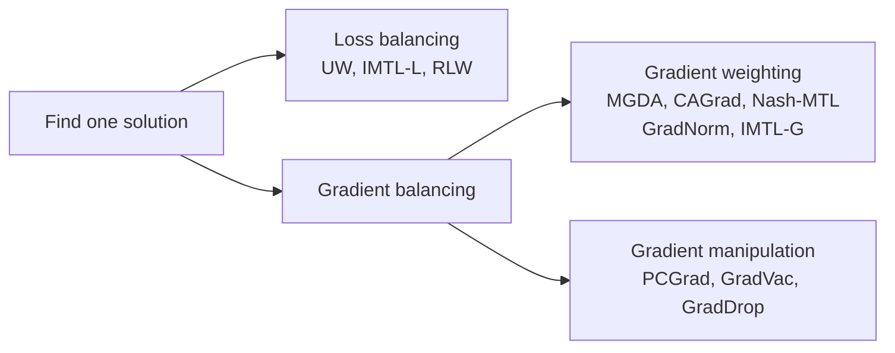

# Gradient Weighting and Manipulation for Multi-Objective Optimization

## Problem and notation

Let $X\subseteq\mathbb R^d$ be a nonempty feasible set, and let $f_s:X\to\mathbb R$ be the objective indexed by $s\in[S]=\{1,\ldots,S\}$. We consider minimization of the vector-valued function
$$
\min_{\mathbf{x}\in X}\mathbf{F}(\mathbf{x}),
\qquad
\mathbf{F}(\mathbf{x})=\bigl(f_1(\mathbf{x}),\ldots,f_S(\mathbf{x})\bigr)^\top.
\tag{1}
$$
^eq-moo-model

Let $\Delta_S=\{\mathbf{w}\in\mathbb R^S:w_s\geq0\text{ for all }s\in[S],\ \sum_{s\in[S]}w_s=1\}$ denote the probability simplex.

For Pareto optimality, scalarization, and Pareto stationarity, see [Introduction to Multi-objective Optimization](Intro%20Multi-Objective%20Optimization.md).

## Gradient weighting and manipulation in multi-task learning

This note combines Part IV of the [AAAI 2024 tutorial](https://lisha-chen.github.io/www/files/tutorial/aaai2024_tut.pdf#page=138) [\[26\]](#^ref-chen-2024-tutorial) with the single-solution taxonomy in [Section 3 and Figure 2 of the survey](https://arxiv.org/pdf/2501.10945v3#page=4) [\[6\]](#^ref-chen-2026-survey). Task losses are objectives; the methods differ in how they balance losses, weight gradients, or modify gradient signals.

Using the notation above, at a fixed $\mathbf{x}\in\mathbb R^d$, let
$$
\mathbf{g}_s=\nabla f_s(\mathbf{x}),\qquad
G=G(\mathbf{x})=[\mathbf{g}_1,\ldots,\mathbf{g}_S]\in\mathbb R^{d\times S},\qquad
\mathbf{g}_0=\frac1S\sum_{s\in[S]}\mathbf{g}_s,\qquad
f_0(\mathbf{x})=\frac1S\sum_{s\in[S]}f_s(\mathbf{x}).
$$
Here $\mathbf{g}_0=\nabla f_0(\mathbf{x})$ is the **average gradient**, not a zeroth task. Every method below uses the update convention
$$
\mathbf{x}_{t+1}=\mathbf{x}_t+\eta_t \mathbf{d}_t,\qquad \eta_t>0.
$$
Thus $\mathbf{d}$ is the direction actually added to $\mathbf{x}$, and $-\mathbf{d}$ is the gradient-like vector shown in the figure. Pairwise conflict means $\mathbf{g}_i^\top \mathbf{g}_j<0$; common first-order descent requires the stronger condition $\mathbf{g}_s^\top \mathbf{d}<0$ for **every** $s\in[S]$. The formulas describe unconstrained updates of the shared parameters using exact gradients.

### What is balanced or modified?

**Loss balancing** chooses or learns coefficients in a scalar objective, such as $\sum_s w_s f_s(\mathbf{x})$. With the weights held fixed during the model step, its gradient is $G\mathbf{w}$. **Gradient weighting** chooses coefficients using gradient geometry or training dynamics and takes $\mathbf{d}=-G\mathbf{w}$; the coefficient constraints depend on the method. **Gradient manipulation** first changes individual gradient signals, then aggregates them. These describe mechanisms: a projection can also be expressed as a linear combination of the original gradients.

  <strong>Figure 1:</strong> Single-solution branch of the survey taxonomy, with representative methods.

Adapted from [Chen et al., Figure 2 and Section 3](https://arxiv.org/pdf/2501.10945v3#page=4) [\[6\]](#^ref-chen-2026-survey). Here, CAGrad is classified as gradient weighting; “gradient manipulation” also has a broader usage in the literature.

### Gradient weighting

Gradient-based treatment of multiple objectives predates modern multi-task learning. [Mukai (1980)](https://doi.org/10.1109/TAC.1980.1102298) [\[86\]](#^ref-mukai-1980) provides an early algorithmic foundation for multicriterion optimization.

**MGDA: choose a minimum-norm combination.** MGDA computes
$$
\mathbf{w}^{\mathrm{MGDA}}\in\operatorname*{argmin}_{\mathbf{w}\in\Delta_S}\|G\mathbf{w}\|^2,
\qquad
\mathbf{d}_{\mathrm{MGDA}}=-G\mathbf{w}^{\mathrm{MGDA}}.
$$
When $\mathbf{d}_{\mathrm{MGDA}}\neq0$, projection optimality gives $\mathbf{g}_s^\top \mathbf{d}_{\mathrm{MGDA}}\leq-\|\mathbf{d}_{\mathrm{MGDA}}\|^2<0$ for every $s$. This links the update directly to the stationarity certificate in [[Intro Multi-Objective Optimization#^eq-stationarity-certificate|(5) in the introduction]] [Désidéri (2012)](https://doi.org/10.1016/j.crma.2012.03.014) [\[5\]](#^ref-desideri-2012). [Sener and Koltun (2018)](https://proceedings.neurips.cc/paper/2018/hash/432aca3a1e345e339f35a30c8f65edce-Abstract.html) [\[27\]](#^ref-sener-2018) brought this viewpoint to deep multi-task learning and proposed an efficient shared-representation approximation.

**CAGrad: control departure from the average gradient.** Conflict-Averse Gradient Descent chooses the direction with the best worst-task first-order improvement inside a ball around $-\mathbf{g}_0$ [Liu et al. (2021)](https://proceedings.neurips.cc/paper_files/paper/2021/hash/9d27fdf2477ffbff837d73ef7ae23db9-Abstract.html) [\[28\]](#^ref-liu-2021-cagrad):
$$
\mathbf{d}_{\mathrm{CA}}\in\operatorname*{argmax}_{\mathbf{v}\in\mathbb R^d}
\min_{s\in[S]}\bigl(-\mathbf{g}_s^\top \mathbf{v}\bigr)
\qquad\text{subject to}\qquad
\|\mathbf{v}+\mathbf{g}_0\|\leq c\|\mathbf{g}_0\|.
$$
For $c>0$, write $\mathbf{g}_{\mathbf{w}}=G\mathbf{w}$. The corresponding weight problem and direction are
$$
\mathbf{w}^{\mathrm{CA}}\in\operatorname*{argmin}_{\mathbf{w}\in\Delta_S}
\left\{\mathbf{g}_0^\top \mathbf{g}_{\mathbf{w}}+c\|\mathbf{g}_0\|\,\|\mathbf{g}_{\mathbf{w}}\|\right\},
\qquad
\mathbf{d}_{\mathrm{CA}}=-\mathbf{g}_0-c\|\mathbf{g}_0\|\frac{\mathbf{g}_{\mathbf{w}^{\mathrm{CA}}}}{\|\mathbf{g}_{\mathbf{w}^{\mathrm{CA}}}\|},
$$
where the direction formula applies when $\mathbf{g}_{\mathbf{w}^{\mathrm{CA}}}\neq0$; degenerate cases can be handled through the primal problem. For $c=0$, $\mathbf{d}_{\mathrm{CA}}=-\mathbf{g}_0$. The normalization factor in the second term is needed to satisfy the ball constraint. When $0\leq c<1$ and $\mathbf{g}_0\neq0$, every feasible $\mathbf{v}$ satisfies $\mathbf{g}_0^\top \mathbf{v}\leq-(1-c)\|\mathbf{g}_0\|^2<0$. CAGrad therefore preserves descent of the **average** objective, while improving the worst-task linear prediction within that neighborhood; it need not decrease every individual objective.

The CAGrad panel of Figure 2 shows the ball centered at $\mathbf{g}_0$ in gradient space: the red arrow is $-\mathbf{d}_{\mathrm{CA}}$, while the actual parameter update points in the opposite direction.

**Nash-MTL: choose weights through bargaining.** Nash-MTL treats each task's predicted improvement as a utility in a bargaining problem [Navon et al. (2022)](https://proceedings.mlr.press/v162/navon22a.html) [\[29\]](#^ref-navon-2022-nash). Under its nonstationary, linearly independent-gradient setting, a representative direction satisfies
$$
G^\top G\,\boldsymbol{\alpha}=1/\boldsymbol{\alpha},\qquad \boldsymbol{\alpha}\in\mathbb R_{++}^S,
\qquad \mathbf{d}_{\mathrm{Nash}}=-G\boldsymbol{\alpha},
$$
where $1/\boldsymbol{\alpha}$ is the elementwise reciprocal. These positive coefficients are **not** constrained to $\Delta_S$. In particular, $\mathbf{g}_s^\top \mathbf{d}_{\mathrm{Nash}}=-1/\alpha_s<0$. The bargaining construction is invariant to positive rescaling of individual objectives; its assumptions and treatment of stationarity should accompany this property.

### Gradient manipulation

For PCGrad and GradVac, write the corrected task gradients as $\widetilde{\mathbf{g}}_s$ and aggregate them as $\mathbf{d}=-\sum_s\widetilde{\mathbf{g}}_s$. GradDrop instead masks gradient signals at a chosen activation layer before backpropagation to the model parameters.

**PCGrad: remove conflicting components before aggregation.** Projecting Conflicting Gradients starts with $\widetilde{\mathbf{g}}_s\leftarrow \mathbf{g}_s$. For each task $s$, it visits the other tasks $j\neq s$ in a random order and, only if $\widetilde{\mathbf{g}}_s^\top \mathbf{g}_j<0$, performs
$$
\widetilde{\mathbf{g}}_s\leftarrow
\widetilde{\mathbf{g}}_s-
\frac{\widetilde{\mathbf{g}}_s^\top \mathbf{g}_j}{\|\mathbf{g}_j\|^2}\,\mathbf{g}_j.
$$
The comparison uses the current modified gradient $\widetilde{\mathbf{g}}_s$ and the other task's original gradient $\mathbf{g}_j$; zero $\mathbf{g}_j$ can be skipped. The update is $\mathbf{d}_{\mathrm{PC}}=-\sum_{s\in[S]}\widetilde{\mathbf{g}}_s$ [Yu et al. (2020)](https://arxiv.org/abs/2001.06782) [\[8\]](#^ref-yu-2020-pcgrad). Averaging instead of summing changes only the overall scale, which can be absorbed into $\eta_t$. For a conflicting pair, this projection removes the component opposed to $\mathbf{g}_j$. With more than two tasks, later projections can reintroduce earlier conflicts, so pairwise surgery does not give MGDA's general common-descent certificate.

**GradVac: align gradients to an adaptive similarity target.** Gradient Vaccine maintains a moving target for each task pair's cosine similarity [Wang et al. (2021)](https://openreview.net/forum?id=F1vEjWK-lH_) [\[49\]](#^ref-wang-2021-gradvac). Let
$$
\rho_{sj}=\frac{\widetilde{\mathbf{g}}_s^\top\mathbf{g}_j}{\|\widetilde{\mathbf{g}}_s\|\,\|\mathbf{g}_j\|}
$$
be the current cosine similarity and let $\bar\rho_{sj}$ be its exponential-moving-average target. For nonzero gradients and $|\bar\rho_{sj}|<1$, if $\rho_{sj}<\bar\rho_{sj}$, the pairwise correction is
$$
\widetilde{\mathbf{g}}_s\leftarrow\widetilde{\mathbf{g}}_s+
\frac{\|\widetilde{\mathbf{g}}_s\|}{\|\mathbf{g}_j\|}
\left(
\frac{\bar\rho_{sj}\sqrt{1-\rho_{sj}^2}}{\sqrt{1-\bar\rho_{sj}^2}}-\rho_{sj}
\right)\mathbf{g}_j.
$$
This increases similarity toward the target, which may be positive even when the gradients do not conflict. A zero target recovers PCGrad's correction for a conflicting pair. As with PCGrad, a pairwise correction alone does not establish common descent for all tasks.

**GradDrop: resolve coordinatewise sign disagreement.** GradDrop uses a probabilistic mask at a shared activation layer [Chen et al. (2020)](https://proceedings.neurips.cc/paper/2020/hash/16002f7a455a94aa4e91cc34ebdb9f2d-Abstract.html) [\[31\]](#^ref-chen-2020-graddrop). At each location, it uses the relative positive and negative gradient magnitudes to select a sign, then retains gradient contributions with that sign. The masked aggregate is backpropagated through the shared network. This differs from PCGrad's projection and GradVac's cosine target: it operates on coordinatewise gradient signals rather than solving for a common parameter-space descent direction.

  <strong>Figure 2:</strong> Comparison of GD, MGDA, PCGrad, and CAGrad for two conflicting task gradients.

Adapted from [Liu et al. (2021, Figure 2)](https://proceedings.neurips.cc/paper_files/paper/2021/file/9d27fdf2477ffbff837d73ef7ae23db9-Paper.pdf) [\[28\]](#^ref-liu-2021-cagrad). Black arrows are the task gradients $\mathbf{g}_1$ and $\mathbf{g}_2$; red arrows show $-\mathbf{d}$, consistently with the update $\mathbf{x}_{t+1}=\mathbf{x}_t+\eta_t\mathbf{d}_t$. Gray dashed arrows in the PCGrad panel are the projected gradients. In the CAGrad panel, the blue arrow is $\mathbf{g}_0$ and the dashed circle has radius $c\|\mathbf{g}_0\|$. The PCGrad panel uses the average of its two projected gradients; using their sum, as in the text, changes only the step-size scale. The sketches illustrate gradient geometry, with method-specific magnitudes.

## A common view of gradient aggregation

[Hu et al. (2026)](https://arxiv.org/abs/2605.30452v1) [\[78\]](#^ref-hu-2026-unified) organize aggregation rules through gradient geometry and primal subproblems. In this note's sign convention, write $\mathbf{u}=-\mathbf{d}$. Two useful geometric requirements are
$$
\mathbf{u}\in\operatorname{conv}\{\mathbf{g}_1,\ldots,\mathbf{g}_S\},
\qquad G^\top\mathbf{u}\geq0.
$$
The first makes $\mathbf{u}$ a convex combination of task gradients; the second makes $\mathbf{d}=-\mathbf{u}$ nonascending for every task to first order. Dual-cone projection enforces the second requirement. Their primal formulations also describe rules that may allow conflicts, such as capped MGDA. The table includes their PCGrad+, Greedy-DCP, and mixed-aggregator scheduling constructions.

## Summary of gradient and loss balancing methods

The summary uses the survey's mechanisms and adds dual-cone projection and aggregator scheduling where useful. These mechanisms can overlap.

| Method | Family | Mechanism and distinction | Original reference |
| --- | --- | --- | --- |
| MGDA | Gradient weighting | Choose a minimum-norm convex combination of task gradients. Its negative is a common first-order descent direction whenever the exact combination is nonzero. | [Désidéri (2012)](https://doi.org/10.1016/j.crma.2012.03.014) [\[5\]](#^ref-desideri-2012); [Sener and Koltun (2018)](https://proceedings.neurips.cc/paper/2018/hash/432aca3a1e345e339f35a30c8f65edce-Abstract.html) [\[27\]](#^ref-sener-2018) |
| Capped MGDA | Gradient weighting | Cap individual MGDA simplex weights to limit their influence; the CVaR-derived rule can permit task conflicts. | [Hu et al. (2026)](https://arxiv.org/abs/2605.30452v1) [\[78\]](#^ref-hu-2026-unified) |
| CAGrad | Gradient weighting | Improve the worst-task first-order prediction within a ball around the negative average gradient. For $0\leq c<1$, preserve first-order descent of the average loss when its gradient is nonzero. | [Liu et al. (2021)](https://proceedings.neurips.cc/paper_files/paper/2021/hash/9d27fdf2477ffbff837d73ef7ae23db9-Abstract.html) [\[28\]](#^ref-liu-2021-cagrad) |
| PCGrad | Gradient manipulation | Project away conflicting components of task gradients before aggregation. With more than two tasks, later projections can reintroduce earlier conflicts. | [Yu et al. (2020)](https://arxiv.org/abs/2001.06782) [\[8\]](#^ref-yu-2020-pcgrad) |
| PCGrad+ | Repeated gradient projection | Repeat half-space projections toward jointly nonconflicting corrected gradients; practical inner solves require a numerical tolerance. | [Hu et al. (2026)](https://arxiv.org/abs/2605.30452v1) [\[78\]](#^ref-hu-2026-unified) |
| GradVac | Gradient manipulation | Correct task gradients when their cosine similarity is below an adaptive target, including positively aligned pairs. | [Wang et al. (2021)](https://openreview.net/forum?id=F1vEjWK-lH_) [\[49\]](#^ref-wang-2021-gradvac) |
| Nash-MTL | Gradient weighting | Choose positive gradient coefficients through Nash bargaining over predicted task improvements. The coefficients need not sum to one; the exact bargaining direction gives common first-order descent under the assumptions stated above. | [Navon et al. (2022)](https://proceedings.mlr.press/v162/navon22a.html) [\[29\]](#^ref-navon-2022-nash) |
| FairGrad | Gradient weighting | Choose gradient coefficients by maximizing an $\alpha$-fair utility of predicted task improvements. The fairness parameter interpolates between different allocation criteria; proportional fairness recovers the Nash-MTL criterion. | [Ban and Ji (2024)](https://proceedings.mlr.press/v235/ban24a.html) [\[74\]](#^ref-ban-2024-fairgrad) |
| PIVRG | Gradient weighting | Use task-performance information to weight inverse improvement utilities and reduce variance of performance across tasks. | [Qin et al. (2025)](https://openaccess.thecvf.com/content/CVPR2025/html/Qin_Revisiting_Fairness_in_Multitask_Learning_A_Performance-Driven_Approach_for_Variance_CVPR_2025_paper.html) [\[79\]](#^ref-qin-2025-pivrg) |
| UPGrad | Gradient weighting | Project each task gradient onto the cone of vectors with nonnegative inner product with every task gradient, then average the projections. Equivalent Gram-matrix quadratic programs determine the aggregate coefficients. | [Quinton and Rey (2024)](https://arxiv.org/abs/2406.16232v1) [\[75\]](#^ref-quinton-2024-upgrad) |
| DualProj / GEM-style projection | Dual-cone projection | Project the average gradient once onto the nonconflicting cone. GEM uses related constraints against stored-task gradients in continual learning. | [Quinton and Rey (2024)](https://arxiv.org/abs/2406.16232v1) [\[75\]](#^ref-quinton-2024-upgrad); [Lopez-Paz and Ranzato (2017)](https://papers.nips.cc/paper_files/paper/2017/hash/f87522788a2be2d171666752f97ddebb-Abstract.html) [\[82\]](#^ref-lopezpaz-2017-gem) |
| DCGD | Dual-cone gradient aggregation | Construct updates nonconflicting with the PDE-residual and boundary-loss gradients; designed for physics-informed neural networks. | [Hwang and Lim (2024)](https://proceedings.neurips.cc/paper_files/paper/2024/hash/b2b781badeeb49896c4b324c466ec442-Abstract-Conference.html) [\[80\]](#^ref-hwang-2024-dcgd) |
| ConFIG | Normalized-gradient aggregation | Solve a normalized-gradient linear system and rescale its direction to balance projections; introduced for physics-informed neural networks. | [Liu et al. (2025)](https://openreview.net/forum?id=APojAzJQiq) [\[81\]](#^ref-liu-2025-config) |
| Greedy-DCP | Dual-cone projection | Select the largest-norm individually projected task gradient instead of averaging the projections. | [Hu et al. (2026)](https://arxiv.org/abs/2605.30452v1) [\[78\]](#^ref-hu-2026-unified) |
| Mixed Aggregator Scheduling (MAS) | Aggregator scheduling | Alternate nonconflicting aggregation rules using random or round-robin schedules, with coefficient normalization to control relative update scales. | [Hu et al. (2026)](https://arxiv.org/abs/2605.30452v1) [\[78\]](#^ref-hu-2026-unified) |
| Aligned-MTL | Gradient weighting | Align the principal components of the gradient matrix to improve its conditioning and reduce conflicting or dominating gradient effects; allow predefined task weights. | [Senushkin et al. (2023)](https://openaccess.thecvf.com/content/CVPR2023/html/Senushkin_Independent_Component_Alignment_for_Multi-Task_Learning_CVPR_2023_paper.html) [\[76\]](#^ref-senushkin-2023-aligned) |
| DB-MTL | Gradient weighting with loss balancing | Apply logarithmic loss transformations to balance loss scales, then rescale task-gradient magnitudes using the maximum gradient norm. | [Lin et al. (2023)](https://arxiv.org/abs/2308.12029v2) [\[77\]](#^ref-lin-2023-dbmtl) |
| GradNorm | Gradient weighting | Adjust task weights using gradient magnitudes and relative training rates. | [Chen et al. (2018)](https://proceedings.mlr.press/v80/chen18a.html) [\[30\]](#^ref-chen-2018-gradnorm) |
| GradDrop | Gradient manipulation | Stochastically mask gradient signals at a shared activation layer according to sign consistency. | [Chen et al. (2020)](https://proceedings.neurips.cc/paper/2020/hash/16002f7a455a94aa4e91cc34ebdb9f2d-Abstract.html) [\[31\]](#^ref-chen-2020-graddrop) |
| IMTL-G | Gradient weighting | Balance projections of the aggregate onto normalized task-gradient directions. | [Liu et al. (2021)](https://openreview.net/pdf/1641df474b8e0e2f7dd6c0dda99081b06fed400c.pdf) [\[32\]](#^ref-liu-2021-imtl) |
| IMTL-L | Loss balancing | Learn task-loss transformations to balance their scales. | [Liu et al. (2021)](https://openreview.net/pdf/1641df474b8e0e2f7dd6c0dda99081b06fed400c.pdf) [\[32\]](#^ref-liu-2021-imtl) |
| Uncertainty weighting (UW) | Loss balancing | Learn loss weights through task-dependent homoscedastic uncertainty. This is loss balancing. | [Kendall et al. (2018)](https://openaccess.thecvf.com/content_cvpr_2018/html/Kendall_Multi-Task_Learning_Using_CVPR_2018_paper.html) [\[33\]](#^ref-kendall-2018-uw) |
| Random loss weighting (RLW) | Loss balancing | Sample weights for the scalarized loss at each iteration. | [Lin et al. (2022)](https://openreview.net/forum?id=jjtFD8A1Wx) [\[34\]](#^ref-lin-2022-rw) |
| Random gradient weighting (RGW) | Gradient weighting | Sample coefficients for combining task gradients. | [Lin et al. (2022)](https://openreview.net/forum?id=jjtFD8A1Wx) [\[34\]](#^ref-lin-2022-rw) |
| Dynamic task prioritization (DTP) | Loss balancing | Adapt loss weights to prioritize tasks according to learning difficulty. | [Guo et al. (2018)](https://openaccess.thecvf.com/content_ECCV_2018/html/Michelle_Guo_Focus_on_the_ECCV_2018_paper.html) [\[35\]](#^ref-guo-2018-dtp) |

For implementation frameworks, benchmark families, and evaluation protocols, see [Benchmarks and Libraries for Multi-Objective Optimization](Intro%20MOO%20--%20Benchmarks%20and%20Libraries.md).

## References

[5] Jean-Antoine Désidéri (2012). [Multiple-gradient descent algorithm (MGDA) for multiobjective optimization](https://doi.org/10.1016/j.crma.2012.03.014). *Comptes Rendus Mathématique*, **350**(5–6), 313–318. ^ref-desideri-2012

[6] Weiyu Chen, Baijiong Lin, Xiaoyuan Zhang, Xi Lin, Han Zhao, Qingfu Zhang, and James Kwok (2026). [Gradient-Based Multi-Objective Deep Learning: Algorithms, Theories, Applications, and Beyond](https://openreview.net/forum?id=eCUcXXH3PS). *Transactions on Machine Learning Research*, August 2026. [Published PDF](https://openreview.net/pdf?id=eCUcXXH3PS). [arXiv version used for Section 3 and Figure 2](https://arxiv.org/abs/2501.10945v3). ^ref-chen-2026-survey

[8] Tianhe Yu, Saurabh Kumar, Abhishek Gupta, Sergey Levine, Karol Hausman, and Chelsea Finn (2020). [Gradient Surgery for Multi-Task Learning](https://arxiv.org/abs/2001.06782). *Advances in Neural Information Processing Systems*, **33**, 5824–5836. ^ref-yu-2020-pcgrad

[26] Tianyi Chen, Zhuoran Yang, and Lisha Chen (2024). [Learning with Multiple Objectives: Foundations and Applications](https://lisha-chen.github.io/www/files/tutorial/aaai2024_tut.pdf). AAAI 2024 tutorial, February 20, 2024. Part IV: *Multi-objective Learning Beyond Bilevel*, presented by Lisha Chen. ^ref-chen-2024-tutorial

[27] Ozan Sener and Vladlen Koltun (2018). [Multi-Task Learning as Multi-Objective Optimization](https://proceedings.neurips.cc/paper/2018/hash/432aca3a1e345e339f35a30c8f65edce-Abstract.html). *Advances in Neural Information Processing Systems*, **31**. ^ref-sener-2018

[28] Bo Liu, Xingchao Liu, Xiaojie Jin, Peter Stone, and Qiang Liu (2021). [Conflict-Averse Gradient Descent for Multi-task Learning](https://proceedings.neurips.cc/paper_files/paper/2021/hash/9d27fdf2477ffbff837d73ef7ae23db9-Abstract.html). *Advances in Neural Information Processing Systems*, **34**. ^ref-liu-2021-cagrad

[29] Aviv Navon, Aviv Shamsian, Idan Achituve, Haggai Maron, Kenji Kawaguchi, Gal Chechik, and Ethan Fetaya (2022). [Multi-Task Learning as a Bargaining Game](https://proceedings.mlr.press/v162/navon22a.html). *Proceedings of the 39th International Conference on Machine Learning*, PMLR **162**, 16428–16446. ^ref-navon-2022-nash

[30] Zhao Chen, Vijay Badrinarayanan, Chen-Yu Lee, and Andrew Rabinovich (2018). [GradNorm: Gradient Normalization for Adaptive Loss Balancing in Deep Multitask Networks](https://proceedings.mlr.press/v80/chen18a.html). *Proceedings of the 35th International Conference on Machine Learning*, PMLR **80**, 794–803. ^ref-chen-2018-gradnorm

[31] Zhao Chen, Jiquan Ngiam, Yanping Huang, Thang Luong, Henrik Kretzschmar, Yuning Chai, and Dragomir Anguelov (2020). [Just Pick a Sign: Optimizing Deep Multitask Models with Gradient Sign Dropout](https://proceedings.neurips.cc/paper/2020/hash/16002f7a455a94aa4e91cc34ebdb9f2d-Abstract.html). *Advances in Neural Information Processing Systems*, **33**. ^ref-chen-2020-graddrop

[32] Liyang Liu, Yi Li, Zhanghui Kuang, Jing-Hao Xue, Yimin Chen, Wenming Yang, Qingmin Liao, and Wayne Zhang (2021). [Towards Impartial Multi-task Learning](https://openreview.net/pdf/1641df474b8e0e2f7dd6c0dda99081b06fed400c.pdf). *International Conference on Learning Representations*. ^ref-liu-2021-imtl

[33] Alex Kendall, Yarin Gal, and Roberto Cipolla (2018). [Multi-Task Learning Using Uncertainty to Weigh Losses for Scene Geometry and Semantics](https://openaccess.thecvf.com/content_cvpr_2018/html/Kendall_Multi-Task_Learning_Using_CVPR_2018_paper.html). *Proceedings of the IEEE Conference on Computer Vision and Pattern Recognition*, 7482–7491. ^ref-kendall-2018-uw

[34] Baijiong Lin, Feiyang Ye, Yu Zhang, and Ivor W. Tsang (2022). [Reasonable Effectiveness of Random Weighting: A Litmus Test for Multi-Task Learning](https://openreview.net/forum?id=jjtFD8A1Wx). *Transactions on Machine Learning Research*. ^ref-lin-2022-rw

[35] Michelle Guo, Albert Haque, De-An Huang, Serena Yeung, and Li Fei-Fei (2018). [Dynamic Task Prioritization for Multitask Learning](https://openaccess.thecvf.com/content_ECCV_2018/html/Michelle_Guo_Focus_on_the_ECCV_2018_paper.html). *Proceedings of the European Conference on Computer Vision*, 282–299. ^ref-guo-2018-dtp

[49] Zirui Wang, Yulia Tsvetkov, Orhan Firat, and Yuan Cao (2021). [Gradient Vaccine: Investigating and Improving Multi-task Optimization in Massively Multilingual Models](https://openreview.net/forum?id=F1vEjWK-lH_). *International Conference on Learning Representations*. [arXiv:2010.05874](https://arxiv.org/abs/2010.05874). ^ref-wang-2021-gradvac

[74] Hao Ban and Kaiyi Ji (2024). [Fair Resource Allocation in Multi-Task Learning](https://proceedings.mlr.press/v235/ban24a.html). *Proceedings of the 41st International Conference on Machine Learning*, PMLR **235**, 2715–2731. ^ref-ban-2024-fairgrad

[75] Pierre Quinton and Valérian Rey (2024). [Jacobian Descent for Multi-Objective Optimization](https://arxiv.org/abs/2406.16232v1). arXiv:2406.16232. [Updated version, accepted at NeurIPS 2026](https://arxiv.org/abs/2406.16232v4). ^ref-quinton-2024-upgrad

[76] Dmitry Senushkin, Nikolay Patakin, Arseny Kuznetsov, and Anton Konushin (2023). [Independent Component Alignment for Multi-Task Learning](https://openaccess.thecvf.com/content/CVPR2023/html/Senushkin_Independent_Component_Alignment_for_Multi-Task_Learning_CVPR_2023_paper.html). *Proceedings of the IEEE/CVF Conference on Computer Vision and Pattern Recognition*, 20083–20093. ^ref-senushkin-2023-aligned

[77] Baijiong Lin, Weisen Jiang, Feiyang Ye, Yu Zhang, Pengguang Chen, Ying-Cong Chen, Shu Liu, and James T. Kwok (2023). [Dual-Balancing for Multi-Task Learning](https://arxiv.org/abs/2308.12029v2). arXiv:2308.12029v2. ^ref-lin-2023-dbmtl

[78] Zeou Hu, Kelvin Ho, and Yaoliang Yu (2026). [A Unified Framework for Gradient Aggregation in Multi-Objective Optimization](https://arxiv.org/abs/2605.30452v1). arXiv:2605.30452v1, Sections 4–5 and Appendix A. ^ref-hu-2026-unified

[79] Xiaohan Qin, Xiaoxing Wang, and Junchi Yan (2025). [Revisiting Fairness in Multitask Learning: A Performance-Driven Approach for Variance Reduction](https://openaccess.thecvf.com/content/CVPR2025/html/Qin_Revisiting_Fairness_in_Multitask_Learning_A_Performance-Driven_Approach_for_Variance_CVPR_2025_paper.html). *Proceedings of the IEEE/CVF Conference on Computer Vision and Pattern Recognition*, 20492–20501. ^ref-qin-2025-pivrg

[80] Youngsik Hwang and Dong-Young Lim (2024). [Dual Cone Gradient Descent for Training Physics-Informed Neural Networks](https://proceedings.neurips.cc/paper_files/paper/2024/hash/b2b781badeeb49896c4b324c466ec442-Abstract-Conference.html). *Advances in Neural Information Processing Systems*, **37**, 98563–98595. ^ref-hwang-2024-dcgd

[81] Qiang Liu, Mengyu Chu, and Nils Thuerey (2025). [ConFIG: Towards Conflict-free Training of Physics Informed Neural Networks](https://openreview.net/forum?id=APojAzJQiq). *International Conference on Learning Representations*. [arXiv:2408.11104](https://arxiv.org/abs/2408.11104). ^ref-liu-2025-config

[82] David Lopez-Paz and Marc'Aurelio Ranzato (2017). [Gradient Episodic Memory for Continual Learning](https://papers.nips.cc/paper_files/paper/2017/hash/f87522788a2be2d171666752f97ddebb-Abstract.html). *Advances in Neural Information Processing Systems*, **30**. ^ref-lopezpaz-2017-gem

[86] H. Mukai (1980). [Algorithms for multicriterion optimization](https://doi.org/10.1109/TAC.1980.1102298). *IEEE Transactions on Automatic Control*, **25**(2), 177–186. ^ref-mukai-1980
